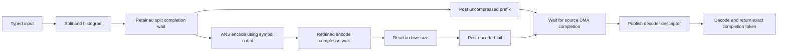

# DietGPU review and iteration priorities

Date: 2026-10-09. Local follow-up to `350861a8`.

Two concrete changes are implemented: use ANS symbol counts instead of input
byte counts in the two-stage compressor, and remove two redundant outer stream
waits. The codec and complete P2P source compile with CUDA 12.8.1; 30 host geometry
cases pass against the compiled codec. GPU round trips, high-concurrency RDMA and
model performance have not run for this candidate.

## 1. Correct the two-stage compressor's size units

`FloatCompressSplitContext.maxSize` is set to input **bytes** by the UCCL
registration path. The normal `floatCompress` path instead passes the number of
float words to its internal compressor. The added two-stage path used the byte
count for its exponent buffer and the ANS maximum-size bound.

The split produces one ANS byte for each FP16, BF16 or FP32 word, and one byte
for each pair of FP8 words. A shared `getFloatSymbolCountFromBytes` conversion
now supplies both the exponent-row stride and the ANS bound. `maxSize` keeps its
existing byte semantics for the caller; archive sizing and on-wire headers are
unchanged.

For a 64 MiB input, these are exact allocation/launch formulas from the source:

| Input dtype | Exponent scratch request, before → after | ANS block slots, before → after | Full encode CTAs, before → after | Runtime speedup |
|---|---|---|---|---|
| FP16 / BF16 | 64 → 32 MiB | 16,384 → 8,192 | 2,048 → 1,024 | Not measured |
| FP32 | 64 → 16 MiB | 16,384 → 4,096 | 2,048 → 512 | Not measured |
| FP8 pair formats | 32 → 32 MiB | 16,384 → 8,192 | 2,048 → 1,024 | Not measured |

ANS blocks hold 4,096 symbols; the full encode kernel launches eight warps per
CTA, each handling one block. The coalescing grid and per-block scratch arrays
also follow the block bound. Before the fix, excess encoder warps exit without
encoding data, but their grid still launches and the prefix scan still spans
the overestimated bound.

This reduces requested scratch and excess work. The backend's fixed scratch
pool allocation is unchanged, so its reserved GPU memory does not automatically
shrink by these factors. Tables and other constant-size allocations also remain.

## 2. Remove duplicate waits while preserving the publication boundary

`floatCompressSplitOneBatch` already synchronizes its stream before returning.
The UCCL wrapper then did arithmetic and synchronized that same stream again.
`floatCompressEncodeOneBatch` likewise synchronizes before returning, followed
by another wrapper synchronization. Those two outer waits are removed; the
inner waits and compressed-size readback remain.

Removing either retained wait requires a different stream/event and NIC lifetime
protocol. This change does not make that claim or replace the existing source
and destination ownership gates.

## Next experiments, in order

1. **Size the launch grid for the actual SM allocation.** Split and decode use
   cached `cudaDeviceProp.multiProcessorCount`; the Green Context manager has a
   separate allocated resource count. The decoder also launches a four-wave
   occupancy grid without using the destination's known output extent. Measure
   actual allocated SMs, launched CTAs, useful blocks and tail latency for the
   8/32-SM settings before changing the grid. A candidate should use the selected
   stream/context's SM resources and cap excess CTAs using the known output
   size. CUDA exposes context/stream resource queries in its
   [12.8 Green Context API](https://docs.nvidia.com/cuda/archive/12.8.0/cuda-driver-api/group__CUDA__GREEN__CONTEXTS.html).
   The performance benefit is a source-based hypothesis, not an observed result.
2. **Batch ready decoder requests.** Every current request independently builds
   an ANS decode table, launches decoding, copies a small result and records an
   event. The existing codec accepts batches. Compare ready-only batches of
   1/4/8 requests at high concurrency; retain each archive and destination until
   its own verified completion. Do not wait for an unready request to fill the
   batch. Measure P99 as well as throughput; no batching implementation is
   included in this change.
3. **Specialize the common single-item decoder call.** UCCL submits one archive,
   while `floatDecompress` uses the inline provider capacity of 128 for all
   batches up to 128. A one-item provider could reduce launch-parameter traffic.
   Check kernel register/local-memory reports and launch timings before adding
   specializations. This changes a different cost from ANS kernel throughput.
4. **Only then test interleaved ANS decoding.** The current warp decoder follows
   one block's dependent state chain. Interleaving two independent blocks might
   hide dependency latency, but extra registers can hurt occupancy under a small
   SM allocation. Require profiler evidence that this dependency, rather than
   CPU submission, excess CTAs or memory traffic, limits the full transfer.

Changing the entropy model, archive format or shared source-buffer lifetime is
outside this iteration. The measured full-transfer critical path should select
the next experiment.

## Validation and acceptance

| Check | Result | Scope / speedup |
|---|---|---|
| CUDA 12.8.1 codec build, SM90 target | PASS | Compilation only |
| Complete P2P build with DietGPU enabled | PASS | Compilation only |
| Compiled symbol-count checks | 30 host cases PASS | Five dtypes; small, tail and 16/64/256 MiB sizes |
| Two-stage GPU regression target | Builds | 20 cases prepared; NOT_RUN |
| GPU byte equality and memcheck | NOT_RUN | No measured speedup |
| High-concurrency RDMA / RL / PD model E2E | NOT_RUN | No measured speedup |

`p2p/rdma/tests/test_split_float` exercises the actual split/encode entry points,
checks the allocated exponent-row size, decodes the result and compares all
bytes for FP16, BF16, FP32 and both FP8 formats. Its `--geometry` mode calls only
the compiled host conversion helper; the local run resolves CUDA linkage with
SDK driver stubs and does not create a GPU context. The GPU mode includes a
non-block-aligned tail and 16/64/256 MiB inputs.

On an admitted isolated H100, run the new GPU target and memcheck, followed by
the existing native lifetime gate and RDMA C=64/128, Q=1/2/4/8/16 matrix within
the admitted workload budget. Compare paired old/new codec runs with the same
inputs, verification mode and SM settings. Report split, encode, decode, whole
transfer and actual model iteration timings separately. Source-derived space
or CTA reductions must not be entered as measured speedups.

The previously frozen `78687754` package remains an older prerequisite. A pass
on that package cannot qualify these new codec changes. Raw logs, execution
metadata and build artifacts remain private; new source stays on a local branch.
