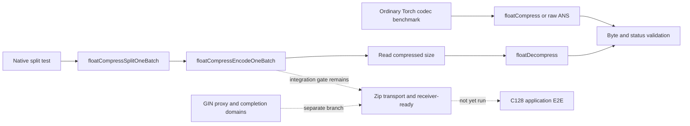

# Hopper baseline preparation

Date: 2026-10-10. Base: `b90b0321c9bbc2175d2f3244670e7de5910ab1c2`.
This change repairs the measurement/build baseline. It does not introduce a
new kernel, bitstream, GIN completion contract, or measured speedup.

## Changes

- CMake honors explicit `CMAKE_CUDA_ARCHITECTURES` or `CUDAARCHS`, with the
  existing device detection retained when neither is supplied. Targets inherit
  the selected architecture directly. The required CMake version is now 3.18,
  when the architecture property was introduced ([CMake reference](https://cmake.org/cmake/help/latest/variable/CMAKE_CUDA_ARCHITECTURES.html)).
- The vendor's tests live in `dietgpu/test`, and its old bundled glog/googletest
  directories do not exist. CMake now uses those actual test paths, an installed
  GTest package, UCCL logging headers, and CUDA runtime/driver targets. Test
  discovery occurs at test time. No dependency downloads occur during configure.
- CMake uses the selected Torch package's compiler/ABI flags instead of forcing
  ABI 0, following its [CMake integration contract](https://docs.pytorch.org/cppdocs/installing.html).
  CUDA translation units use the same flags as the C++ binding.
- The ordinary Python codec benchmark retains all timed samples, excludes
  warmup, preallocates IO/scratch/events, and verifies bytes, per-member status,
  and decoded sizes. Total input bytes remain fixed across equal/ragged batches.
- `StackDeviceMemory` now records the stack position after allocation. Previously
  a successful allocation's new bytes were omitted from that call's peak update.
  The native GPU test checks the first allocation, nested allocation, overflow,
  and retained peak after free. This is a measurement correction, not a memory
  saving or throughput result.
- The existing native split/encode test adds 4095/4096/4097-symbol tails for five
  formats, explicit signed-zero/subnormal/NaN bit patterns, archive/output
  guards, and BF16 phase samples through the actual two-stage codec entry points.



The two codec drivers are separate baselines. Their normal-data generators
differ; do not compare their numbers as paired variants of identical inputs.
For a candidate comparison, use the same driver, generator, compiler, input
sizes, verification settings and resource budget on both revisions.

## Remote execution

Run only within the H100 manager's admitted resources. Dependencies and all
large evidence stay remote; no Mac download/cache/proxy is part of these steps.
Use a fresh result directory and preserve failures and complete raw samples.
`CUDA_HOME`, `BUILD_JOBS` and `RESULTS` below are assigned by the manager.

The native path needs CUDA and a GNU C++17 compiler, without Torch, GTest or RDMA:

```bash
make -C thirdparty/dietgpu/dietgpu/float -f Makefile.cuda \
  GPU_ARCH=sm_90 NVCC="$CUDA_HOME/bin/nvcc" -j"$BUILD_JOBS"
make -C p2p/rdma/tests test_split_float CUDA_HOME="$CUDA_HOME" CXX=g++
bash p2p/rdma/tests/run_hopper_codec.sh "$RESULTS"
```

The script runs 35 bitwise round trips, 15 boundary cases under memcheck, and
three independent BF16 runs at each of 8/64 MiB, with 3 warmups and 30 samples
per run. The small intentional scratch-overflow regression precedes timing.
Its successful status is only a native codec gate, not GIN/RDMA/model E2E.

Each native sample reports split, encode, size-readback interval, decode, and
whole codec host time separately. The host interval includes retained codec
waits, size readback and final decode completion; it excludes allocation, input
generation, destination poisoning and full byte/guard verification. It is a
single-request codec measurement; it is not a continuous in-flight benchmark.

The optional Torch/GTest path uses remote packages with matched ABI:

```bash
cmake -S thirdparty/dietgpu -B build-hopper \
  -DCMAKE_BUILD_TYPE=RelWithDebInfo -DCMAKE_CUDA_ARCHITECTURES=90 \
  -DCMAKE_PREFIX_PATH="$(python -c 'import torch; print(torch.utils.cmake_prefix_path)')" \
  -DCMAKE_EXPORT_COMPILE_COMMANDS=ON -DCMAKE_CUDA_FLAGS=-Xptxas=-v
cmake --build build-hopper --parallel "$BUILD_JOBS" \
  --target dietgpu ans_test ans_statistics_test batch_prefix_sum_test float_test
./build-hopper/bin/ans_test --gtest_filter='ANSTest.ZeroSized:ANSTest.BatchPointer:ANSTest.BatchStride'
./build-hopper/bin/float_test --gtest_filter='FloatTest.BatchSize1:FloatTest.Batch'
./build-hopper/bin/ans_statistics_test
./build-hopper/bin/batch_prefix_sum_test
python thirdparty/dietgpu/dietgpu/benchmark.py \
  --library build-hopper/lib/libdietgpu.so --codec both --dtype bf16 \
  --bytes 8388608 67108864 --batch 128 --ragged --repeats 30
```

Run the Python driver three independent times and retain each JSON record.
Repeat with batch 1/32/128, equal/ragged and normal/random-bit inputs. This is
codec batch size, not service concurrency. Torch stream mode rejects a positive
`UCCL_DIETGPU_SM_USAGE`: the current binding does not establish a matching Torch
stream in that Green Context. Native context tests are a separate gate.

Full correctness and paired comparisons precede any default kernel selection.
TMA and topology policies remain gated on measured bottlenecks. The later
transport matrix includes C128 and distinguishes RAW traffic below the default
16 MiB compression threshold from confirmed compressed writes.

## Validation and comparison

| Check / workload | Baseline | Candidate | Speedup / status |
|---|---|---|---|
| Host sampling regression | Old raw ANS kept only last sample | Retains 2/7/3 synthetic samples, excludes warmups | PASS; not GPU timing |
| Host equal/ragged shapes | No configurable workload construction | Exact totals at batch 1/32/128; empty members rejected | PASS; not codec validation |
| Python syntax / Ruff / shell syntax | — | PASS | Not a performance result |
| CUDA build of this change | Not run | Not run | Pending remote execution |
| BF16 native 8/64 MiB | Not measured | Not measured | NOT_RUN |
| Codec batch 128, ragged | Not measured | Not measured | NOT_RUN |
| Cross-node GIN / Zip / C128 application | Not measured | Not measured | NOT_RUN |

The earlier `b90b0321` build and 30 host geometry checks do not validate this
new source. No new CUDA build, GPU correctness, memcheck, RDMA or application
performance result is claimed here.
