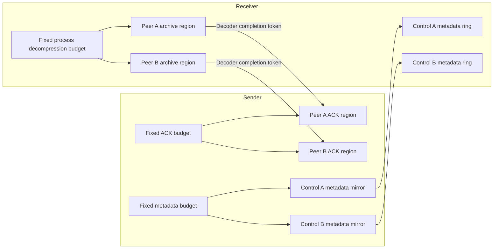
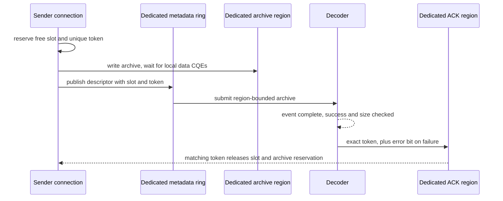

# Compressed writes with independent peer regions

Date: 2026-10-09. Local branch: `zip-peer-regions-main`.
Based on the sender lifetime candidate `af750854` and official main `540cc775`.

## Problem and resulting behavior

The original endpoint advertises the same full decompression buffer, metadata
ring and ACK ring to every peer. Each connection independently starts its arena
and slot counters at zero. Concurrent connections can overwrite another peer's
archive, descriptor or completion. A large ring does not prevent this collision.

The candidate gives each connection an exclusive, aligned region from a fixed
budget. The process-wide decompression pool partitions the singleton GPU buffer;
the endpoint partitions its existing host ACK and metadata budgets. Each control
connection receives a dedicated metadata slice instead of the full shared ring.
The unused full allocation previously made for every control connection is removed.

`UCCL_P2P_ZIP_MAX_PEERS` defaults to 4 and is limited to 64. The total GPU archive
budget uses `UCCL_P2P_DECOMPRESS_BUFFER_BYTES`, defaulting to the existing
compression buffer size. A region is `floor(budget / peers / 256) * 256` bytes.
Each endpoint keeps 256 KiB total for ACKs and 256 KiB total for control metadata;
metadata slices cover up to `2 * peers` control connections in both directions.
The source buffer and scratch allocations are unchanged. Increasing peers does
not multiply the archive or ring allocations. A new connection that exceeds the reserved
peer capacity uses the registered raw path; benchmarks must count that fallback
and cannot report it as a compressed run.

This remains a single assigned GPU per process. Multiple RDMA endpoint instances
share the region allocator, but their singleton MR registration tables still
require separate qualification; this candidate does not claim that setup works.

## Slot, token and lifetime rules

Each sender reserves a free ACK slot before compression. The same index selects
the control metadata entry. Capacity is bounded by the local ACK region, local
metadata mirror and receiver's metadata ring. Full capacity blocks new allocation while progress
polling drains existing writes. A modulo counter alone cannot establish that a
slot is free. Partial posting failure releases its slot only after posted DMA
has drained. A failed metadata post remains eligible for a later progress retry.

Every reservation receives a nonzero, process-wide 63-bit token. The receiver
returns that exact token after the decoder event and device result checks; bit
63 marks a decoding failure. A stale success or failure for an earlier slot
generation is ignored. Tokens remain independent of the 32-bit tracker ID and
remain unique when a connection is recreated within the process. Exhausting
the token domain terminates instead of repeating a token.

The region lease retains the full registered backing buffer. Every associated
data/control QP holds the lease, including channels added after setup. Pending
GPU work is waited before receiver teardown; the final region owner releases
only after QP destruction. Control-channel memory also survives until its QP
has been destroyed. QP destruction must succeed before its region is released.

## Compatibility and evidence

Protocol 2 is appended after the complete legacy handshake extent. The metadata
descriptor remains 64 bytes; its spare space holds the token. A new receiver
advertises compressed windows only to protocol 2 senders. A new sender ignores
legacy compressed windows and uses the existing registered raw path. The
compression-only registration proposal in #1058 is not incorporated here;
combining it will require a supported fallback or an explicit admission error.

| Check | Workload | Result | Speedup |
|---|---|---|---|
| Fixed budget and retained consumer | Four aligned regions, exhaustion, delayed final owner, pool teardown | CPU PASS | N/A |
| Concurrent region reuse | 16 threads, 512 lease/reuse rounds, exact bytes while held | CPU PASS | N/A |
| Slot capacity and generations | Full pool, slot reuse, stale success/error, recreated connection | CPU PASS | N/A |
| Concurrent tokens | 16 threads, 65,536 tokens, no repeats or zero/error-bit tokens | CPU PASS | N/A |
| Contended ACK slot reuse | 16 threads, four slots, 2,048 reservations, exact ownership and stale token rejection | CPU PASS | N/A |
| Host AddressSanitizer / UBSan / ThreadSanitizer | Same production pool/token checks | PASS | N/A |
| Real handshake ABI | Production serialization, legacy extent, 64-byte token descriptor | Linux CPU PASS | N/A |
| Full CUDA/RDMA build | DietGPU, Python extension, shared library and SM90 native test | Local Linux build PASS | N/A |
| Multi-peer transfer | Actual compressed data/control QPs, distinct peer destinations | Pending | Not measured |
| High-concurrency model E2E | RL weight refresh and vLLM PD KV through Zip | Pending | Not measured |

CPU protocol tests do not establish GPU/NIC ordering or model E2E correctness.
The native async-decoder prerequisite is `78687754`, a minimal compilation fix
to `70213197`; it does not contain or qualify this multi-peer candidate. See
[build evidence](BUILD_VALIDATION.md). Next qualification must measure
receiver-ready completion, exact destination bits and compressed/fallback counts
at Q=1/2/4/8/16 before attributing an E2E speedup to this change.
