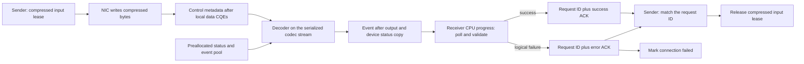

# Compressed receive lifetime: implementation and qualification

Date: 2026-10-08. Base: official UCCL main
`540cc775ba8ab231122f9a98a6d832699f239f70`.
Local branch: `zip-recv-lifetime-main`. New contributions stay local under the
current publication instruction.

## Problem and resulting behavior

The baseline receiver posts an ACK before enqueuing its asynchronous decoder.
The sender releases the compressed input arena on a nonzero ACK. A subsequent
write can therefore replace the decoder's input before it is consumed. Moving
the ACK into a host callback alone also reports success on rejected parameters
and ignores the device capacity/success result.

The candidate queues a decoder with a leased status record and a completion
event. Receiver progress posts an ACK only after that event, checking both the
immediate codec status and the device success/element-count result. A logical
decode failure uses the existing error bit; a GPU runtime error stops execution
before any success ACK or resource recycling. The sender accepts only the
expected request ID and exposes a separate compressed receiver-ready query.



```mermaid
sequenceDiagram
  participant Sender
  participant NIC
  participant Receiver
  participant GPU
  Sender->>NIC: compressed data writes
  NIC-->>Sender: sender-local CQEs
  Sender->>Receiver: WriteReqMeta
  Receiver->>GPU: decoder, status copy, completion event
  loop receiver progress
    Receiver->>GPU: query event
    GPU-->>Receiver: pending or complete
  end
  Receiver->>Receiver: verify success and exact element count
  Receiver-->>Sender: matching success/error ACK
  Sender->>Sender: release input arena; report receiver-ready or failure
```

## Ownership and completion boundaries

| Resource / state | Owner | Release or observation boundary |
|---|---|---|
| Original user source | Existing send path | Existing sender-local completion |
| Compressed NIC source buffer | Existing singleton codec | Still requires the sender lifetime audit below |
| Receiver compressed input arena | Sender's reservation | Matching decoder-complete ACK |
| Device result, pinned host result, event | Per-request lease from a fixed pool | Decoder event completed, then request destruction |
| User destination | Caller | Successful decoder-complete ACK |
| Codec scratch and stream | Existing process singleton | Host enqueue operations serialized; teardown drains the stream |

Status/event storage is allocated once for 4096 requests. Per-request GPU and
pinned host allocations were removed because they would serialize other GPU
work. Pool exhaustion rejects submission and yields a failure acknowledgement;
it is not reported as a completed destination. The pool's shared ownership
keeps its event/status storage alive while outstanding requests drain.

The wire layout and success encoding remain unchanged. Raw `check_completion`
retains its sender-local meaning; `check_compressed_completion` is for known
compressed writes. This candidate does not introduce a full generation protocol
for tracker-ID wrap or reconnects.

## Validation and current evidence

| Test | Workload / check | Result | Speedup |
|---|---|---|---|
| CPU ACK regression | Zero sentinel, success/error identity, stale ACK after slot reuse, 32-bit boundary | PASS on local Clang; 16 assertions | N/A |
| Native async decoder | BF16, 16/64/256 MiB, C=1, Q=1/2/4/8/16 | Prepared; H100 execution pending | Not measured |
| Concurrent native decoder | BF16, 16 MiB, C=64/Q=2 and C=128/Q=4/16 | Prepared; H100 execution pending | Not measured |
| Device failure result | Output capacity smaller than archive; invalid destination | Prepared; H100 execution pending | N/A |
| Forced input reuse | Gate decoder; old immediate-ACK ordering overwrites archive A with valid B | Prepared; H100 execution pending | N/A |
| Protected input lifetime | Keep archive A until decoder event; compare exact bytes | Prepared; H100 execution pending | N/A |
| Green context / memcheck | Caller context restored, SM requests 8/32, sanitizer error exit | Prepared; H100 execution pending | Not measured |
| Compressed RDMA receiver-ready | Q>1 with actual data and control QPs | Pending network allocation and additional safety gates | Not measured |

The native harness calls the same production decoder implementation; it does
not initialize a network or load a model. Its gated experiment reproduces the
baseline ACK ordering with real codec kernels, while the production receiver
integration still needs a separate RDMA reproduction. Timings include host
submission and event completion and are diagnostic, not distributed E2E
speedups. Synthetic BF16 buffers are not real RL weight refreshes.

## Remaining safety gates before performance work

1. Endpoint metadata currently publishes the same full decompression arena,
   ACK ring and metadata ring to multiple peers. Their per-connection allocators
   and counters start independently. Add negotiated, disjoint connection
   windows within a fixed total memory budget, then verify 2-to-1, 1-to-2 and
   4-by-4 transfers. Each process must use its assigned GPU.
2. Audit the shared compressed sender buffer across two-phase writes and
   concurrent callers. Per-method scratch locking does not establish NIC source
   lifetime across split, encode and later writes. Also reserve the codec's
   maximum compressed size rather than assuming every archive fits the
   uncompressed byte count.
3. Close the four existing #1052 review issues with real rank/epoch/iteration
   progress, multiple threads per block and wrap-aware counters. The prior
   published regression is insufficient evidence.
4. Only after a safe baseline: compare one dual-block ANS implementation against
   that baseline, then run real weight refresh and correctly routed PD KV
   transfer. Expand 8 to 16/32 GPUs only after these gates pass.

The unsafe baseline will not be used as a performance denominator. The current
native prerequisite does not count as completion of the full 8-to-32-GPU plan.

## Reproduction

On an assigned H100, CUDA 12.4 or newer, C++17 compiler, GNU make, and
Compute Sanitizer are required. No Python environment, model download or RDMA
registration is needed for this prerequisite.

```bash
bash p2p/rdma/tests/build_zip_packet.sh
# Run only inside the coordinator's explicitly assigned single-GPU step.
bash p2p/rdma/tests/run_zip_packet.sh "$PRIVATE_RESULTS"
```

The coordinator supplies device isolation and captures actual child/controller
exits, raw outputs and checksummed archives. The preparation request is bounded
to 20 minutes including CPU build, GPU execution, drain and collection, with
peak GPU data below 36 GiB and temporary CPU data below 1 GiB. Hardware identities,
access information and scheduling evidence remain private.
