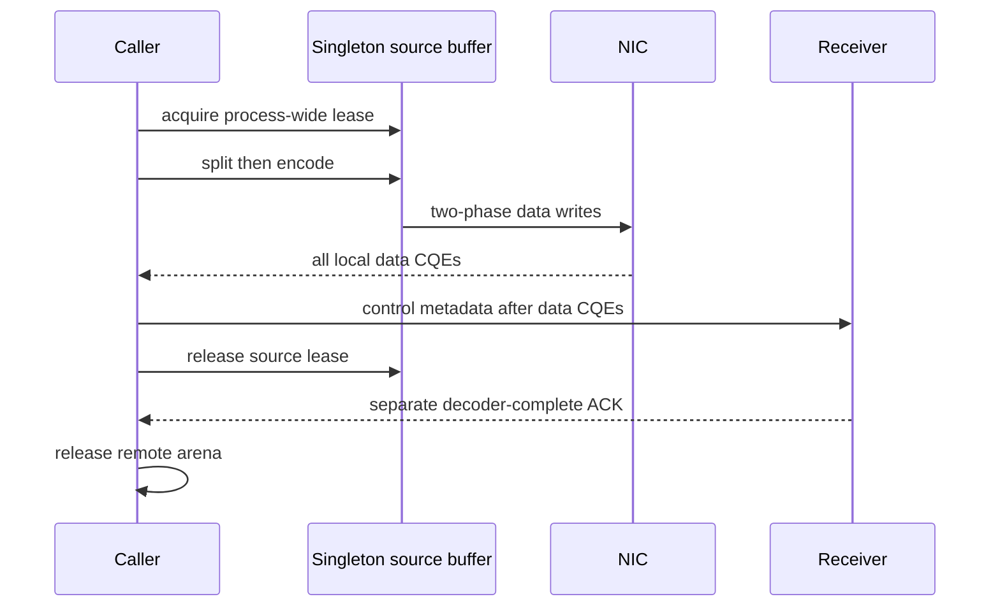

# Two-phase compressed sender lifetime

Date: 2026-10-08. Branch: `zip-send-lifetime-main`.
This local follow-up depends on the receiver candidate `48029e7f`.

The process singleton owns one compressed source buffer. Previously,
`compress_write_request_split_first` returned after posting its second phase;
the next caller could split new data into that buffer while the NIC was still
reading the prior request. Per-method codec mutexes also allowed two callers'
split and encode phases to interleave across connections.

The candidate takes one process-wide write-buffer lease before the first
phase, keeps it across split/encode and data posts, and releases it after all
local data CQEs. This is a serialized correctness baseline. Remote decoder
completion independently owns the receiver arena, so several remote decodes
can remain outstanding after the sender buffer becomes reusable.

The receiver arena now reserves DietGPU's worst-case encoded size, including
archive headers and ANS expansion. Compression eligibility checks that bound
against both the local source buffer and advertised remote arena, and requires
the prepared compression context's extent to match the write. Unsupported
sizes use the existing registered raw path. An overflowed 32-bit codec bound
cannot become a smaller reservation.

| Item | Evidence | Status |
|---|---|---|
| Prior source reuse / phase interleaving | Actual shared buffer and return-before-CQE source ordering | Source-confirmed |
| Prior arena under-reservation | Original bytes reserved while codec documents worst-case expansion | Source-confirmed |
| New lease through local CQEs | Local implementation and format/diff checks | CUDA/RDMA execution pending |
| New maximum-size admission | Calls bundled codec bound for the request dtype and byte extent | CUDA/RDMA execution pending |
| Multi-peer destination ownership | Endpoint still advertises shared full windows | Separate fix required |
| Throughput / E2E speedup | No safe-baseline network run yet | Not measured |

The single-GPU native decoder packet remains frozen at `48029e7f` and does not
exercise this sender follow-up. Qualification needs actual compressed data and
control QPs, exact destination bytes, C/Q counters and separate sender-local
versus receiver-ready timing. The shared singleton still targets one assigned
GPU per process. This work remains on the local branch; no new PR is published.
