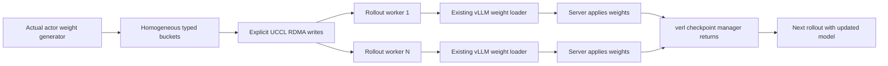

# Receiver-ready Zip checkpoints in verl

Date: 2026-10-09. Local branch: `zip-peer-regions-main`.

The optional `uccl_zip` checkpoint backend preserves floating-point dtype and
uses explicit receiver-ready compressed writes. Host lifecycle tests pass.
Native H100, RDMA, full-framework scheduling and model E2E execution remain
unqualified; there is no measured speedup for this integration.

## Integration boundary

The reviewed verl source is `5b3e1f86bd39aee07ae15b6bf515198b68052486`.
Its `CheckpointEngineConfig.custom_backend_module` and backend registry allow
loading the adapter without changing verl. Relevant contract and loader files
were checked against that commit:

- `verl/checkpoint_engine/base.py`: topology, weight chunking, manager lifecycle.
- `verl/workers/engine_workers.py`: sender construction and checkpoint execution.
- `verl/workers/rollout/vllm_rollout/bucketed_weight_transfer.py`: copies each
  yielded weight into an owned bucket before advancing; direct large-weight
  transfers await the consumer's receipt.
- `verl/workers/rollout/vllm_rollout/vllm_rollout.py`: waits for the final server
  application before completing the weight update.

The existing NIXL backend registers opaque byte buffers and issues READs.
Enabling compression through an environment variable would not establish that
those READs exercise Zip's typed WRITE path. This adapter makes that path explicit.

Actor rank 0 sends to every rollout worker. Other actor ranks still drain the
framework weight generator, preserving its collective participation. This is
one sender with multiple consumers; the independent 4-writer/4-receiver stage
in `test_zip_receiver_ready.py` remains a separate qualification gate.



## Buffer ownership

Each active worker allocates `depth * bucket_size` bytes of staging. Dtype changes
or a full bucket trigger publication; tails retain their actual byte extent.
There is no zero padding to manufacture compressible inputs. FP16, BF16 and FP32
are supported. Zip buckets of at least 16 MiB use `write_compressed_async`; smaller
tails use ordinary writes and are counted separately. Raw comparison uses the
same adapter with compression disabled in a fresh worker process.

A source slot remains reserved across all recipients until every consumer has
finished copying its views. A slow consumer therefore supplies backpressure.
Readiness can arrive out of order; consumers yield tensor chunks in sequence.
Round, model step, slot and sequence checks reject stale messages. The standalone
credit ledger rejects duplicate consumers and stale slot generations.

```mermaid
sequenceDiagram
    participant S as Actor source slot
    participant U as UCCL data path
    participant R as Rollout receive slot
    participant L as Existing weight loader
    S->>U: Typed write to each receiver
    U->>R: Decode into destination
    R-->>U: Exact native decoder ACK
    U-->>S: Native handle ready
    S->>R: Bucket metadata and model step
    R->>L: Yield ordered tensor views
    L->>L: Copy views; complete GPU copies
    R-->>S: Consumer credit for this slot generation
    S->>S: Reuse only after every consumer credits
```

Native decoder completion permits publishing bucket metadata. Consumer credits
permit overwriting framework staging buffers. These are distinct lifetimes.
Final vLLM server application can finish later; the existing manager waits for it.
`uccl_zip/transfer_seconds` measures the sender path including its consumer
credits, not the full model refresh or RL iteration.

Endpoints and RDMA connections persist across checkpoints. Buffers are
deregistered only after successful finalization, then re-advertised on the next
round. Changed worker endpoints require engine recreation; elastic membership
is unsupported. Failed rounds retain registrations and buffers for controlled
worker teardown. A Python cancellation or control timeout does not prove native
DMA drained; this adapter does not implement transport recovery. The run
controller must bound native execution independently.

## Loading the candidate

Build UCCL with DietGPU and distribute this candidate's Python extension plus
both files from `p2p/integrations` to every worker. Add that integration directory
to each worker's `PYTHONPATH`. Apply this fragment to the existing verl recipe:

```yaml
actor_rollout_ref:
  rollout:
    checkpoint_engine:
      backend: uccl_zip
      custom_backend_module: uccl_zip_verl
      update_weights_bucket_megabytes: 64
      engine_kwargs:
        uccl_zip:
          mode: zip
          depth: 16
          timeout: 600
          verify_payload: true
```

Set `UCCL_P2P_TRANSPORT=rdma`, `UCCL_P2P_COMPRESS_STRATEGY=encode` and
`UCCL_P2P_ZIP_MAX_PEERS` to cover the rollout workers before their processes
start. Select a workload budget that fits the admitted H100 allocation; increasing
the peer limit partitions the existing archive pool rather than multiplying it.
For raw A/B runs, use `mode: raw` and `UCCL_P2P_COMPRESS_STRATEGY=none` in fresh
workers. These settings are a prepared integration recipe, not an executed run.

Correctness runs default to SHA-256 comparison of actual source/destination
bytes, including CPU copies. After those pass, performance runs may disable
`verify_payload`, identically on both sides. Reports must retain
`uccl_zip/payload_verification` so these modes cannot be mixed. Native counter
deltas must match all compressed writes, failures must stay zero and inflight
must drain to zero. `archive_bytes` counts codec output, not total network bytes.

## Validation and result table

Host tests use Python 3.12.13, PyTorch 2.8.0, NumPy 2.2.6 and pyzmq 27.1.0.
The control test executes the reviewed verl contract/chunk helper definitions
with real CPU tensors and ZeroMQ. It simulates P2P completion and codec counters;
it excludes Ray scheduling, CUDA, actual compression, RDMA and trained models.

| Check | Workload | Result | Speedup |
|---|---|---|---|
| Raw checkpoint lifecycle | Two consumers, depth 2, three model-version rounds; FP32/BF16/FP16 | Host PASS, byte exact | N/A |
| Zip adapter control lifecycle | Same workload, simulated codec; delayed consumer and out-of-order readiness | Host PASS, byte exact | N/A |
| Large tensor reconstruction | Tensor larger than one 16 MiB bucket, real verl split/merge helpers | Host PASS | N/A |
| Corrupted payload | Single-byte corruption; finalization must retain registrations | Host PASS | N/A |
| Stale round credit | Old round received while a new transfer is active | Host PASS, original error reaches sender | N/A |
| Consumer-credit ownership | Four consumers, depth 16, reverse completion and 8,192 generations | Four ledger tests PASS | N/A |
| Full native H100 decoder / memcheck | Prepared prerequisite | NOT_RUN | Not measured |
| Actual compressed multi-peer RDMA | Prepared distributed stage | NOT_RUN | Not measured |
| High-batch RL and vLLM PD model E2E | Full iteration / actual compressed KV transfer | NOT_RUN | Not measured |

Run the host tests from the UCCL checkout:

```sh
python p2p/tests/test_zip_consumer_credits.py -v
VERL_SOURCE_ROOT="$REVIEWED_VERL_SOURCE" python p2p/tests/test_verl_zip_control.py -v
```

Before reporting RL results, run the native correctness gate, actual multi-peer
RDMA gate, then at least three real model checkpoint stages with full refresh
and full-iteration timings. High-concurrency/batch cases and repeated raw/Zip
windows must come from the same model recipe. vLLM PD requires a separate real
KV transport integration; this checkpoint backend does not implement it.

Raw execution logs and deployment metadata remain private. This candidate is
committed locally only.
