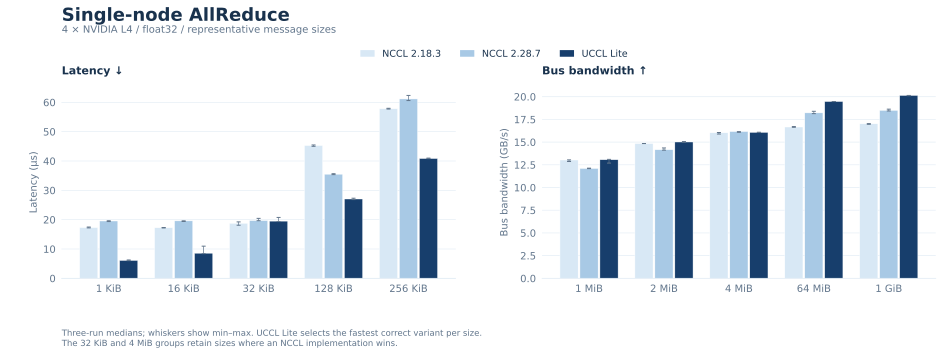
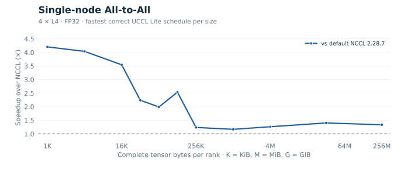
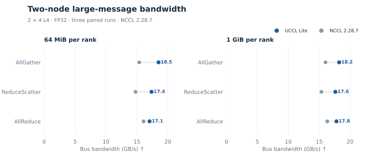
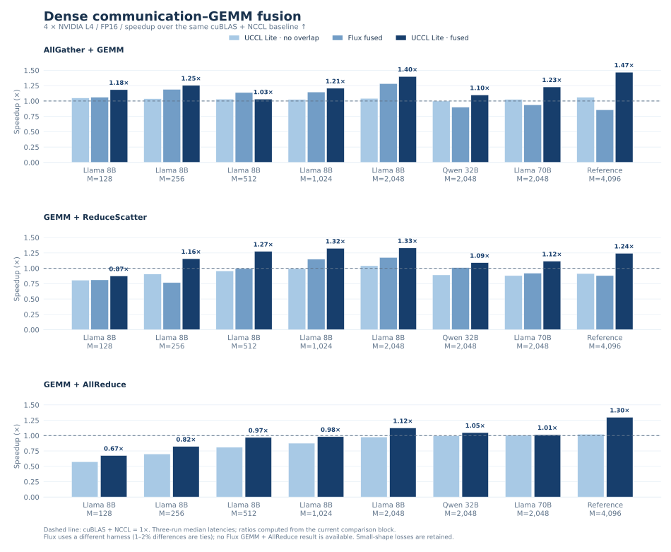
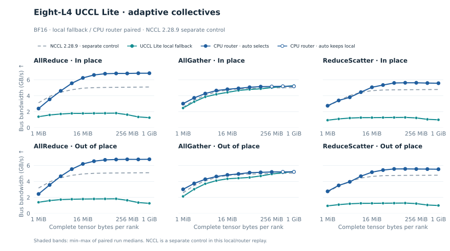

<div align="center">

# UCCL Lite

**Collectives and communication–GEMM fusion for PCIe GPU nodes.**

[Get started](#get-started) · [Results](#measured-results) · [CPU router](#optional-cpu-router) · [Documentation](#documentation)

</div>

UCCL Lite is an experimental collection of CUDA collective kernels, an
optional CPU router, fusion kernels, and hardware probes. The direct peer paths
target **four NVIDIA L4 GPUs on a PCIe Gen4 dual-socket node**; the network
paths target **two such nodes**, with two NIC rails per node. The CPU router is
a separate BF16 module for 1–32 local GPUs. Most collective and fusion paths
use MSCCL++; standalone peer AG/RS uses CUDA peer copies.

The measurements below describe those testbeds and workloads. Small messages
and small GEMMs can lose to NCCL; the full sweeps and negative results are linked
alongside the figures.

## What is included

| Component | Purpose |
| --- | --- |
| [Hardware profiler](docs/hardware-profiler.md) | Discover PCI/NUMA/peer topology; measure directed and concurrent GPU transfers, CPU copy, and BF16 reduction bandwidth. |
| [Single-node collectives](docs/collectives.md) | Float32 AllReduce and All-to-All schedules, plus [direct-peer AllGather and ReduceScatter](docs/peer-ag-rs.md). |
| [Eight-GPU local fallback](docs/collectives.md#eight-gpu-bf16-local-fallback) | Project-owned BF16 AR/AG/RS for two four-GPU NUMA groups, using peer copies within groups and pinned host staging across groups. |
| [Two-node collectives](docs/multinode.md) | Eight-rank AllReduce, AllGather, and ReduceScatter over local CUDA IPC and two GPUDirect rails. |
| [Optional CPU router](docs/cpu-router.md) | BF16 AR/AG/RS over NUMA-local host memory, selected only with matching local benefit evidence. |
| [Fusion kernels](docs/fusion.md) | AG+GEMM, GEMM+RS, GEMM+AR, and expert-parallel MoE pipelines. |

The four-GPU topology is `(GPU 0, GPU 1)` on NUMA node 0 and `(GPU 2, GPU 3)`
on NUMA node 1. The large-message ring follows **0 → 1 → 3 → 2 → 0**. Moving
to another GPU order or interconnect needs a new topology check and crossover
measurements.

## Get started

From the UCCL repository root, with CUDA and MSCCL++ installed:

```bash
cd experimental/lite
make -j2 single-node MSCCLPP_HOME=/path/to/mscclpp
./build/uccl_lite_allreduce -b 1024 -e 1048576 -w 5 -n 10
./build/uccl_lite_alltoall -b 1024 -e 1048576 -w 5 -n 10

# CUDA-only topology and bandwidth probe
make hardware_profiler
./build/uccl_lite_hardware_profiler --peer-order 0,1,3,2
```

The collective executables start four local ranks and check their output by
default. Verify the device order with `nvidia-smi topo -m` before running them.
[Build details](docs/build.md) cover NCCL, CUTLASS, the optional CPU router,
and the two-node launcher.

## Measured results

Collective figures use **latency for small messages** and **bandwidth for large
messages**. Fusion figures show complete-operation time or token throughput.

### Single node: collective schedules



On four L4s, the float32 AllReduce sweep has lower median time at **19 of 21**
sizes than both tested NCCL versions. At 1 KiB it takes **6.08 µs**, versus
**17.29/19.54 µs** for NCCL 2.18.3/2.28.7. At 1 GiB it reaches
**20.13 GB/s bus bandwidth**, versus **17.01/18.49 GB/s**. This historical
summary selects the fastest correct UCCL Lite variant per size; some mid-size
differences are ties. [Full sweep and method](benchmarks/README.md).



At 1 KiB, scheduled All-to-All takes **5.21 µs** versus **21.9 µs** for the
recorded default NCCL transport. At 256 MiB/rank it reaches **74.47 GB/s
aggregate** versus **55.79 GB/s**. Aggregate traffic differs from AllReduce
bus bandwidth. For direct-peer AG/RS at 32 MiB, measured bus bandwidth is
**18.19 / 17.56 GB/s** versus **16.46 / 15.42 GB/s** for NCCL 2.28.7;
both paths regress on small messages. [AG/RS sweep and ownership
rules](docs/peer-ag-rs.md).

### Two nodes: large-message collectives



At 1 GiB on two four-L4 nodes, **AllGather / ReduceScatter / AllReduce** reach
**18.23 / 17.62 / 17.79 GB/s bus bandwidth**, versus **16.02 / 15.36 /
16.31 GB/s** for NCCL 2.28.7. These are three paired runs with slowest-rank
CUDA-event timing; AG/RS are out of place and AR is in place. Small messages
can lose: at 1 KiB, AG takes **97.66 µs** versus **19.36 µs** for NCCL.
The [two-node results](docs/multinode.md) include small-message latency,
timing ranges, and the complete sweeps.

### Communication–compute fusion



At the large FP16 reference shapes, fusion changes complete-operation latency
from **22.87 → 15.58 ms** for AG+GEMM, **22.95 → 18.46 ms** for GEMM+RS, and
**25.66 → 19.77 ms** for GEMM+AR, compared with cuBLAS + NCCL. The
[labeled eight-shape plot](docs/fusion.md) retains small-shape regressions;
Flux and no-overlap controls remain in the [measurement record](benchmarks/README.md).


For DeepSeek-shaped BF16 expert parallelism, the full layer at 32k tokens/rank
takes **85.28 ms** versus **129.77 ms** for NCCL + grouped cuBLAS. That is
**384k versus 253k tokens/s/rank** in this kernel benchmark. At eight tokens,
fusion is slower: **2.46 versus 1.37 ms**. The full layer includes dispatch,
both projections, SwiGLU, weighted reduction, and combine; routing-plan
construction and framework work are outside timing. [Workload and controls](docs/fusion.md).

## Optional CPU router

The CPU router is a separately built library. A caller supplies its existing
backend as a callback. The included eight-GPU example now supplies a **UCCL
Lite two-NUMA BF16 collective** as that backend; NCCL is an optional external
control. Automatic selection requires an **exact local** match for collective,
dtype, byte count, placement, topology/software identity, and fallback
identity. A candidate needs at least **3% median speedup with non-overlapping
timing ranges**; a fresh fallback-only dispatcher runs the local collective
without creating router workers.

```bash
make -j2 cpu-router local-collectives adaptive-collectives \
  NCCL_HOME=/path/to/nccl
./build/uccl_lite_collectives --gpus 8 --fallback local --op all \
  --in-place --begin 1048576 --end 1073741824 \
  --calibrate build/local-in-place.profile
./build/uccl_lite_collectives --gpus 8 --fallback local --op all \
  --in-place --begin 1048576 --end 1073741824 \
  --backend auto --profile build/local-in-place.profile
```

On this **eight-L4** host, GPUs 0–3 and 4–7 occupy separate NUMA nodes. The
hardware probe measured **49.30 / 50.98 GB/s** aggregate H2D / D2H over all
eight GPUs and **9.89–10.27 GB/s** on individual peer links within a node;
cross-node CUDA peer access is unavailable. The probe describes the machine;
the paired collective timings below determine each automatic choice.



At **1 GiB of full tensor bytes per rank**, the paired UCCL Lite local and
CPU-router paths measured these median slowest-rank CUDA-event times. NCCL
2.28.9 is a separate control run under the same benchmark timing scope:

| Placement | Collective | UCCL Lite local | CPU router | NCCL control | Automatic choice |
| --- | --- | ---: | ---: | ---: | --- |
| In place | AllReduce | 1479.32 ms | 277.64 ms | 368.50 ms | Router |
| In place | AllGather | 183.35 ms | 181.60 ms | 186.73 ms | Local |
| In place | ReduceScatter | 933.82 ms | 169.57 ms | 196.42 ms | Router |
| Out of place | AllReduce | 1443.51 ms | 276.35 ms | 369.08 ms | Router |
| Out of place | AllGather | 187.14 ms | 181.69 ms | 186.26 ms | Local |
| Out of place | ReduceScatter | 881.90 ms | 170.28 ms | 196.49 ms | Router |

The local path gathers each GPU's shard through NUMA-pinned host memory. For
AllReduce and ReduceScatter through 2 MiB it also reduces eight inputs in
pinned host memory; larger reductions use the four-GPU peer groups. The router
uses **128 KiB packets for AllReduce through 4 MiB** and its original 512 KiB
packets otherwise. Across the 1-MiB–1-GiB doubling sweep, automatic mode
selected the router at **32/33** keys in each placement. It retained local
AllGather at 1 GiB under the 3% selection margin. Load the matching
calibration profile before using `auto`; without one, it runs the local
fallback. At 1 MiB, the selected router AllReduce measured **0.488 / 0.529
ms** in/out of place, versus **0.588 / 0.579 ms** in the separate NCCL
control. The prior 512 KiB router packet setting measured **0.799 / 0.775
ms** in a same-code diagnostic. Every timed call passed the output check.
Measurements used CUDA 12.9, driver 580.178.04, five warmups, ten timed calls
per repetition, and three alternating paired repetitions. [Paired local/router
data and selection replay](benchmarks/data/local_fallback_8l4_20261110_v3/README.md) ·
[Separate NCCL control and hardware profile](benchmarks/data/cpu_router_8l4_20261110/README.md).

The earlier four-L4 calibration retained NCCL in all **12** cases. Historical
eight-L4 figures used a different no-P2P configuration and NCCL 2.27.5; they
do not enable routing on this host. NCCL-backed profiles from the earlier
eight-L4 run also cannot select a backend against the new UCCL Lite fallback.
[API and calibration](docs/cpu-router.md) ·
[Historical primitive figures](docs/primitive-collectives.md).

## Documentation

- [Build targets and correctness commands](docs/build.md)
- [Hardware profiler methods and measurements](docs/hardware-profiler.md)
- [Collective algorithms](docs/collectives.md) and [two-node design](docs/multinode.md)
- [Fusion design and workloads](docs/fusion.md)
- [Full measurement files](benchmarks/README.md) and [validation limits](docs/validation.md)

UCCL Lite provides specialized research kernels and benchmarks, not an
NCCL-compatible API or a serving-framework integration. The project follows
the repository [license](../../LICENSE); the adapted CUTLASS wrapper retains
its [upstream notice](NOTICE.md).
