<div align="center">

# UCCL Lite

**Collectives and communication–GEMM fusion for PCIe GPU nodes.**

[Get started](#get-started) · [Results](#measured-results) · [CPU router](#optional-cpu-router) · [Documentation](#documentation)

</div>

UCCL Lite is an experimental collection of CUDA collective kernels, an
optional CPU router, fusion kernels, and hardware probes. The direct peer paths
target **four NVIDIA L4 GPUs on a PCIe Gen4 dual-socket node**; the network
paths target **two such nodes**, with two NIC rails per node. The CPU router is
a separate module for 1–32 local GPUs. Most collective and fusion paths
use MSCCL++; standalone peer AG/RS uses CUDA peer access.

The eight-L4 results were measured on a separate host with four GPUs per
NUMA node. Fresh four-L4, two-node, and eight-L4 dense fusion
measurements appear below with their own timing scopes. Small messages
and small GEMMs can lose to NCCL; negative results are retained.

## What is included

| Component | Purpose |
| --- | --- |
| [Profiler](docs/hardware-profiler.md) | Inspect GPU, PCIe, and NUMA topology and measure transfer bandwidth. |
| [Single-node collectives](docs/collectives.md) | AllReduce, AllGather, and ReduceScatter on one node. |
| [Multi-node collectives](docs/multinode.md) | Collective implementations across nodes using local GPU access and network rails. |
| [CPU router](docs/cpu-router.md) | Optional NUMA-aware path for local collectives, selected from measured benefit. |
| [Fusion kernels](docs/fusion.md) | Combine collective communication with GEMM and MoE stages. |

## Get started

From the UCCL repository root on the 8xL4 GPU host:

```bash
cd experimental/lite
make -j2 adaptive-collectives \
  CUDA_HOME=/usr/local/cuda-12.9 \
  CUTLASS_HOME=/data/zhongjie/cutlass-v4.5.0 \
  NCCL_HOME=build/nccl-2.28.9
./build/uccl_lite_collectives --gpus 8 --fallback nccl \
  --backend force --op allreduce --begin 1048576 --end 1048576 \
  --warmup 1 --iterations 1 --repeats 3
```

The eight-GPU benchmark checks every invocation. Verify the device order with
`nvidia-smi topo -m` before running them. The 2+2 four-GPU programs need their
own machine. [Build details](docs/build.md) cover NCCL, CUTLASS, MSCCL++, and
the two-node launcher.

## Measured results

### Single-node collectives

#### AllReduce on single 4xL4 GPU

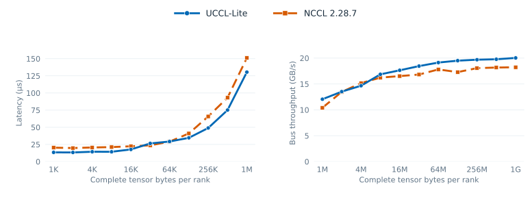

#### AllGather on single 4xL4 GPU

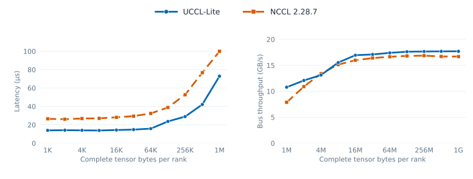

#### ReduceScatter on single 4xL4 GPU

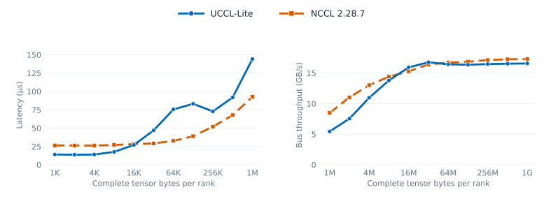

[Four-L4 data](benchmarks/data/optimization_20261110/README.md)

#### 8xL4 GPU

This comparison uses GPUs 0–3 on NUMA node 0 and 4–7 on node 1.
AllReduce is in place; AllGather and ReduceScatter are out of place. Each UCCL Lite curve
uses the fastest measured project-owned path at that size, chosen without
looking at NCCL. The CPU router is selected for all large AR/AG/RS sizes.
At 128 KiB, AR selects the local path and RS selects GPU reduction/progress;
RS uses the CPU-reduction router at other sizes. Its 256 KiB–4 MiB calls use
128 KiB packets.

##### AllReduce on single 8xL4 GPU

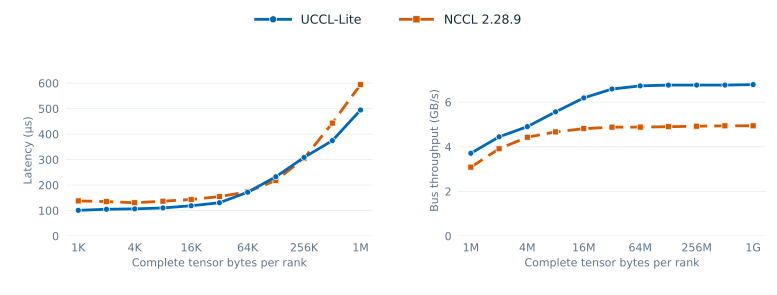

##### AllGather on single 8xL4 GPU

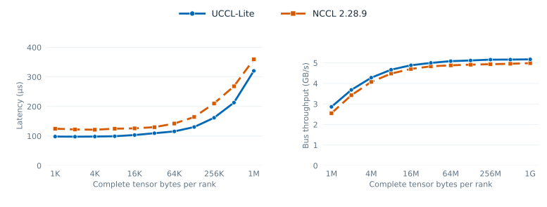

##### ReduceScatter on single 8xL4 GPU

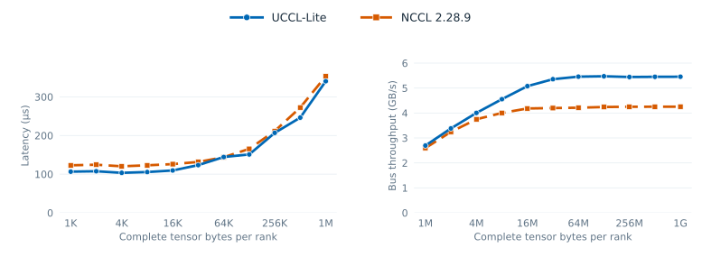

### Multi-node collectives

#### AllReduce on two 4xL4 GPU nodes

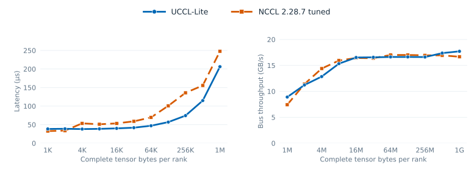

#### AllGather on two 4xL4 GPU nodes

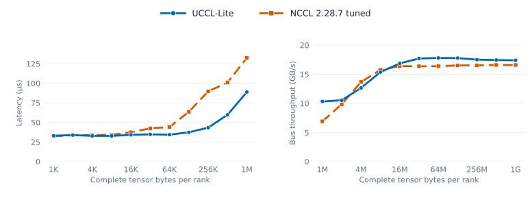

#### ReduceScatter on two 4xL4 GPU nodes

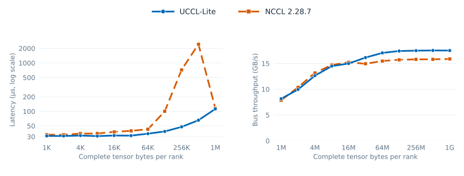

[Two-node data](benchmarks/data/optimization_20261110/README.md)

### Fusion on single 4xL4 GPU

#### Dense AG+GEMM, GEMM+RS, GEMM+AR

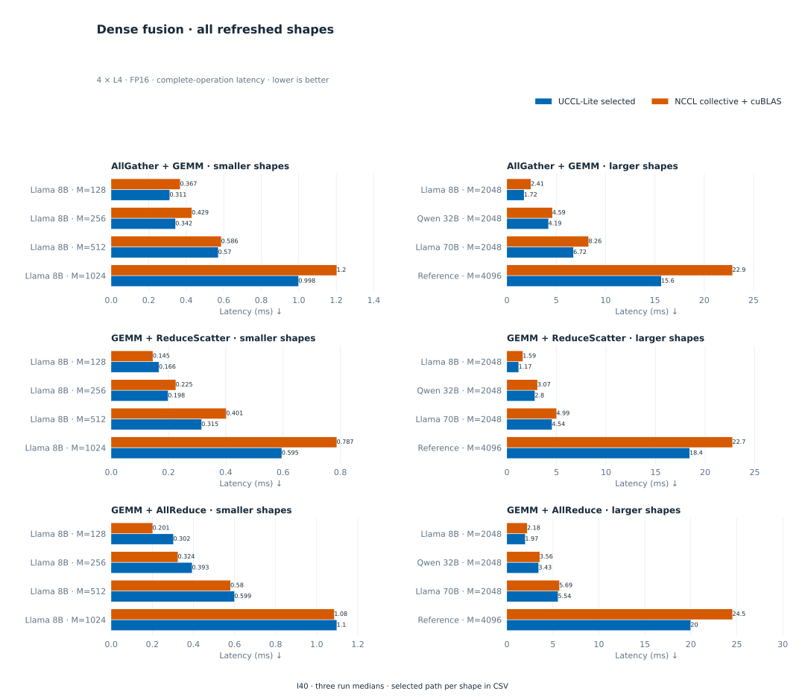

#### Expert-parallel MoE

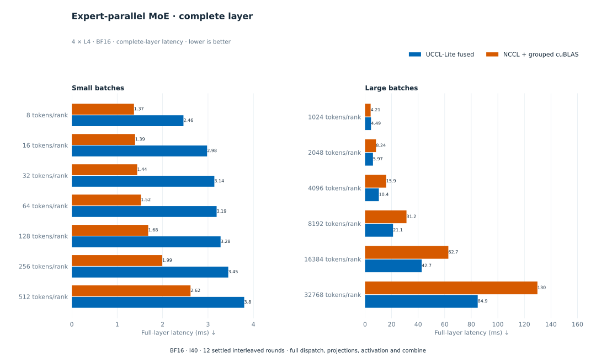

[Fusion data and limits](docs/fusion.md)

### Fusion on single 8xL4 GPU

These eight-GPU experiments use the CPU router across the two NUMA groups.
Each bar is the median of two independent runs; each run has five alternating
repetitions of ten checked calls. The comparison includes cuBLAS + NCCL,
cuBLAS + UCCL-Lite CPU router in sequence, and a resident GEMM kernel fused
with the CPU router. All bars show slowest-GPU CUDA-event latency.
GEMM + AllReduce uses 128 KiB packets; the other two operations use 512 KiB
packets. The larger AllGather + GEMM shapes use a tuned resident GEMM tile.
At every plotted shape, at least one UCCL-Lite path is faster than NCCL.
[Samples and reproduction commands](benchmarks/data/fusion_8l4_20261110/README.md)
are retained.

#### GEMM + AllReduce on single 8xL4 GPU

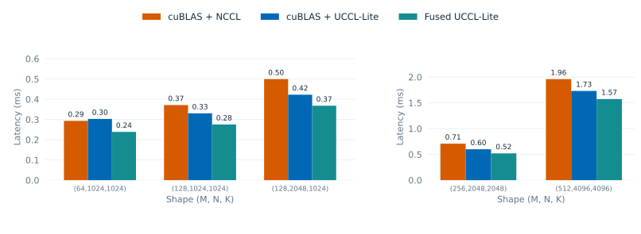

The fused path is faster than cuBLAS + NCCL at all five tested shapes. At
`(M,N,K)=(256,2048,2048)` it takes **0.521 versus 0.708 ms**; at
`(512,4096,4096)` it takes **1.574 versus 1.961 ms**. The earlier 512 KiB
packet runs and their regressions remain in the measurement record.

#### AllGather + GEMM on single 8xL4 GPU

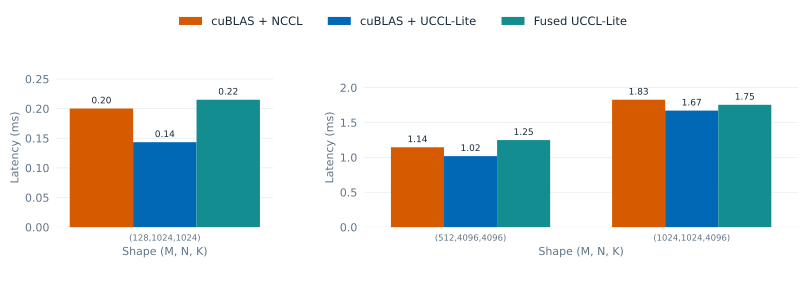

The sequential CPU-router path is fastest at all three tested shapes; at
`(128,1024,1024)` it takes **0.144 versus 0.203 ms** for cuBLAS + NCCL.
The tuned resident fused kernel also beats NCCL at the two larger shapes,
but it remains slower than the sequential router path and regresses at the
smallest shape.

#### GEMM + ReduceScatter on single 8xL4 GPU

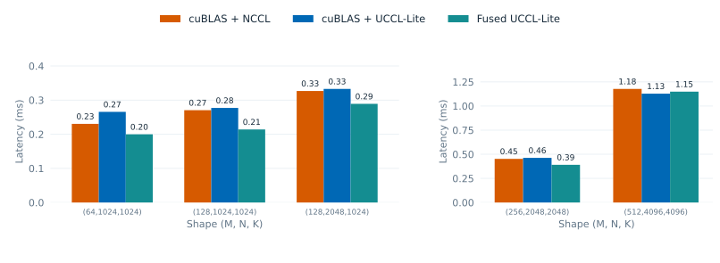

The fused path takes **0.214 ms versus 0.270 ms** for cuBLAS + NCCL at
`(128,1024,1024)` and **0.391 ms versus 0.452 ms** at `(256,2048,2048)`.
At `(512,4096,4096)`, separate cuBLAS + CPU router is slightly faster than
the fused path; the difference is small across the two runs.

#### Other fusion workloads

The four-GPU expert-parallel MoE results above use CUDA IPC peer links.
MoE has not been ported across this host's two four-GPU NUMA groups.

## Optional CPU router

### Motivation

When GPU Direct P2P is unavailable between GPU groups, their data already
needs a host-mediated path. The CPU router uses that host-memory stop to do
useful work with otherwise idle CPU cores: reduce packets before forwarding
them and share a packet with multiple destinations. Reusable packet operators
also support packing and deduplication. Routing is most promising when PCIe
transfers constrain the collective while NUMA-local host
memory and spare CPU cores can keep up with the packet flow. Fast direct P2P
or contention for host memory can erase that advantage.

### High-level design

The optional CPU router exchanges packets through NUMA-local pinned host
memory. **Forward** moves a packet, **Multicast** sends one packet to multiple
destinations, and **Process (CPU)** transforms packet contents with Reduce,
Pack, and Deduplicate operators. Collectives compose these operations, with
packet slots and reader credits preventing reuse until consumers finish.

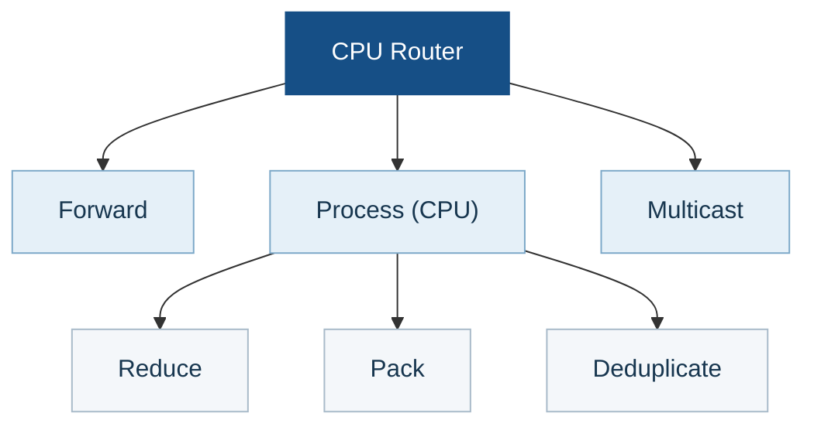

The `Process (CPU)` operators can be used in different collectives:

- **Reduce** combines contributions for AllReduce and ReduceScatter.
- **Pack** assembles fragments for AllGather and token buffers for
  dispatch/combine.
- **Deduplicate** removes repeated token records in dispatch/combine. The
  included fixed-width operator is intended for small routing metadata.

## Documentation

- [Build targets and correctness commands](docs/build.md)
- [Hardware profiler methods and measurements](docs/hardware-profiler.md)
- [Collective algorithms](docs/collectives.md) and [two-node design](docs/multinode.md)
- [Fusion design and workloads](docs/fusion.md)
- [Full measurement files](benchmarks/README.md) and [validation limits](docs/validation.md)

UCCL Lite provides specialized research kernels and benchmarks, not an
NCCL-compatible API or a serving-framework integration. The project follows
the repository [license](../../LICENSE); the adapted CUTLASS wrapper retains
its [upstream notice](NOTICE.md).
