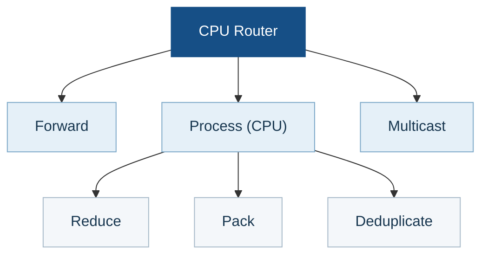

<div align="center">

# UCCL Lite

**Collectives and communication–GEMM fusion for PCIe GPU nodes.**

[Get started](#get-started) · [Results](#measured-results) · [CPU router](#optional-cpu-router) · [Documentation](#documentation)

</div>

UCCL Lite is an experimental collection of CUDA collective kernels, an
optional CPU router, fusion kernels, and hardware probes. The direct peer paths
target **four NVIDIA L4 GPUs on a PCIe Gen4 dual-socket node**; the network
paths target **two such nodes**, with two NIC rails per node. The CPU router is
a separate module for 1–32 local GPUs. Most collective and fusion paths
use MSCCL++; standalone peer AG/RS uses CUDA peer copies.

The eight-L4 results were measured on a separate host with four GPUs per
NUMA node. Fresh four-L4, two-node, and fusion measurements appear below
with their own timing scopes. Small messages and small GEMMs can lose to
NCCL; full sweeps and negative results are retained.

## What is included

| Component | Purpose |
| --- | --- |
| [Profiler](docs/hardware-profiler.md) | Inspect GPU, PCIe, and NUMA topology and measure transfer bandwidth. |
| [Single-node collectives](docs/collectives.md) | AllReduce, AllGather, and ReduceScatter on one node. |
| [Multi-node collectives](docs/multinode.md) | Collective implementations across nodes using local GPU access and network rails. |
| [CPU router](docs/cpu-router.md) | Optional NUMA-aware path for local collectives, selected from measured benefit. |
| [Fusion kernels](docs/fusion.md) | Combine collective communication with GEMM and MoE stages. |

## Get started

From the UCCL repository root on the 8xL4 GPU host:

```bash
cd experimental/lite
make -j2 adaptive-collectives \
  CUDA_HOME=/usr/local/cuda-12.9 \
  CUTLASS_HOME=/data/zhongjie/cutlass-v4.5.0 \
  NCCL_HOME=build/nccl-2.28.9
./build/uccl_lite_collectives --gpus 8 --fallback nccl \
  --backend force --op allreduce --begin 1048576 --end 1048576 \
  --warmup 1 --iterations 1 --repeats 3
```

The eight-GPU benchmark checks every invocation. Verify the device order with
`nvidia-smi topo -m` before running them. The 2+2 four-GPU programs need their
own machine. [Build details](docs/build.md) cover NCCL, CUTLASS, MSCCL++, and
the two-node launcher.

## Measured results

The completed 8xL4 GPU comparison shows **latency from 1 KiB to 1 MiB** and
**throughput from 1 MiB to 1 GiB** for each collective. The four-L4,
two-node, and fusion sections below use fresh matched measurements with
their own recorded hardware and timing scopes.

### Single-node collectives

#### Four L4 (refreshed)

Both hosts have the required 2+2 NUMA and full peer-access topology. On l40,
FP32 in-place AllReduce uses slowest-rank host enqueue+completion timing,
with four processes for each backend. Every call is checked. Three
backend-alternating runs each use five warmups and ten timed calls. At each
size, the blue curve selects the fastest correct UCCL Lite non-router path,
independently of NCCL 2.28.7.


At 1 KiB, AR takes **13.454 / 20.333 µs** (A2 LL / NCCL); at 1 GiB it
takes **80.373 / 88.315 ms** (A3 ring / NCCL). The selected path and every
other AR candidate are in the [full four-L4 record](benchmarks/data/refresh_20261110/README.md).

On `mibura-sky-test-02`, FP32 out-of-place AllGather and ReduceScatter use
one same-harness peer/NCCL comparison and slowest-rank per-call CUDA events.
Their three alternating repetitions also check every warmup and timed call.
At 1 GiB, AG takes **45.645 / 49.371 ms** and RS takes **51.002 / 49.011 ms**
(UCCL Lite / NCCL). Both lose markedly at small sizes: at 1 KiB, AG is
**90.666 / 40.282 µs** and RS **99.914 / 32.938 µs**.


The AR figure uses host-clock time on l40; AG/RS use CUDA-event time on the
owner host. Compare paths within each operation. The eight-GPU CPU router is
not a four-GPU candidate.

#### 8xL4 GPU

This comparison uses GPUs 0–3 on NUMA node 0 and 4–7 on node 1.
AllReduce is in place; AllGather and ReduceScatter are out of place. Each UCCL Lite curve
uses the fastest measured project-owned path at that size, chosen without
looking at NCCL. The CPU router is selected for all large AR/AG/RS sizes.
At 128 KiB, AR selects the local path and RS selects GPU reduction/progress;
RS uses the CPU-reduction router at other sizes. Its 256 KiB–4 MiB calls use
128 KiB packets.

##### AllReduce on single 8xL4 GPU


##### AllGather on single 8xL4 GPU


##### ReduceScatter on single 8xL4 GPU


### Multi-node collectives

#### Two nodes × four L4 (refreshed)

Both hosts have the 2+2 GPU/NUMA layout, full local peer access, and two
active IB rails. The refreshed FP32 comparison uses eight GPU ranks,
NCCL 2.28.7 with `mlx5_0,mlx5_1`, and slowest-rank host
enqueue+completion time on both sides. AR is in place; AG and RS are out of
place. Each of three alternating paired repetitions has five warmups
and ten timed calls; every call's complete output is checked. Complete
bytes per rank are matched within each operation.


At 1 GiB, AR / AG / RS take **106.115 / 54.152 / 53.653 ms** with UCCL
Lite, versus **110.971 / 56.947 / 59.488 ms** with NCCL. Their three-run
ranges do not overlap at that size. All three UCCL paths lose at 1 KiB.
NCCL AR at 1 MiB has a repeated, high-variance delay; its raw samples and
targeted recheck are retained without a stable speedup claim. The earlier
mixed-timer sweep remains only in the [two-node diagnostic archive](docs/multinode.md).

[Full two-node results, topology and raw logs](benchmarks/data/refresh_20261110/README.md).

### Fusion: four L4

The refreshed dense FP16 comparisons use **complete-operation latency** for
each shape. Each paired bar compares the selected UCCL Lite path with the
matching NCCL collective + cuBLAS baseline. The eight-shape sweep was run
three times on l40; the second run reversed shape order. At the large
reference shapes, AG+GEMM takes **15.631 / 22.850 ms**, GEMM+RS
**18.423 / 22.746 ms**, and GEMM+AR **19.964 / 24.515 ms** (UCCL Lite /
baseline). Small-shape regressions remain visible, including GEMM+AR at
M=128 (**0.302 / 0.201 ms**).


The BF16 expert-parallel MoE chart likewise compares complete-layer latency
for every measured token count, with **NCCL + grouped cuBLAS** as its actual
baseline. The 12-round settled, interleaved run on l40 reaches **84.861 /
129.830 ms** at 32,768 tokens per rank, but loses at eight tokens
(**2.459 / 1.370 ms**). Routing-plan construction and framework work are
outside this kernel benchmark.


[Shapes, selected paths, raw logs, and negative results](docs/fusion.md) ·
[Fresh measurement files](benchmarks/data/refresh_20261110/README.md).

The separate eight-L4 host has no GPU peer access between its two
four-GPU NUMA groups. These four-GPU fusion runs do not establish
eight-GPU fusion performance.

## Optional CPU router

### Motivation

When GPU Direct P2P is unavailable between GPU groups, their data already
needs a host-mediated path. The CPU router uses that host-memory stop to do
useful work with otherwise idle CPU cores: reduce packets before forwarding
them and share a packet with multiple destinations. Reusable packet operators
also support packing and deduplication. Routing is most promising when PCIe
transfers constrain the collective while NUMA-local host
memory and spare CPU cores can keep up with the packet flow. Fast direct P2P
or contention for host memory can erase that advantage.

### High-level design

The optional CPU router exchanges packets through NUMA-local pinned host
memory. **Forward** moves a packet, **Multicast** sends one packet to multiple
destinations, and **Process (CPU)** transforms packet contents with Reduce,
Pack, and Deduplicate operators. Collectives compose these operations, with
packet slots and reader credits preventing reuse until consumers finish.



The `Process (CPU)` operators can be used in different collectives:

- **Reduce** combines contributions for AllReduce and ReduceScatter.
- **Pack** assembles fragments for AllGather and token buffers for
  dispatch/combine.
- **Deduplicate** removes repeated token records in dispatch/combine. The
  included fixed-width operator is intended for small routing metadata.

### Profiler and selection

The hardware profiler checks topology and measures PCIe, peer, and host-memory
bandwidth to identify plausible routing opportunities. It does **not** enable
the router from a bandwidth ratio. A separate paired calibration checks output
correctness and times the router against the caller's existing local backend
for each exact collective, data type, message size, and buffer placement. The
profile is bound to the hardware/software configuration and backend identity.

At runtime, `auto` looks up the matching profile; it does not benchmark during
the collective. The router is selected only when at least three repetitions
show a **3% median gain** and the router's slowest run is faster than the
fallback's fastest run. Missing, stale, or inconclusive evidence keeps the
existing backend without allocating router buffers or starting workers. See
the [architecture and calibration guide](docs/cpu-router.md) for the API and
exact profile rules.

## Documentation

- [Build targets and correctness commands](docs/build.md)
- [Hardware profiler methods and measurements](docs/hardware-profiler.md)
- [Collective algorithms](docs/collectives.md) and [two-node design](docs/multinode.md)
- [Fusion design and workloads](docs/fusion.md)
- [Full measurement files](benchmarks/README.md) and [validation limits](docs/validation.md)

UCCL Lite provides specialized research kernels and benchmarks, not an
NCCL-compatible API or a serving-framework integration. The project follows
the repository [license](../../LICENSE); the adapted CUTLASS wrapper retains
its [upstream notice](NOTICE.md).
