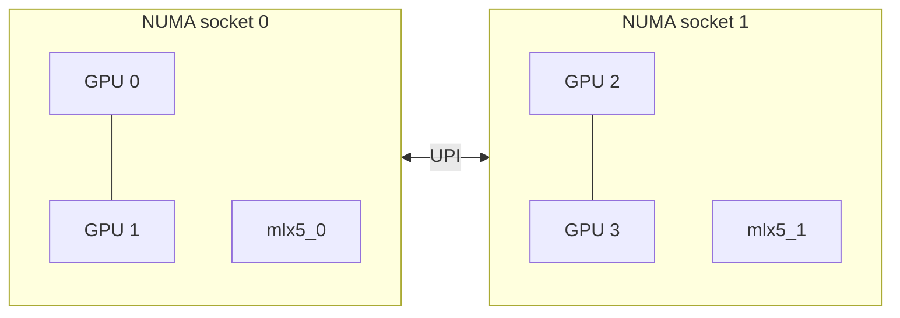
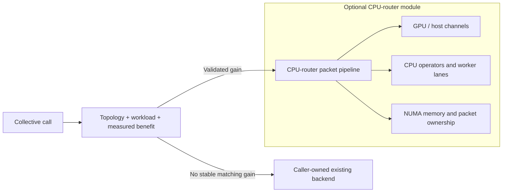
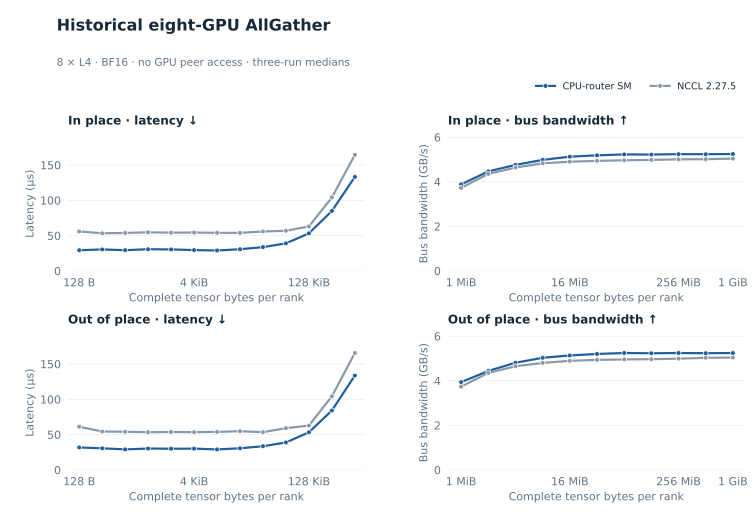
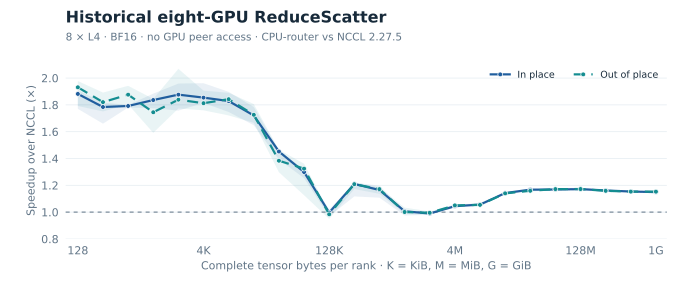

<div align="center">

# UCCL Lite

**Topology-aware collectives and communication–compute fusion for PCIe GPUs.**

[Build & run](docs/build.md) · [CPU-router module](docs/cpu-router.md) · [Collectives](docs/collectives.md) · [Fusion](docs/fusion.md) · [Multi-node](docs/multinode.md) · [Measurements](benchmarks/README.md)

</div>

UCCL Lite explores how much communication performance a PCIe-only GPU system
can deliver when transfers follow the topology and computation starts as soon
as its inputs arrive. It combines low-latency packet protocols, scheduled peer
transfers, copy-engine rings, and readiness-driven GEMM fusion on
[MSCCL++](https://github.com/microsoft/mscclpp).

The MSCCL++ peer paths are specialized to **four NVIDIA L4 GPUs, PCIe Gen4,
no NVLink, with two GPUs per NUMA socket**. The optional **CPU-router module**
provides BF16 AllReduce, AllGather, and ReduceScatter through NUMA-local host
memory for 1–32 local GPUs, with a policy that enables it only when matching
measurements show a stable gain. Two-node AllReduce extends the four-GPU peer
layout to eight GPUs across two network rails. This is an experimental kernel
and benchmark project: application integrations and serving-framework hooks
are intentionally outside its scope.

## At a glance

| Component | What is implemented | Representative recorded result |
| :--- | :--- | :--- |
| **AllReduce** | LL packets, NUMA hierarchy, copy-engine ring | **6.08 µs** at 1 KiB; **20.13 GB/s** bus bandwidth at 1 GiB |
| **All-to-All** | Collision-free peer schedules on SMs and copy engines | **74.47 GB/s** aggregate at 256 MiB/rank |
| **CPU-router module** | Optional BF16 AR/AG/RS backend; NUMA memory, channels, CPU executor, packet pipeline | Historical 8-L4 AG/RS: **5.25 / 5.59 GB/s** at 1 GiB; local selection is measurement-gated |
| **Dense fusion** | AllGather + GEMM, GEMM + ReduceScatter, GEMM + AllReduce | **1.47× / 1.24× / 1.30×** over cuBLAS + NCCL at the large reference shapes |
| **Expert-parallel MoE** | Ragged dispatch, grouped GEMM, activation, down projection, combine | **1.39–1.52×** full-layer speedup at large token counts |

These are historical measurements on the documented L4 testbed, not portable
performance guarantees. Fusion can lose on small shapes. Collective summaries
select the fastest correct configuration per size; the executables expose
those variants rather than a universal automatic selector.

## Why topology matters



Small messages benefit from carrying completion flags inside their packets.
Large transfers benefit from copy engines and the ring **0 → 1 → 3 → 2 → 0**,
which spreads cross-socket traffic over the entire operation. All-to-All uses
rotating peer schedules so each GPU has one sender and one receiver per step.
Fusion extends the same idea: publish the readiness of a shard or arrival
group, then communicate or compute it while the remaining work continues.

## Start with a single node

Install CUDA and build MSCCL++; then, from the UCCL repository root:

```bash
cd experimental/lite
make -j2 MSCCLPP_HOME=/path/to/mscclpp

# Each executable starts four local ranks. Sizes are bytes per rank.
./build/uccl_lite_allreduce -b 1024 -e 1048576 -w 5 -n 10
./build/uccl_lite_alltoall -b 1024 -e 1048576 -w 5 -n 10
```

Correctness checking is enabled by default. Check `nvidia-smi topo -m` first:
the kernels assume NUMA pairs `(0,1)` and `(2,3)` and peer access between GPUs.
The default architecture is `sm_89`; changing it does not automatically adapt
the algorithms to another topology.

Fusion adds NCCL, cuBLAS, and CUTLASS:

```bash
make -j2 fusion \
  MSCCLPP_HOME=/path/to/mscclpp \
  NCCL_HOME=/path/to/nccl/build \
  CUTLASS_HOME=/path/to/cutlass

# Tokens per rank; full MoE layer including dispatch and combine.
./build/uccl_lite_fused_moe_layer -b 2048 -e 2048 -c 2
```

See [build instructions](docs/build.md) for all targets, dependency versions,
small correctness runs, and the optional two-node setup.

## Optional CPU-router backend

CPU-router is a separately built library, not a replacement for the existing
four-GPU peer paths. A caller supplies its existing backend as a callback.
The dispatcher retains that callback unless the operation, dtype, size,
placement, topology, and baseline match validated measurements showing at least
**3% speedup with non-overlapping timing ranges**. No matching evidence means
no router initialization, no router worker threads, and no pinned router buffers.



```bash
make -j2 cpu-router adaptive-collectives

# On the current four-L4 host, auto retains the fallback and creates no router.
# This standalone BF16 example supplies NCCL as its existing backend.
./build/uccl_lite_collectives --gpus 4 --backend auto --op all

# Measure both paths on the local host, then use the saved evidence.
./build/uccl_lite_collectives --gpus 4 --begin 1048576 --end 8388608 \
  --calibrate build/router-local.profile
./build/uccl_lite_collectives --gpus 4 --begin 1048576 --end 8388608 \
  --backend auto --profile build/router-local.profile
```

`--backend off` disables the module; `--backend force` enables it for explicit
testing without claiming a speedup. `--reference benchmarks/data/primitives_8l4.csv`
allows the historical profile only on its matching eight-L4/no-P2P configuration,
including the recorded CUDA, driver, CPU budget, and NCCL baseline. It never
turns the router on merely because eight GPUs are visible.
On the current four-L4 host, paired BF16 calibration at 1/2/4/8 MiB for all
three collectives retained the fallback in all **12** cases. Reusing the profile
in a fresh process initialized no router. The eight-GPU enable decisions are
covered by policy tests against historical measurements; this port's eight-GPU
performance has not been rerun.
[API, policy, calibration, and limitations](docs/cpu-router.md)

## Measured performance

### Single-node AllReduce


Across 21 doubling sizes from 1 KiB to 1 GiB, UCCL Lite wins **19** against
both tested NCCL 2.18.3 and NCCL 2.28.7 configurations. At 1 KiB,
latency is 6.08 µs versus 17.29/19.54 µs for the two NCCL versions. At 1 GiB,
bus bandwidth is 20.13 GB/s versus 17.01/18.49 GB/s. Some mid-size differences
are below 1% and should be treated as ties.

The grouped bars show representative sizes, including the 32 KiB and 1–4 MiB
exceptions. Whiskers show three-run min–max ranges around median latency or
bandwidth. UCCL Lite selects the fastest correct variant per size.
[Full data and measurement scope](benchmarks/README.md)

### Single-node All-to-All


The scheduled peer transfers reach **74.47 GB/s aggregate** at 256 MiB/rank,
with **1.17–4.20×** speedup over the tested default NCCL transport across the
recorded sweep. NCCL uses host staging on this testbed. Aggregate bandwidth
counts all nonlocal traffic and is distinct from AllReduce bus bandwidth.

### Standalone AllGather and ReduceScatter — eight-GPU primitives

The independent AllGather and ReduceScatter results come from a separate
CPU-router implementation on **one node with eight L4 GPUs, BF16, and no GPU
peer access**. They were recorded on October 12 after the ReduceScatter packet
scheduling fix. The runtime is now included as the optional CPU-router module;
the data remains a historical primitive-collective comparison, not a fresh
eight-GPU validation of the port. It is a different
configuration from the four-GPU float32 benchmarks above.





At 1 GiB in-place, the CPU-router SM path reaches **5.25 GB/s for AllGather**
and **5.59 GB/s for ReduceScatter**, versus **5.04 / 4.86 GB/s** for NCCL
2.27.5. Both placements are shown, with three-run median bars and min–max
whiskers. The figure compares the CPU-router path with NCCL 2.27.5 only.

AllGather size is the complete output per rank; ReduceScatter size is the
complete input per rank. Neither figure includes GEMM. The full 128 B–1 GiB
sweep and exact provenance are described in [primitive results](docs/primitive-collectives.md).

### Dense fusion


Each panel compares no-overlap UCCL Lite, fused UCCL Lite, and Flux where
available against the **same cuBLAS + NCCL latency**. The dashed line is 1×;
bars below it are slower than that baseline. At the large reference shapes,
fusion reaches **1.47× / 1.24× / 1.30×** for the three operations.

All eight recorded shapes are shown, including small-shape regressions. Flux
uses a separate harness, so differences of roughly 1–2% should be treated as
ties. There is no corresponding Flux GEMM+AllReduce result.
[Shapes and design](docs/fusion.md)

### Expert-parallel MoE


The lighter bars separate collective replacement and GEMM choice from the
dark-blue fused path. Against NCCL All-to-All-v + grouped cuBLAS, fusion reaches
**1.48–1.61×** for dispatch + GEMM and **1.39–1.52×** for the full layer at
large token counts. Full-layer small-batch regressions are retained.

These BF16 DeepSeek-shaped EP=4 benchmarks exclude routing-plan construction
from timing. The full layer includes dispatch, both projections, SwiGLU,
weighted reduction, and combine; it is not a full-model serving measurement.

## Source map

```text
experimental/lite/
├── Makefile                    # Independent build; binaries go to build/
├── src/collectives/             # Single-node and two-node algorithms + harnesses
├── src/cpu_router/              # Optional routing runtime, policy, and dispatcher
├── include/uccl_lite/           # Reusable grouped-GEMM, routing, and MoE kernels
├── benchmarks/
│   ├── fusion/                 # Dense and expert-parallel MoE benchmarks
│   ├── probes/                 # GEMM, tensor-core, and overlap diagnostics
│   ├── cpu_router/             # BF16 dispatch and paired calibration example
│   └── data/                   # Curated reference measurements
├── tests/cpu_router/            # Host policy, numeric, eager, and graph checks
├── scripts/                    # Multi-node launcher and figure regeneration
├── patches/                    # MSCCL++ mapped-host registration fix
└── docs/                       # Build, design, and validation notes
```

## Scope and status

- **Specialized peer paths:** four local ranks, or exactly two nodes with four
  ranks each. The separate CPU-router discovers local GPU/NUMA/peer topology
  and supports 1–32 ports owned by one process; this does not generalize the
  original MSCCL++ algorithms to arbitrary ranks.
- **Explicit data types:** float32 standalone collectives, FP16 dense fusion,
  and BF16 MoE with FP32 accumulation where documented.
- **Independent runtimes:** MSCCL++ remains external for the peer paths.
  CPU-router uses CUDA, host memory, and CPU workers and has no MSCCL++ or NCCL
  dependency. NCCL is used only by its example fallback/benchmark. This
  directory does not replace UCCL's main transports or provide an NCCL-compatible API.
- **Experimental paths:** persistent mapped-host communication is retained as
  an opt-in diagnostic and has known correctness failures. The reliable host
  fallback uses synchronous staging.
- **No application layer:** no serving hooks, framework monkey patches,
  Torch extensions, model downloads, or application throughput claims.

Read [validation notes](docs/validation.md) before extending the kernels.
The project follows the repository [license](../../LICENSE); the adapted
CUTLASS grouped-GEMM wrapper retains its [upstream notice](NOTICE.md).
