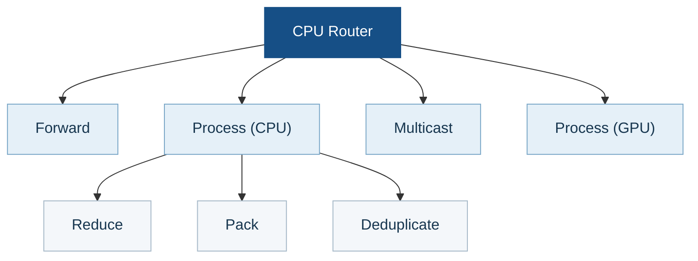

<div align="center">

# UCCL Lite

**Collectives and communication–GEMM fusion for PCIe GPU nodes.**

[Get started](#get-started) · [Results](#measured-results) · [CPU router](#optional-cpu-router) · [Documentation](#documentation)

</div>

UCCL Lite is an experimental collection of CUDA collective kernels, an
optional CPU router, fusion kernels, and hardware probes. The direct peer paths
target **four NVIDIA L4 GPUs on a PCIe Gen4 dual-socket node**; the network
paths target **two such nodes**, with two NIC rails per node. The CPU router is
a separate module for 1–32 local GPUs. Most collective and fusion paths
use MSCCL++; standalone peer AG/RS uses CUDA peer copies.

The current result refresh uses an **8xL4 GPU host with four GPUs per NUMA
node**. Four-L4, two-node, and fusion measurements will be refreshed on their
respective machines; their earlier records remain linked. Small messages and
small GEMMs can lose to NCCL; full sweeps and negative results are retained.

## What is included

| Component | Purpose |
| --- | --- |
| [Profiler](docs/hardware-profiler.md) | Inspect GPU, PCIe, and NUMA topology and measure transfer bandwidth. |
| [Single-node collectives](docs/collectives.md) | AllReduce, AllGather, ReduceScatter, and All-to-All on one node. |
| [Multi-node collectives](docs/multinode.md) | Collective implementations across nodes using local GPU access and network rails. |
| [CPU router](docs/cpu-router.md) | Optional NUMA-aware path for local collectives, selected from measured benefit. |
| [Fusion kernels](docs/fusion.md) | Combine collective communication with GEMM and MoE stages. |

## Get started

From the UCCL repository root on the 8xL4 GPU host:

```bash
cd experimental/lite
make -j2 adaptive-collectives eight-gpu-alltoall \
  CUDA_HOME=/usr/local/cuda-12.9 \
  CUTLASS_HOME=/data/zhongjie/cutlass-v4.5.0 \
  NCCL_HOME=build/nccl-2.28.9
./build/uccl_lite_collectives --gpus 8 --fallback nccl \
  --backend force --op allreduce --begin 1048576 --end 1048576 \
  --warmup 1 --iterations 1 --repeats 3
./build/uccl_lite_alltoall_8l4 --begin 1048576 --end 1048576 \
  --warmup 1 --iterations 1 --repeats 3
```

The eight-GPU benchmarks check every invocation. Verify the device order with
`nvidia-smi topo -m` before running them. The 2+2 four-GPU programs need their
own machine. [Build details](docs/build.md) cover NCCL, CUTLASS, MSCCL++, and
the two-node launcher.

## Measured results

The completed 8xL4 GPU comparison shows **latency from 1 KiB to 1 MiB** and
**throughput from 1 MiB to 1 GiB** for each collective. The other topology and
fusion sections link their earlier records until the matching machines can be
rerun.

### Single-node collectives

#### Four L4 (earlier measurements; refresh pending)

AllReduce, AllGather, ReduceScatter, and All-to-All will be refreshed on a
four-L4 machine with the required 2+2 NUMA topology, using the best direct
peer UCCL Lite path against one matching NCCL control. No CPU router will be
used for that comparison. Earlier measurements remain in the
[single-node design](docs/collectives.md), [peer AG/RS record](docs/peer-ag-rs.md),
and [benchmark archive](benchmarks/README.md).

#### 8xL4 GPU

This comparison uses GPUs 0–3 on NUMA node 0 and 4–7 on node 1.
AllReduce is in place; AllGather and ReduceScatter are out of place. Each UCCL Lite curve
uses the fastest measured project-owned path at that size, chosen without
looking at NCCL. The CPU router is selected for all large AR/AG/RS sizes.
At 128 KiB, AR selects the local path and RS selects GPU reduction/progress;
RS uses the CPU-reduction router at other sizes. Its 256 KiB–4 MiB calls use
128 KiB packets.

##### AllReduce on single 8xL4 GPU


##### AllGather on single 8xL4 GPU


##### ReduceScatter on single 8xL4 GPU


### Multi-node collectives

#### Two nodes × four L4 (earlier measurements; All-to-All pending)

AllReduce, AllGather, ReduceScatter, and All-to-All will be filled on the
two-node testbed. The earlier AR/AG/RS results, including the
[large-message latency bars](docs/assets/multinode-peer.svg), remain in the
[two-node design record](docs/multinode.md); two-node All-to-All has not yet
been measured.

### Fusion (earlier measurements; refresh pending)

Dense AG+GEMM, GEMM+RS, GEMM+AR, and expert-parallel MoE results will be
refreshed on their respective testbeds. The previous
[latency bar figures and workload definitions](docs/fusion.md), including
small-shape regressions, remain available until then.

## Optional CPU router

### Motivation

When GPU Direct P2P is unavailable between GPU groups, their data already
needs a host-mediated path. The CPU router uses that host-memory stop to do
useful work with otherwise idle CPU cores: reduce packets before forwarding
them and share a packet with multiple destinations. Reusable packet operators
also support packing and deduplication. Routing is most promising when PCIe
transfers constrain the collective while NUMA-local host
memory and spare CPU cores can keep up with the packet flow. Fast direct P2P
or contention for host memory can erase that advantage.

### High-level design

The optional CPU router exchanges packets through NUMA-local pinned host
memory. **Forward** moves a packet, **Multicast** sends one packet to multiple
destinations, and **Process** transforms packet contents. CPU processing
provides Reduce, Pack, and Deduplicate operators; selected reductions can
instead use GPU processing. Collectives compose these operations, with packet
slots and reader credits preventing reuse until consumers finish.



The `Process (CPU)` operators can be used in different collectives:

- **Reduce** combines contributions for AllReduce and ReduceScatter.
- **Pack** assembles fragments for AllGather and token buffers for
  dispatch/combine.
- **Deduplicate** removes repeated token records in dispatch/combine. The
  included fixed-width operator is intended for small routing metadata.

### Profiler and selection

The hardware profiler checks topology and measures PCIe, peer, and host-memory
bandwidth to identify plausible routing opportunities. It does **not** enable
the router from a bandwidth ratio. A separate paired calibration checks output
correctness and times the router against the caller's existing local backend
for each exact collective, data type, message size, and buffer placement. The
profile is bound to the hardware/software configuration and backend identity.

At runtime, `auto` looks up the matching profile; it does not benchmark during
the collective. The router is selected only when at least three repetitions
show a **3% median gain** and the router's slowest run is faster than the
fallback's fastest run. Missing, stale, or inconclusive evidence keeps the
existing backend without allocating router buffers or starting workers. See
the [architecture and calibration guide](docs/cpu-router.md) for the API and
exact profile rules.

## Documentation

- [Build targets and correctness commands](docs/build.md)
- [Hardware profiler methods and measurements](docs/hardware-profiler.md)
- [Collective algorithms](docs/collectives.md) and [two-node design](docs/multinode.md)
- [Fusion design and workloads](docs/fusion.md)
- [Full measurement files](benchmarks/README.md) and [validation limits](docs/validation.md)

UCCL Lite provides specialized research kernels and benchmarks, not an
NCCL-compatible API or a serving-framework integration. The project follows
the repository [license](../../LICENSE); the adapted CUTLASS wrapper retains
its [upstream notice](NOTICE.md).
