<div align="center">

# UCCL Lite

**Collectives and communication–GEMM fusion for PCIe GPU nodes.**

[Get started](#get-started) · [Results](#measured-results) · [CPU router](#optional-cpu-router) · [Documentation](#documentation)

</div>

UCCL Lite is an experimental collection of CUDA collective kernels, an
optional CPU router, fusion kernels, and hardware probes. The direct peer paths
target **four NVIDIA L4 GPUs on a PCIe Gen4 dual-socket node**; the network
paths target **two such nodes**, with two NIC rails per node. The CPU router is
a separate module for 1–32 local GPUs. Most collective and fusion paths
use MSCCL++; standalone peer AG/RS uses CUDA peer access.

The eight-L4 results were measured on a separate host with four GPUs per
NUMA node. A third, **8xL4 SHM**, testbed disables GPU peer transport on
that host by policy. Fresh four-L4, two-node, and eight-L4 dense fusion
measurements appear below with their own timing scopes. Small messages
and small GEMMs can lose to NCCL; negative results are retained.

## What is included

| Component | Purpose |
| --- | --- |
| [Profiler](docs/hardware-profiler.md) | Inspect GPU, PCIe, and NUMA topology and measure transfer bandwidth. |
| [Single-node collectives](docs/collectives.md) | AllReduce, AllGather, and ReduceScatter on one node. |
| [Multi-node collectives](docs/multinode.md) | Collective implementations across nodes using local GPU access and network rails. |
| [CPU router](docs/cpu-router.md) | Optional NUMA-aware path for local collectives, selected from measured benefit. |
| [Fusion kernels](docs/fusion.md) | Combine collective communication with GEMM and MoE stages. |

## Get started

From the UCCL repository root on the 8xL4 GPU host:

```bash
cd experimental/lite
make -j2 adaptive-collectives \
  CUDA_HOME=/usr/local/cuda-12.9 \
  CUTLASS_HOME=/data/zhongjie/cutlass-v4.5.0 \
  NCCL_HOME=build/nccl-2.28.9
./build/uccl_lite_collectives --gpus 8 --fallback nccl \
  --backend force --op allreduce --begin 1048576 --end 1048576 \
  --warmup 1 --iterations 1 --repeats 3
```

The eight-GPU benchmark checks every invocation. Verify the device order with
`nvidia-smi topo -m` before running them. The 2+2 four-GPU programs need their
own machine. [Build details](docs/build.md) cover NCCL, CUTLASS, MSCCL++, and
the two-node launcher.

## Measured results

### Single-node collectives

#### AllReduce on single 4xL4 GPU (FP32)


#### AllGather on single 4xL4 GPU (FP32)


#### ReduceScatter on single 4xL4 GPU (FP32)


[Four-L4 FP32 data](benchmarks/data/optimization_20261110/README.md)

#### AllReduce on single 4xL4 GPU (BF16 CPU router, in place)

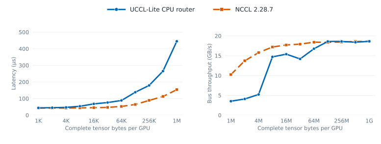

#### AllGather on single 4xL4 GPU (BF16 CPU router, out of place)

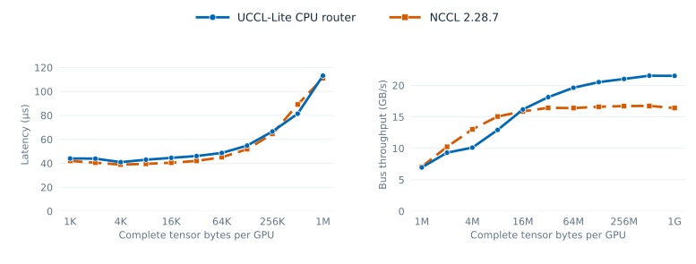

#### ReduceScatter on single 4xL4 GPU (BF16 CPU router, out of place)

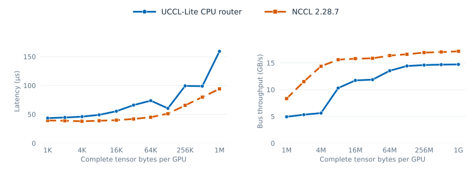

[Four-L4 BF16 CPU-router figure data](benchmarks/data/cpu_router_4l4_figures_20261111/README.md)

#### 8xL4 GPU

This comparison uses GPUs 0–3 on NUMA node 0 and 4–7 on node 1.
AllReduce is in place; AllGather and ReduceScatter are out of place. Each UCCL Lite curve
uses the fastest measured project-owned path at that size, chosen without
looking at NCCL. The CPU router is selected for all large AR/AG/RS sizes.
At 128 and 256 KiB, AllReduce uses a compact CPU router with four workers
per NUMA node and 16 transport blocks. [Paired measurements](benchmarks/data/ar_compact_8l4_20261111/README.md)
replace the earlier 128 KiB local-path selection. At 128 KiB, ReduceScatter
selects GPU reduction/progress; RS uses the CPU-reduction router at other
sizes. Its 256 KiB–4 MiB calls use 128 KiB packets.
AllGather uses 512 KiB packets below 4 MiB and 2 MiB packets from 4 MiB
through 1 GiB. The [paired AllGather measurements](benchmarks/data/ag_packet_8l4_20261111/README.md)
and packet-size screening support this choice.

##### AllReduce on single 8xL4 GPU


##### AllGather on single 8xL4 GPU


##### ReduceScatter on single 8xL4 GPU


#### 8xL4 SHM

This testbed reuses the eight-GPU host but disables every GPU peer link in
UCCL-Lite's benchmark topology. NCCL P2P is disabled and its GPU channels
are verified to use SHM. The physical PCIe topology is unchanged. UCCL-Lite
uses host-memory packets for AllReduce, AllGather, and ReduceScatter; the
128–256 KiB AllReduce and 64 KiB ReduceScatter cases use size-specific router
settings. AllGather uses the SM-kernel host-packet path. AllReduce is in
place; the others are out of place.
The SHM AllGather figure reuses the tuned UCCL-Lite host-packet timings from
the 8xL4 GPU sweep. Its 128/256 KiB AllReduce points likewise reuse the
compact router run. NCCL SHM curves come from the earlier SHM sweep, so
these points compare separate runs. Other AllReduce and ReduceScatter points
retain their paired SHM measurements. [SHM results and transport evidence](benchmarks/data/shm_8l4_20261111/README.md)
include the source of every plotted curve.

##### AllReduce on single 8xL4 SHM

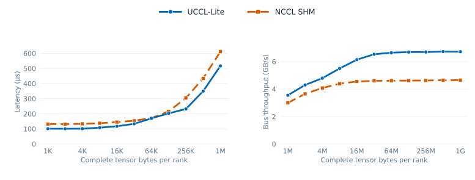

##### AllGather on single 8xL4 SHM

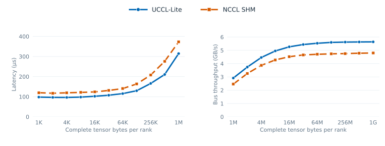

##### ReduceScatter on single 8xL4 SHM

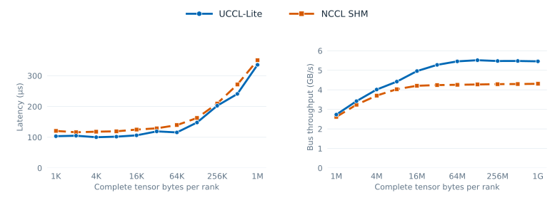

At 1 GiB, UCCL-Lite takes **279.4 / 166.6 / 172.1 ms** for AR / AG / RS,
versus **403.7 / 195.6 / 218.0 ms** with NCCL SHM. At 64 KiB,
AllReduce differs by only about 1%, so that point is effectively tied.

### Multi-node collectives

#### AllReduce on two 4xL4 GPU nodes


#### AllGather on two 4xL4 GPU nodes


#### ReduceScatter on two 4xL4 GPU nodes


[Two-node AllGather selected data](benchmarks/data/host_multicast_selected_2x4l4_20261111/README.md) ·
[AllReduce and ReduceScatter data](benchmarks/data/nccl_tuned_2x4l4_20261111/README.md)

### Fusion on single 4xL4 GPU

#### Dense AG+GEMM, GEMM+RS, GEMM+AR


#### Expert-parallel MoE


[Fusion data and limits](docs/fusion.md)

### Fusion on single 8xL4 GPU

The eight L4s span two NUMA groups. Figures compare cuBLAS + NCCL, cuBLAS +
CPU router, and fused GEMM + CPU router. Values are slowest-GPU CUDA-event
latencies, aggregated across two runs. [Methods and samples](benchmarks/data/fusion_8l4_models_20261111/README.md).

#### GEMM + AllReduce on single 8xL4 GPU

BF16 TP=8 FFN down projection: decode `M=1,16,32`; prefill
`M=2048,4096,8192`. Each model's `N` and per-GPU `K` appear in the figures.

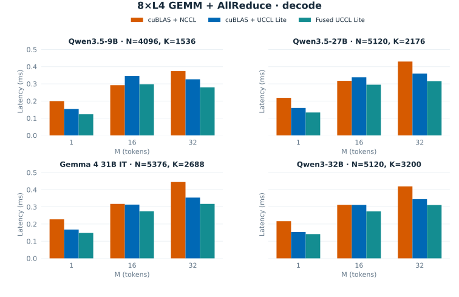

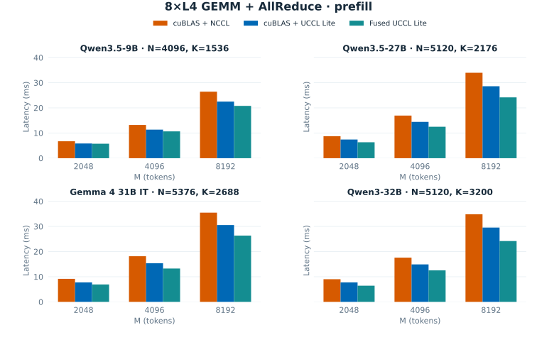

Fused has the lowest aggregate median at 23/24 shapes. Qwen3.5-9B `M=16`
favors NCCL by 0.005 ms; Qwen3.5-27B `M=16` changes winner between runs.
The 12 prefill points show 1.17–1.44× speedup over NCCL. These are isolated
GEMM + AR timings. [Full results](benchmarks/data/fusion_8l4_models_20261111/README.md)
and the [older five-shape figure](docs/assets/fusion-8l4-gemm-ar.svg) are
available separately.

#### AllGather + GEMM on single 8xL4 GPU


The sequential CPU-router path is fastest at all three tested shapes; at
`(128,1024,1024)` it takes **0.144 versus 0.203 ms** for cuBLAS + NCCL.
The tuned resident fused kernel also beats NCCL at the two larger shapes,
but it remains slower than the sequential router path and regresses at the
smallest shape.

#### GEMM + ReduceScatter on single 8xL4 GPU


The fused path takes **0.214 ms versus 0.270 ms** for cuBLAS + NCCL at
`(128,1024,1024)` and **0.391 ms versus 0.452 ms** at `(256,2048,2048)`.
At `(512,4096,4096)`, separate cuBLAS + CPU router is slightly faster than
the fused path; the difference is small across the two runs.

#### Other fusion workloads

The four-GPU expert-parallel MoE results above use CUDA IPC peer links.
MoE has not been ported across this host's two four-GPU NUMA groups.

## Optional CPU router

### Motivation

When GPU Direct P2P is unavailable between GPU groups, their data already
needs a host-mediated path. The CPU router uses that host-memory stop to do
useful work with otherwise idle CPU cores: reduce packets before forwarding
them and share a packet with multiple destinations. Reusable packet operators
also support packing and deduplication. Routing is most promising when PCIe
transfers constrain the collective while NUMA-local host
memory and spare CPU cores can keep up with the packet flow. Fast direct P2P
or contention for host memory can erase that advantage.

### High-level design

The optional CPU router exchanges packets through NUMA-local pinned host
memory. **Forward** moves a packet, **Multicast** sends one packet to multiple
destinations, and **Process (CPU)** transforms packet contents with Reduce,
Pack, and Deduplicate operators. Collectives compose these operations, with
packet slots and reader credits preventing reuse until consumers finish.

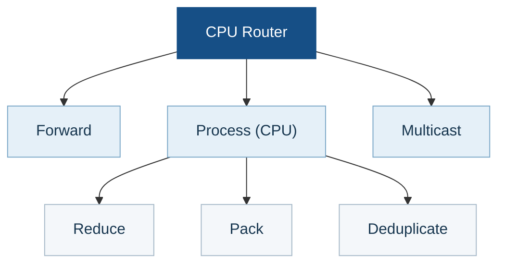

The `Process (CPU)` operators can be used in different collectives:

- **Reduce** combines contributions for AllReduce and ReduceScatter.
- **Pack** assembles fragments for AllGather and token buffers for
  dispatch/combine.
- **Deduplicate** removes repeated token records in dispatch/combine. The
  included fixed-width operator is intended for small routing metadata.

### 8xL4 collective packet flows

Each animation shows all eight GPUs and one packet stage at a time. Larger
tensors pipeline many packets.

#### AllReduce

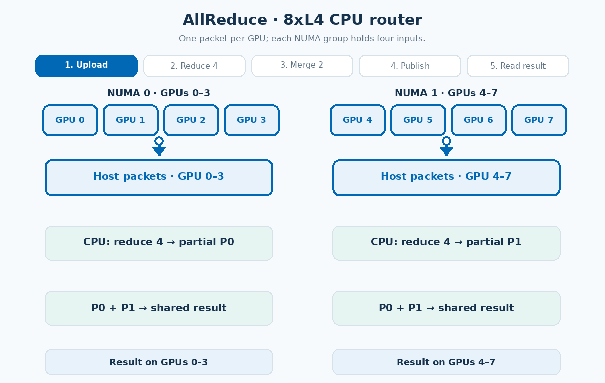

#### AllGather

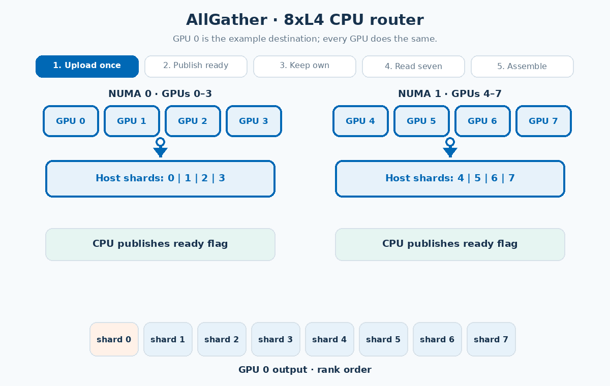

#### ReduceScatter

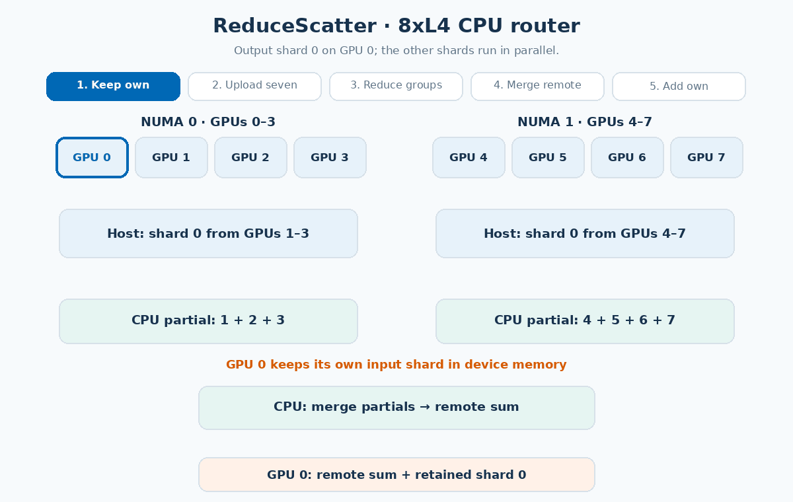

Regenerate all three GIFs with `python3 scripts/animate_cpu_router.py` from
`experimental/lite` (requires Pillow).

## Documentation

- [Build targets and correctness commands](docs/build.md)
- [Hardware profiler methods and measurements](docs/hardware-profiler.md)
- [Collective algorithms](docs/collectives.md) and [two-node design](docs/multinode.md)
- [Fusion design and workloads](docs/fusion.md)
- [Full measurement files](benchmarks/README.md) and [validation limits](docs/validation.md)

UCCL Lite provides specialized research kernels and benchmarks, not an
NCCL-compatible API or a serving-framework integration. The project follows
the repository [license](../../LICENSE); the adapted CUTLASS wrapper retains
its [upstream notice](NOTICE.md).
