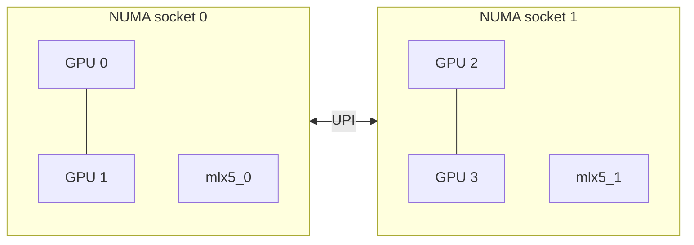

<div align="center">

# UCCL Lite

**Topology-aware collectives and communication–compute fusion for PCIe GPUs.**

[Build & run](docs/build.md) · [Collectives](docs/collectives.md) · [Fusion](docs/fusion.md) · [Multi-node](docs/multinode.md) · [Measurements](benchmarks/README.md)

</div>

UCCL Lite explores how much communication performance a PCIe-only GPU system
can deliver when transfers follow the topology and computation starts as soon
as its inputs arrive. It combines low-latency packet protocols, scheduled peer
transfers, copy-engine rings, and readiness-driven GEMM fusion on
[MSCCL++](https://github.com/microsoft/mscclpp).

The current implementation is specialized to **four NVIDIA L4 GPUs, PCIe Gen4,
no NVLink, with two GPUs per NUMA socket**. Two-node AllReduce extends that
layout to eight GPUs across two network rails. This is an experimental kernel
and benchmark project: application integrations and serving-framework hooks
are intentionally outside its scope.

## At a glance

| Component | What is implemented | Representative recorded result |
| :--- | :--- | :--- |
| **AllReduce** | LL packets, NUMA hierarchy, copy-engine ring | **6.08 µs** at 1 KiB; **20.13 GB/s** bus bandwidth at 1 GiB |
| **All-to-All** | Collision-free peer schedules on SMs and copy engines | **74.47 GB/s** aggregate at 256 MiB/rank |
| **Dense fusion** | AllGather + GEMM, GEMM + ReduceScatter, GEMM + AllReduce | **1.47× / 1.24× / 1.30×** over cuBLAS + NCCL at the large reference shapes |
| **Expert-parallel MoE** | Ragged dispatch, grouped GEMM, activation, down projection, combine | **1.39–1.52×** full-layer speedup at large token counts |
| **Tensor-parallel MoE** | Reusable down/combine/AllReduce and direct-decode device kernels | Kernel headers; host integration is caller-owned |
| **Two-node AllReduce** | Hierarchical GDR, host routing, TCCL-style global ring | **19.21 GB/s** at 1 GiB for the host-staged global ring |

These are historical measurements on the documented L4 testbed, not portable
performance guarantees. Fusion can lose on small shapes. Collective curves
select the fastest correct configuration per size; the executables expose
those variants rather than a universal automatic selector.

## Why topology matters



Small messages benefit from carrying completion flags inside their packets.
Large transfers benefit from copy engines and the ring **0 → 1 → 3 → 2 → 0**,
which spreads cross-socket traffic over the entire operation. All-to-All uses
rotating peer schedules so each GPU has one sender and one receiver per step.
Fusion extends the same idea: publish the readiness of a shard or arrival
group, then communicate or compute it while the remaining work continues.

## Start with a single node

Install CUDA and build MSCCL++; then, from the UCCL repository root:

```bash
cd experimental/lite
make -j2 MSCCLPP_HOME=/path/to/mscclpp

# Each executable starts four local ranks. Sizes are bytes per rank.
./build/uccl_lite_allreduce -b 1024 -e 1048576 -w 5 -n 10
./build/uccl_lite_alltoall -b 1024 -e 1048576 -w 5 -n 10
```

Correctness checking is enabled by default. Check `nvidia-smi topo -m` first:
the kernels assume NUMA pairs `(0,1)` and `(2,3)` and peer access between GPUs.
The default architecture is `sm_89`; changing it does not automatically adapt
the algorithms to another topology.

Fusion adds NCCL, cuBLAS, and CUTLASS:

```bash
make -j2 fusion \
  MSCCLPP_HOME=/path/to/mscclpp \
  NCCL_HOME=/path/to/nccl/build \
  CUTLASS_HOME=/path/to/cutlass

# Tokens per rank; full MoE layer including dispatch and combine.
./build/uccl_lite_fused_moe_layer -b 2048 -e 2048 -c 2
```

See [build instructions](docs/build.md) for all targets, dependency versions,
small correctness runs, and the optional two-node setup.

## Measured performance

### Single-node AllReduce


Across 21 doubling sizes from 1 KiB to 1 GiB, UCCL Lite wins **17** against
the tested NCCL 2.18.3, NCCL 2.28.7, and TCCL configurations. At 1 KiB,
latency is 6.08 µs versus 17.29/19.54 µs for the two NCCL versions. At 1 GiB,
bus bandwidth is 20.13 GB/s versus 17.01/18.49 GB/s. Some mid-size differences
are below 1% and should be treated as ties.

The figure uses three-run medians and min–max bands. UCCL Lite selects the
fastest correct variant per size. [Data and measurement scope](benchmarks/README.md)

### Two nodes, several transport choices

| Path | Requires local GPU P2P | Requires GPU RDMA | 1 GiB bus bandwidth |
| :--- | :---: | :---: | ---: |
| UCCL Lite TCCL-style global ring, host-staged sender | Yes | Yes, receive side | **19.21 GB/s** |
| UCCL Lite hierarchical GPUDirect | Yes | Yes | **17.80 GB/s** |
| UCCL Lite pinned-host CPU router | Yes | No | **15.93 GB/s** |
| UCCL Lite strict host-only fallback | No | No | **5.06 GB/s** |
| TCCL reference, specialized global ring | Uses host transport | Yes, receive side | **19.64 GB/s** |

The global-ring reproduction is within 2.2% of TCCL. Host staging here means
the sender uses host memory; it does **not** eliminate the receiver's RDMA
requirement. Under a strict no-P2P/no-GDR constraint, the current host-only
fallback is much slower than TCCL or NCCL 2.28.7. Small multi-node messages
favor NCCL over the hierarchical and global-ring paths.
[Transport details and experimental limitations](docs/multinode.md)

## Source map

```text
experimental/lite/
├── Makefile                    # Independent build; binaries go to build/
├── src/collectives/             # Single-node and two-node algorithms + harnesses
├── include/uccl_lite/           # Reusable grouped-GEMM, routing, and MoE kernels
├── benchmarks/
│   ├── fusion/                 # Dense and expert-parallel MoE benchmarks
│   ├── probes/                 # GEMM, tensor-core, and overlap diagnostics
│   └── data/                   # Curated reference measurements
├── scripts/                    # Multi-node launcher and figure regeneration
├── patches/                    # MSCCL++ mapped-host registration fix
└── docs/                       # Build, design, and validation notes
```

## Scope and status

- **Specialized hardware:** four local ranks, or exactly two nodes with four
  ranks each. General topology discovery and arbitrary world sizes are not
  implemented.
- **Explicit data types:** float32 standalone collectives, FP16 dense fusion,
  and BF16 MoE with FP32 accumulation where documented.
- **Independent runtime:** MSCCL++ is an external dependency. This directory
  does not replace UCCL's main transports or provide an NCCL-compatible API.
- **Experimental paths:** persistent mapped-host communication is retained as
  an opt-in diagnostic and has known correctness failures. The reliable host
  fallback uses synchronous staging.
- **No application layer:** no serving hooks, framework monkey patches,
  Torch extensions, model downloads, or application throughput claims.

Read [validation notes](docs/validation.md) before extending the kernels.
The project follows the repository [license](../../LICENSE); the adapted
CUTLASS grouped-GEMM wrapper retains its [upstream notice](NOTICE.md).
