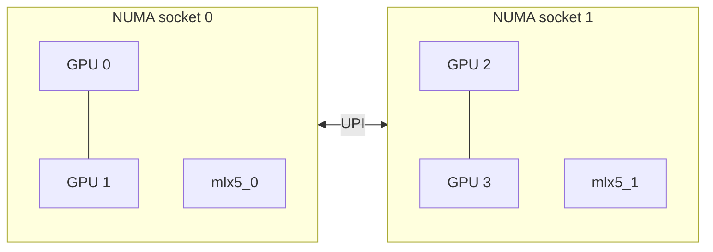
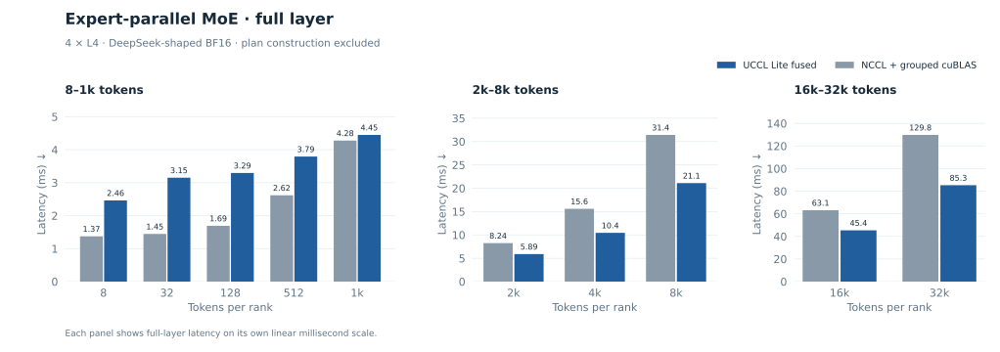
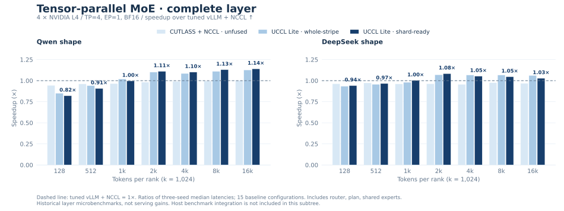
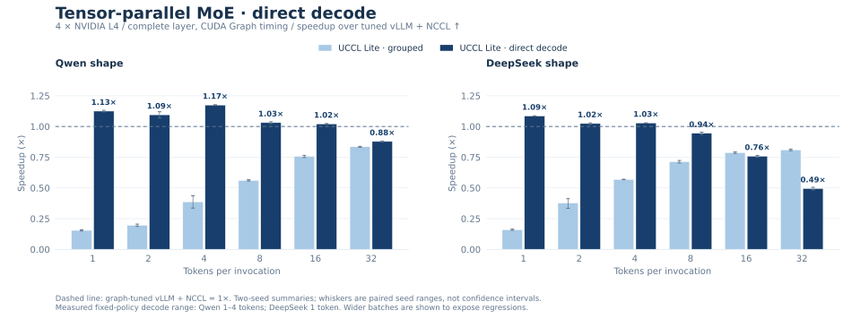
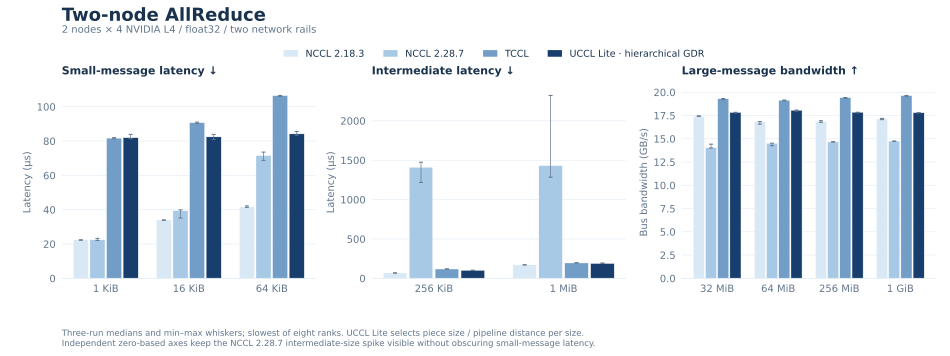
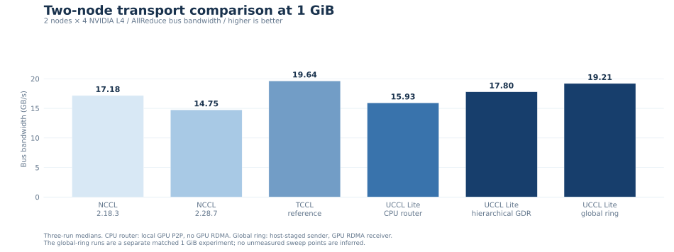

<div align="center">

# UCCL Lite

**Topology-aware collectives and communication–compute fusion for PCIe GPUs.**

[Build & run](docs/build.md) · [Collectives](docs/collectives.md) · [Fusion](docs/fusion.md) · [Multi-node](docs/multinode.md) · [Measurements](benchmarks/README.md)

</div>

UCCL Lite explores how much communication performance a PCIe-only GPU system
can deliver when transfers follow the topology and computation starts as soon
as its inputs arrive. It combines low-latency packet protocols, scheduled peer
transfers, copy-engine rings, and readiness-driven GEMM fusion on
[MSCCL++](https://github.com/microsoft/mscclpp).

The current implementation is specialized to **four NVIDIA L4 GPUs, PCIe Gen4,
no NVLink, with two GPUs per NUMA socket**. Two-node AllReduce extends that
layout to eight GPUs across two network rails. This is an experimental kernel
and benchmark project: application integrations and serving-framework hooks
are intentionally outside its scope.

## At a glance

| Component | What is implemented | Representative recorded result |
| :--- | :--- | :--- |
| **AllReduce** | LL packets, NUMA hierarchy, copy-engine ring | **6.08 µs** at 1 KiB; **20.13 GB/s** bus bandwidth at 1 GiB |
| **All-to-All** | Collision-free peer schedules on SMs and copy engines | **74.47 GB/s** aggregate at 256 MiB/rank |
| **AllGather / ReduceScatter reference results** | Archived eight-GPU CPU-router primitive experiments; runtime not included here | **5.25 / 5.59 GB/s** bus bandwidth at 1 GiB, BF16, in-place |
| **Dense fusion** | AllGather + GEMM, GEMM + ReduceScatter, GEMM + AllReduce | **1.47× / 1.24× / 1.30×** over cuBLAS + NCCL at the large reference shapes |
| **Expert-parallel MoE** | Ragged dispatch, grouped GEMM, activation, down projection, combine | **1.39–1.52×** full-layer speedup at large token counts |
| **Tensor-parallel MoE** | Reusable down/combine/AllReduce and direct-decode device kernels | **1.10–1.14×** Qwen prefill layer; direct decode wins at selected tiny batches |
| **Two-node AllReduce** | Hierarchical GDR, host routing, TCCL-style global ring | **19.21 GB/s** at 1 GiB for the host-staged global ring |

These are historical measurements on the documented L4 testbed, not portable
performance guarantees. Fusion can lose on small shapes. Collective summaries
select the fastest correct configuration per size; the executables expose
those variants rather than a universal automatic selector.

## Why topology matters



Small messages benefit from carrying completion flags inside their packets.
Large transfers benefit from copy engines and the ring **0 → 1 → 3 → 2 → 0**,
which spreads cross-socket traffic over the entire operation. All-to-All uses
rotating peer schedules so each GPU has one sender and one receiver per step.
Fusion extends the same idea: publish the readiness of a shard or arrival
group, then communicate or compute it while the remaining work continues.

## Start with a single node

Install CUDA and build MSCCL++; then, from the UCCL repository root:

```bash
cd experimental/lite
make -j2 MSCCLPP_HOME=/path/to/mscclpp

# Each executable starts four local ranks. Sizes are bytes per rank.
./build/uccl_lite_allreduce -b 1024 -e 1048576 -w 5 -n 10
./build/uccl_lite_alltoall -b 1024 -e 1048576 -w 5 -n 10
```

Correctness checking is enabled by default. Check `nvidia-smi topo -m` first:
the kernels assume NUMA pairs `(0,1)` and `(2,3)` and peer access between GPUs.
The default architecture is `sm_89`; changing it does not automatically adapt
the algorithms to another topology.

Fusion adds NCCL, cuBLAS, and CUTLASS:

```bash
make -j2 fusion \
  MSCCLPP_HOME=/path/to/mscclpp \
  NCCL_HOME=/path/to/nccl/build \
  CUTLASS_HOME=/path/to/cutlass

# Tokens per rank; full MoE layer including dispatch and combine.
./build/uccl_lite_fused_moe_layer -b 2048 -e 2048 -c 2
```

See [build instructions](docs/build.md) for all targets, dependency versions,
small correctness runs, and the optional two-node setup.

## Measured performance

### Single-node AllReduce


Across 21 doubling sizes from 1 KiB to 1 GiB, UCCL Lite wins **17** against
the tested NCCL 2.18.3, NCCL 2.28.7, and TCCL configurations. At 1 KiB,
latency is 6.08 µs versus 17.29/19.54 µs for the two NCCL versions. At 1 GiB,
bus bandwidth is 20.13 GB/s versus 17.01/18.49 GB/s. Some mid-size differences
are below 1% and should be treated as ties.

The grouped bars show representative sizes, including the 32 KiB and 1–4 MiB
exceptions. Whiskers show three-run min–max ranges around median latency or
bandwidth. UCCL Lite selects the fastest correct variant per size.
[Full data and measurement scope](benchmarks/README.md)

### Single-node All-to-All


The scheduled peer transfers reach **74.47 GB/s aggregate** at 256 MiB/rank,
with **1.17–4.20×** speedup over the tested default NCCL transport across the
recorded sweep. NCCL uses host staging on this testbed. Aggregate bandwidth
counts all nonlocal traffic and is distinct from AllReduce bus bandwidth.

### Standalone AllGather and ReduceScatter — eight-GPU primitives

The independent AllGather and ReduceScatter results come from a separate
CPU-router implementation on **one node with eight L4 GPUs, BF16, and no GPU
peer access**. They were recorded on October 12 after the ReduceScatter packet
scheduling fix. This runtime has not been migrated into this subtree; the data
is retained as a historical primitive-collective comparison. It is a different
configuration from the four-GPU float32 benchmarks above.


At 1 GiB in-place, the CPU-router SM path reaches **5.25 GB/s for AllGather**
and **5.59 GB/s for ReduceScatter**, versus **5.04 / 4.86 GB/s** for NCCL
2.27.5. Both placements are shown, with three-run median bars and min–max
whiskers. The NCCL 2.18.3 baseline uses the TCCL runtime with its default NCCL
algorithms; it is not the independent NCCL build used in the four-GPU plots.

AllGather size is the complete output per rank; ReduceScatter size is the
complete input per rank. Neither figure includes GEMM. The full 128 B–1 GiB
sweep and exact provenance are described in [primitive results](docs/primitive-collectives.md).

### Dense fusion


Each panel compares no-overlap UCCL Lite, fused UCCL Lite, and Flux where
available against the **same cuBLAS + NCCL latency**. The dashed line is 1×;
bars below it are slower than that baseline. At the large reference shapes,
fusion reaches **1.47× / 1.24× / 1.30×** for the three operations.

All eight recorded shapes are shown, including small-shape regressions. Flux
uses a separate harness, so differences of roughly 1–2% should be treated as
ties. There is no corresponding Flux GEMM+AllReduce result.
[Shapes and design](docs/fusion.md)

### Expert-parallel MoE



The lighter bars separate collective replacement and GEMM choice from the
dark-blue fused path. Against NCCL All-to-All-v + grouped cuBLAS, fusion reaches
**1.48–1.61×** for dispatch + GEMM and **1.39–1.52×** for the full layer at
large token counts. Full-layer small-batch regressions are retained.

These BF16 DeepSeek-shaped EP=4 benchmarks exclude routing-plan construction
from timing. The full layer includes dispatch, both projections, SwiGLU,
weighted reduction, and combine; it is not a full-model serving measurement.

### Tensor-parallel MoE



These historical **complete-layer** TP=4 / EP=1 measurements include router
projection, GPU plan construction, shared experts, both GEMMs, activation,
combination, and AllReduce. Against tuned vLLM + NCCL, Qwen prefill reaches
**1.10–1.14×** with shard readiness; DeepSeek reaches **1.06–1.07×** with
whole-stripe readiness. Both schedules are plotted rather than selecting a
winner per point. Shard readiness is not a universal improvement.



The direct decode kernel improves Qwen at **1–4 tokens** and DeepSeek at
**one token** under the measured fixed dispatch policy. The wider 1–32-token
sweep shows why it is not enabled for every batch. Whiskers show paired seed
ranges, not confidence intervals.

Only the reusable TP-MoE device headers are included here. The original host
benchmark/framework integration remains outside this subtree; these retained
results are not claims of a new serving integration or a fresh GPU rerun.
[Timing scope, seeds, and data](benchmarks/README.md)

### Two nodes, several transport choices



The hierarchical GDR path beats both tested NCCL versions from **32 MiB**
upward; small messages still favor NCCL. The separate 1 GiB transport comparison
also includes the pinned-host CPU router and the newer global-ring reproduction:



| Path | Requires local GPU P2P | Requires GPU RDMA | 1 GiB bus bandwidth |
| :--- | :---: | :---: | ---: |
| UCCL Lite TCCL-style global ring, host-staged sender | Yes | Yes, receive side | **19.21 GB/s** |
| UCCL Lite hierarchical GPUDirect | Yes | Yes | **17.80 GB/s** |
| UCCL Lite pinned-host CPU router | Yes | No | **15.93 GB/s** |
| UCCL Lite strict host-only fallback | No | No | **5.06 GB/s** |
| TCCL reference, specialized global ring | Uses host transport | Yes, receive side | **19.64 GB/s** |

The global-ring reproduction is within 2.2% of TCCL. Host staging here means
the sender uses host memory; it does **not** eliminate the receiver's RDMA
requirement. Under a strict no-P2P/no-GDR constraint, the current host-only
fallback is much slower than TCCL or NCCL 2.28.7. Small multi-node messages
favor NCCL over the hierarchical and global-ring paths.
[Transport details and experimental limitations](docs/multinode.md)

## Source map

```text
experimental/lite/
├── Makefile                    # Independent build; binaries go to build/
├── src/collectives/             # Single-node and two-node algorithms + harnesses
├── include/uccl_lite/           # Reusable grouped-GEMM, routing, and MoE kernels
├── benchmarks/
│   ├── fusion/                 # Dense and expert-parallel MoE benchmarks
│   ├── probes/                 # GEMM, tensor-core, and overlap diagnostics
│   └── data/                   # Curated reference measurements
├── scripts/                    # Multi-node launcher and figure regeneration
├── patches/                    # MSCCL++ mapped-host registration fix
└── docs/                       # Build, design, and validation notes
```

## Scope and status

- **Specialized hardware:** four local ranks, or exactly two nodes with four
  ranks each. General topology discovery and arbitrary world sizes are not
  implemented.
- **Explicit data types:** float32 standalone collectives, FP16 dense fusion,
  and BF16 MoE with FP32 accumulation where documented.
- **Independent runtime:** MSCCL++ is an external dependency. This directory
  does not replace UCCL's main transports or provide an NCCL-compatible API.
- **Experimental paths:** persistent mapped-host communication is retained as
  an opt-in diagnostic and has known correctness failures. The reliable host
  fallback uses synchronous staging.
- **No application layer:** no serving hooks, framework monkey patches,
  Torch extensions, model downloads, or application throughput claims.

Read [validation notes](docs/validation.md) before extending the kernels.
The project follows the repository [license](../../LICENSE); the adapted
CUTLASS grouped-GEMM wrapper retains its [upstream notice](NOTICE.md).
