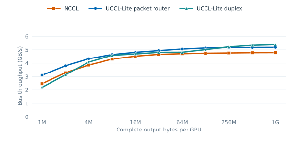

# Eight-L4 duplex host-staged AllGather (2026-11-11)

This experiment adapts the four-L4 double-buffered host staging idea to the
eight-L4 host (GPUs 0–3 on NUMA 0, GPUs 4–7 on NUMA 1). Each source uploads
8 MiB chunks to two NUMA-local registered host slots on a separate CUDA
stream. The destination streams download the seven remote source shards while
the next chunk uploads. A GPU copies its own shard directly in device memory.
CUDA events guard slot reuse after all consumers finish. An optional
`--local-peer 1` variant instead uses peer copies inside each four-GPU group.

The paired controls are the existing packet CPU router and NCCL 2.28.9. All
three use the same BF16 input and output buffers, one process, slowest-rank
CUDA-event latency, and exact checks of every output element on every call.
Each of two process runs measures 11 doubling sizes from 1 MiB to 1 GiB,
with five warmups and three rotating repetitions of ten calls per backend.
The second run reverses size order. The table uses the median of each run's
three repetition medians, then the median of the two runs; all 1,980 timed
samples are in [run 1](samples_run1.csv) and [run 2](samples_run2.csv).

| Complete output per GPU | NCCL (ms) | Packet router (ms) | Duplex staging (ms) |
| ---: | ---: | ---: | ---: |
| 1 MiB | 0.371 | 0.296 | 0.416 |
| 2 MiB | 0.558 | 0.483 | 0.586 |
| 4 MiB | 0.952 | 0.847 | 0.900 |
| 8 MiB | 1.706 | 1.582 | 1.602 |
| 16 MiB | 3.248 | 3.053 | 3.132 |
| 32 MiB | 6.307 | 5.949 | 6.107 |
| 64 MiB | 12.478 | 11.618 | 12.193 |
| 128 MiB | 24.764 | 22.878 | 23.438 |
| 256 MiB | 49.324 | 45.524 | 45.005 |
| 512 MiB | 98.233 | 90.837 | 88.148 |
| 1 GiB | 196.168 | 181.434 | 174.558 |



The [full summary](summary.csv) retains each process run separately. At 1 GiB,
duplex staging beats the packet router by **1.7% in run 1** and **5.9% in
run 2**; its run-level median is **174.56 versus 181.43 ms**. At 512 MiB,
the difference is only 0.8% in run 1 and 5.1% in run 2. At smaller sizes,
the packet router is generally faster. This candidate is opt-in and does not
change the dispatcher or the existing single-node comparison curves.

## Duplex evidence

An [Nsight Systems trace](profile_1g.nsys-rep) covers one warmup and two
checked 1 GiB calls with only the duplex candidate enabled. The derived
[overlap data](duplex_overlap.csv) show that **89.3–93.5%** of each GPU's D2H
active time overlaps H2D. Active-copy rates are **5.5–6.0 GB/s D2H** and
**5.7–5.8 GB/s H2D** per GPU. These rates are measured during DMA activity;
they are not end-to-end throughput or PCIe hardware-counter readings. The
eight simultaneous H2D rates approach the separately measured eight-GPU
H2D probe, but those distinct measurements cannot establish exact link
saturation.

Separate 1 GiB screening runs found about 205 ms when the GPU's own shard
also traversed host memory and about 207 ms when intra-group peer copies
replaced local host downloads. The final paired sweeps use direct device
self-copy and host staging for the other seven sources. The screening runs
are diagnostic, not matched controls.

## Reproduce

From `experimental/lite`, with the local NCCL shim described in the
[eight-GPU router record](../cpu_router_8l4_20261110/README.md):

```bash
make -j2 duplex-allgather-8l4 CUDA_HOME=/usr/local/cuda-12.9 \
  CUTLASS_HOME=/data/zhongjie/cutlass-v4.5.0 \
  NCCL_HOME=build/nccl-2.28.9
export LD_LIBRARY_PATH="$PWD/build/nccl-2.28.9/lib:/usr/local/cuda-12.9/lib64:$LD_LIBRARY_PATH"
export NCCL_NET=Socket
./build/uccl_lite_duplex_allgather_8l4 --begin 1048576 --end 1073741824 \
  --chunk-bytes 8388608 --self-direct 1 --warmup 5 --iterations 10 \
  --repeats 3 --samples build/duplex_samples_run1.csv
./build/uccl_lite_duplex_allgather_8l4 --begin 1048576 --end 1073741824 \
  --chunk-bytes 8388608 --self-direct 1 --warmup 5 --iterations 10 \
  --repeats 3 --reverse --samples build/duplex_samples_run2.csv
python3 scripts/summarize_duplex_allgather_8l4.py
```

`scripts/summarize_router_duplex_profile.py` regenerates the overlap CSV from
an Nsight SQLite export. The source host used driver 580.178.04, CUDA 12.9,
and Nsight Systems 2025.3.2.
