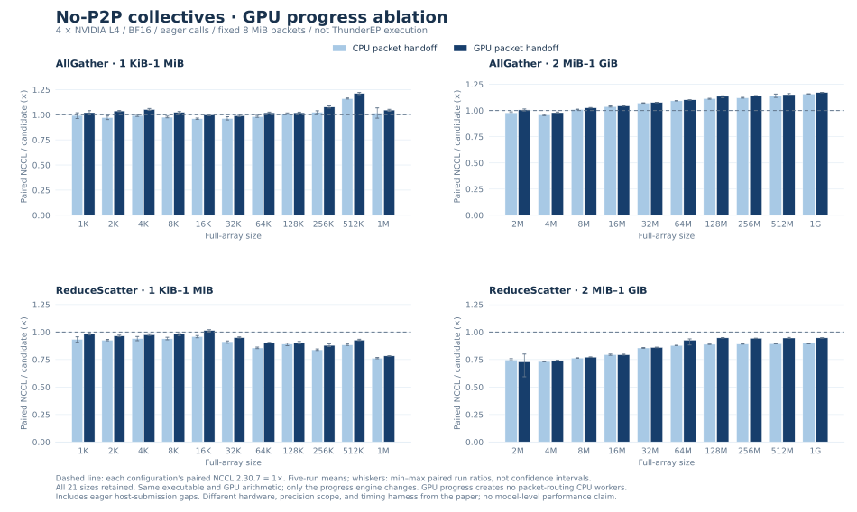

# UCCL Lite versus NCCL and ThunderEP

**Current outcome: some local AllGather wins, no general collective or
end-to-end superiority claim.** The current implementation work and local
comparison are complete for this iteration. ThunderEP has **not** been run on
this machine; the paper's results below are a separate reference, not a
head-to-head measurement.

## 1. Direct comparison with NCCL

Four NVIDIA L4s, two Xeon Silver 4410Y sockets, two NUMA nodes; CUDA 12.9,
driver 595.58.03, NCCL 2.30.7. NCCL P2P and GPU RDMA are disabled and its
channels are verified as `SHM/direct`. UCCL Lite uses mapped host packets,
GPU reduction, destination-interleaved scatter and direct GPU packet progress.
The packet upper bound is fixed at 8 MiB for the complete sweep.

| Collective | Full-array size | NCCL mean | UCCL Lite mean | NCCL / UCCL Lite |
| :--- | ---: | ---: | ---: | ---: |
| AllGather | 1 KiB | 40.727 µs | 39.911 µs | 1.020× |
| AllGather | 1 MiB | 111.228 µs | 106.312 µs | 1.046× |
| AllGather | 1 GiB | 49.201 ms | 42.016 ms | **1.171×** |
| ReduceScatter | 1 KiB | 40.915 µs | 41.666 µs | 0.982× |
| ReduceScatter | 1 MiB | 95.033 µs | 121.436 µs | **0.783×** |
| ReduceScatter | 1 GiB | 48.229 ms | 50.935 ms | **0.947×** |

The candidate has a lower mean at 18/21 AllGather sizes and 1/21 ReduceScatter
sizes. These counts are not significance tests. All 21 sizes and all regressions
are retained below; no per-size best implementation is selected.



The light-blue control uses exactly the same executable, GPU arithmetic,
packet bound and destination layout, but retains CPU packet handoff. At 1 GiB,
control → candidate latency changes from 42.278 → 42.016 ms for AllGather and
51.466 → 50.935 ms for ReduceScatter. These are small improvements. The two
ReduceScatter NCCL baselines also vary, 46.210 versus 48.229 ms; changes in
normalized ratios must not be attributed entirely to the new progress engine.
The clear resource result is **46 → 0 packet-routing CPU workers**. Host command
submission and the graph replay publisher still use the CPU.

### Measurement scope

BF16, out-of-place, eager calls, one process managing four GPUs. For each size:
five warmups per backend, then five alternating paired repetitions of twenty
calls. Every call is checked on every rank. Each sample is slowest-rank CUDA-event
time; tables use the mean of five per-run means. The candidate and control sweeps
contain **16,800 checked timed invocations** in total. Whiskers are min/max paired
run ratios, not confidence intervals. Initialization, fill and verification are
excluded; eager host-submission gaps are included. This is not decode-graph or
complete-model timing.

[Candidate summary](../benchmarks/data/gpu-progress/candidate_summary.csv) ·
[Control summary](../benchmarks/data/gpu-progress/control_summary.csv) ·
[Raw-data checksums, commands and source identities](../benchmarks/data/gpu-progress/ablation_provenance.json)

## 2. ThunderEP reference comparison

At the paper's largest-message endpoint, the authors report these bandwidths
for six-GPU systems. Ratios below are calculated from each pair of reported
bandwidths. **Do not rank UCCL Lite against ThunderEP from different testbeds
or from these independently normalized ratios.** The precise bandwidth
normalization is not established by our local reproduction.
[Paper, §5.2, Figures 11–12](https://arxiv.org/pdf/2609.40093).

| Paper testbed | Collective, 1 GB point | NCCL reported | ThunderEP reported | ThunderEP / NCCL |
| :--- | :--- | ---: | ---: | ---: |
| 6 × RTX 4090 | AllGather | 20.8 GB/s | 26.5 GB/s | 1.274× |
| 6 × RTX 5090 | AllGather | 23.0 GB/s | 35.3 GB/s | 1.535× |
| 6 × RTX 4090 | ReduceScatter | 21.3 GB/s | 21.0 GB/s | 0.986× |
| 6 × RTX 5090 | ReduceScatter | 23.2 GB/s | 24.5 GB/s | 1.056× |

ThunderEP's small-message averages are 2.30×/2.65× for AllGather and
1.91×/2.14× for ReduceScatter on 4090/5090 respectively. Its largest reported
prefill gain is 1.66×. Those are author-reported results, not measurements from
this repository. [Paper, §§5.2–5.3](https://arxiv.org/pdf/2609.40093).

### What the comparison can and cannot establish

| Requirement | Current status |
| :--- | :--- |
| NCCL version, collectives, size-range coverage, five repetitions | Matched locally |
| Consumer GPUs, six ranks, single-NUMA EPYC host, CUDA 13.0 | Not available here; current hardware is four L4s and dual-NUMA Xeons |
| Author ThunderEP implementation | Not obtained; exact-name GitHub repository search returned no result on November 5, 2026; this does not prove no public code exists |
| Exact primitive dtype, inner timing, size rounding and normalization | Some paper details still unresolved; local choices are explicit above |
| Qwen3-30B-A3B and GPT-OSS-20B/120B inference | Not run with this backend; BF16/MXFP4, framework versions and workloads still need matched evaluation |
| UCCL Lite versus ThunderEP on one machine | **Unmeasured** |

The full evaluation configuration and outstanding settings are recorded in
[the comparison specification](thunderep-comparison.md). Application/framework
integration code remains outside this standalone subtree, as required.

## 3. Implemented change and validation

`CpuRouterOptions::gpuProgress` is an explicit C++ option and requires GPU
reduction. A bounded set of lanes in each leader CTA waits on mapped-host upload
and reader-credit generations; other CTAs wait on GPU-local readiness. Every
rank acknowledges each generation, including masked/non-reading ranks, so a
subsequent operation with a different mask cannot reuse an input bank too soon.
CPU packet routing jobs are omitted and no routing executor is created. The
existing CPU path and its default selection behavior are unchanged.

This still waits for the required sources before consumption. It does not
provide ThunderEP-style per-sender expert-compute overlap. DMA and resident
GEMM fusion are not supported with GPU reduction; these paths fail explicitly.
The progress-engine option has a distinct calibration identity, so CPU-progress
measurements cannot enable GPU progress. Unknown configurations retain fallback
without initializing the router.

Validation covers independent random finite BF16 sums (26,569,136 scalar/guard
checks), 732 mixed operations on each of four- and three-GPU layouts, delayed
senders, masks, in-place calls, uneven tails, and 1,000 captured operations per
layout including queue wrap. Default CPU and C-API graph regression checks pass,
as do 31 policy checks, 28 dispatcher checks, eight NCCL configuration identity
checks, and seven summary tests. This is not a proof of arbitrary-stream race
freedom or validation on the paper's hardware.

## Reproduce the local comparison

```bash
make -j2 cpu-router adaptive-collectives router-checks BUILD=build/gpu-progress \
  NCCL_HOME="$PWD/build/nccl-2.30.7/build"
python3 scripts/compare_thunderep.py \
  --binary build/gpu-progress/uccl_lite_collectives \
  --output build/gpu-progress-candidate-new \
  --gpu-progress --interleave-scatter --packet-bytes 8388608
python3 scripts/compare_thunderep.py \
  --binary build/gpu-progress/uccl_lite_collectives \
  --output build/gpu-progress-control-new \
  --interleave-scatter --packet-bytes 8388608
python3 scripts/plot_reduction_ablation.py --gpu-progress --preview
```

To finish the original head-to-head goal, the missing inputs are a verified
ThunderEP implementation and access to a matched six-4090/5090 testbed (or an
agreed alternative for both systems). No additional architecture branch is
started as part of this iteration's handoff.
