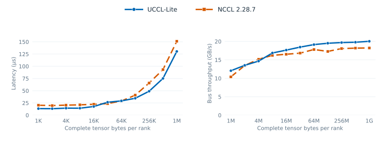

# Single-node collectives

The MSCCL++ peer implementations below assume four GPUs in NUMA pairs
`(0,1)` and `(2,3)`.
`rank ^ 1` is the intra-socket peer and `rank ^ 2` the cross-socket peer.
They are standalone benchmarks with their algorithm kernels and bootstrap
code in the same translation unit.

## November 10 four-L4 matched host sweep

The refreshed AllReduce sweep ran on l40 (`mibura-sky-test-01`): four L4s,
2+2 NUMA, driver 580.178.04, CUDA 12.9, and NCCL 2.28.7. Both paths use
FP32 in-place buffers and four GPU processes. The UCCL Lite executable forks
four ranks; the custom NCCL control uses four MPI ranks. Both report the
slowest-rank host enqueue+completion latency. Three runs alternate backend
order; each has five warmups and ten timed calls. Every warmup and timed
call's complete output is checked. The UCCL path is selected by the lowest
correct three-run median at each size, independently of NCCL's time.

| Complete bytes/rank | UCCL path | UCCL / NCCL (µs) |
| ---: | --- | ---: |
| 1 KiB | A2-tree-ll | 13.454 / 20.333 |
| 1 MiB | A1-hier-sm | 130.459 / 151.121 |
| 64 MiB | A3-ring-ce | 5258.517 / 5650.975 |
| 1 GiB | A3-ring-ce | 80373.248 / 88315.409 |

The selected path wins at 18 of 21 sizes; all three losses remain in the
[candidate table](../benchmarks/data/refresh_20261110/single_native_candidates.csv).
The [full selected summary](../benchmarks/data/refresh_20261110/single_native_summary.csv),
[per-call samples](../benchmarks/data/refresh_20261110/single_native_samples.csv),
and [paired raw logs](../benchmarks/data/refresh_20261110/single_native_l40/)
retain every size. This host-clock curve is separate from the peer AG/RS
CUDA-event sweep and the eight-L4 BF16 CPU router.

## AllReduce

Source: [allreduce.cu](../src/collectives/allreduce.cu).

| Schedule | Mechanism | Useful regime |
| --- | --- | --- |
| A1 hierarchy | Intra-socket ReduceScatter → cross-socket exchange → local AllGather | LL packets for small messages; SM transfers at intermediate sizes |
| A2 tree | Reduce to socket leaders → exchange → broadcast | Latency/traffic tradeoff control |
| A3 ring | Three ReduceScatter + three AllGather steps, `0 → 1 → 3 → 2 → 0` | Copy-engine bandwidth path, typically ≥4 MiB |
| A4 flat LL | Direct packet exchange | Diagnostic comparison |
| A5 ring + flat gather | Ring ReduceScatter followed by direct AllGather | Negative result; never the overall winner in the recorded sweep |

LL packets carry data and completion flags together, avoiding separate barriers
at small sizes. Their extra wire bytes become expensive as the payload grows.
The SM path performs explicit peer writes. The copy-engine path submits commands
through MSCCL++ PortChannels to a host proxy.

The hierarchy minimizes cross-socket volume, but concentrates it in one phase.
The chosen ring sends more cross-socket bytes while spreading that work over the
entire operation, avoiding simultaneous saturation of the UPI link. Large-message
performance depends on both this schedule and copy-engine transfer efficiency.

Immutable receive/forwarding slots and iteration-parity scratch buffers prevent
a fast rank from overwriting data still being reduced. Registered sub-regions
keep proxy offsets inside MSCCL++'s 32-bit offset field. Do not collapse these
regions or remove synchronization based only on a successful small-size test.

The harness reports each eligible variant. The reference summary chooses the
fastest correct three-run median at each size; there is no portable runtime
autotuner. At 1 GiB, the recorded ring reaches 20.13 GB/s bus bandwidth. For four
ranks, bus bandwidth is algorithm bandwidth multiplied by `2*(4-1)/4 = 1.5`.

## All-to-All

Source: [alltoall.cu](../src/collectives/alltoall.cu).

Each rank sends one quarter of its buffer to each rank. All 12 nonlocal flows
are unavoidable, including eight cross-socket flows. The optimization is their
ordering: in step `k`, rank `r` sends to `(r+k) % 4`. Every step is a permutation,
with one sender and one receiver per GPU.

SM variants distinguish unrestricted fan-out, per-thread sequential sends,
grid-synchronized steps, and peer handshakes. Per-thread order alone is not
enough: blocks can drift into different steps and recreate simultaneous fan-out.
Copy-engine variants use the same rotation, and an XOR schedule is retained as
a comparison. A pinned-host staging implementation provides another baseline.

The recorded default-NCCL comparison spans 1.17–4.20× speedup. At 256 MiB/rank,
the best schedule achieves 74.47 GB/s aggregate. This is the sum of all nonlocal
traffic, `12*(bytes_per_rank/4)/seconds`, not per-GPU bus bandwidth. NCCL's default
path on that testbed stages through host memory; forcing GPU P2P produces a
different, much weaker baseline and must be labeled separately.

## Direct peer AllGather and ReduceScatter

[peer_ag_rs.cu](../src/collectives/peer_ag_rs.cu) adds standalone four-GPU
float32 AG and RS paths using source-side peer writes and destination-owned
output. The matched NCCL sweep finds AG wins from 1–64 MiB and RS wins mainly
at 8–32 MiB, with substantial small-message regressions. See the
[algorithm, full sweep and timing scope](peer-ag-rs.md). This path does not
replace the separate BF16/no-P2P CPU router.

## Eight-GPU BF16 local fallback

[local_collectives.cu](../src/collectives/local_collectives.cu) provides a
caller-owned fallback for two four-GPU NUMA groups. It uses pinned host memory
for cross-group transfers and requires CUDA peer access within each group for
AllReduce and ReduceScatter. It supports in-place and out-of-place BF16
AR/AG/RS with one process owning all device streams. Its eager `enqueue`
completes the streams before returning; `prepare` allocates pinned host and
GPU scratch outside timing. For reductions through 2 MiB it downloads all
eight inputs to pinned host buffers, reduces BF16 values with CPU workers,
and uploads the result. Larger reductions use peer-group GPU partials and
host staging. It does not link NCCL or MSCCL++.

The [paired eight-L4 calibration](../benchmarks/data/local_fallback_8l4_20261110_v3/README.md)
retains local AllGather at 1 GiB under the selection margin. The local AR/RS
paths are slower and remain explicit negative results; the measurement-gated
dispatcher chooses the router for them on this host. With 128 KiB packets
through 4 MiB AllReduce, the router also beats the separate NCCL control at
1 MiB in both placements.
The earlier NCCL run is a separate control, not an automatic fallback for this
configuration.

## Eight-GPU BF16 All-to-All

[alltoall_8l4_bench.cu](../benchmarks/collectives/alltoall_8l4_bench.cu)
compares two project-owned out-of-place paths on the same two-NUMA topology:
NUMA-pinned host staging for every nonself chunk, and local CUDA peer copies
with host staging across the NUMA groups. Both exchange equal rank-ordered
chunks and check every output element on all eight GPUs. The external control
uses grouped NCCL send/recv pairs. The [full 1 MiB–1 GiB record](../benchmarks/data/alltoall_8l4_20261110/README.md)
finds host staging the faster UCCL Lite candidate at all 11 sizes, while
NCCL wins all 11. This is a standalone eager benchmark, not a runtime
All-to-All selector.

## Boundaries

These are specialized algorithms, not an NCCL compatibility layer. Their
assumed topology, process count, buffer ownership, and synchronization protocol
are part of their contract. Collectives require GPU peer access except for
explicitly host-staged paths. Re-measure crossover sizes on another system.
