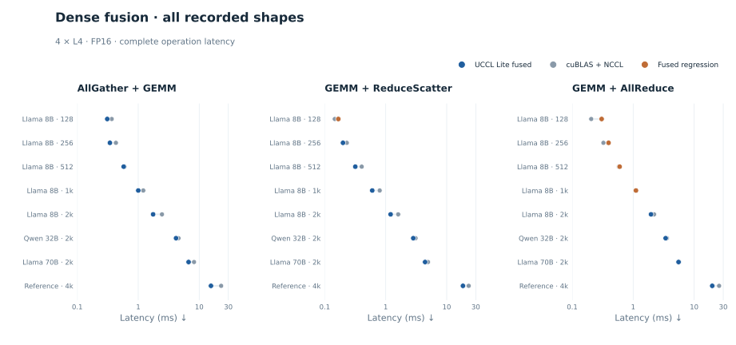
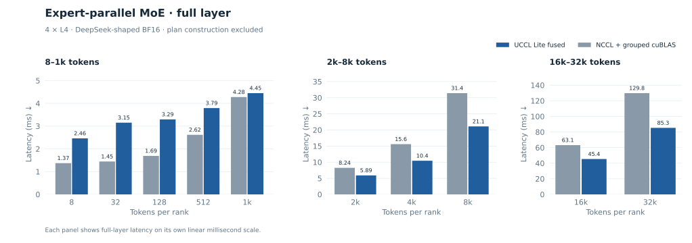

# Communication–compute fusion

Fusion is useful when the first completed piece can be consumed before the
entire operation finishes. UCCL Lite exposes readiness at the granularity that
preserves GEMM efficiency: input groups, output shards, or channel stripes.

## Dense tensor parallelism

[dense_fusion.cu](../benchmarks/fusion/dense_fusion.cu) contains FP16 benchmarks
and their cuBLAS+NCCL controls in one executable.

- **AllGather + GEMM:** compute local rows while gathering the intra-socket
  peer, then compute those rows while gathering the other socket. Small shapes
  use gated CUTLASS kernels; the M=512 policy uses a non-overlapped hierarchy.
- **GEMM + ReduceScatter:** produce destination shards in the order consumed
  by the ring. A low-occupancy communication grid consumes each ready shard
  while cuBLAS computes later shards.
- **GEMM + AllReduce:** follow each stripe's ReduceScatter with AllGather,
  allowing earlier AllGather traffic to overlap later GEMM work. The large
  reference shape uses two stripes; more stripes lose GEMM efficiency.

| Large reference operation | cuBLAS + NCCL | UCCL Lite fused | Time saved |
| --- | ---: | ---: | ---: |
| AG + GEMM, `(4096,49152,12288)` | 22.871 ms | 15.578 ms | 7.293 ms |
| GEMM + RS, `(4096,12288,49152)` | 22.954 ms | 18.461 ms | 4.493 ms |
| GEMM + AR, `(4096,12288,49152)` | 25.658 ms | 19.774 ms | 5.884 ms |

The paired bars show absolute latency for every shape. The two columns use
different labeled linear ranges so the sub-millisecond cases remain legible;
longer bars mean slower operations. The large reference shapes are favorable,
not averages. The retained
[shape sweep](../benchmarks/data/dense_fusion.txt) includes regressions, including
small GEMM+AllReduce cases. Flux uses a separate harness with different timing
aggregation; approximately 1–2% differences should be treated as ties.

The executable also retains a persistent CUTLASS epilogue/readiness experiment.
Do not attribute its timings to the cuBLAS ready-ring results above.

## Expert-parallel MoE

[fused_moe.cu](../benchmarks/fusion/fused_moe.cu) measures dispatch + gate/up GEMM.
[fused_moe_layer.cu](../benchmarks/fusion/fused_moe_layer.cu) adds SwiGLU, down
projection, weighted reduction, and combine. The reusable implementation lives
in [megamoe_core.cuh](../include/uccl_lite/megamoe_core.cuh).

Dispatch de-duplicates tokens per destination. Gather-A GEMM reads received
rows through an index list; a problem's arrival group determines when its tiles
may execute. The dispatcher occupies a block of the GEMM grid to avoid a
separate dispatcher being scheduled behind workers waiting for its data.

The default shape is DeepSeek-V2-Lite: H=2048, I=1408, 64 experts, top-6, EP=4,
BF16 inputs/outputs with FP32 GEMM accumulation. The Qwen build uses I=512,
256 experts, top-8. At 2,048 tokens/rank, the full layer takes **5.893 ms**
versus **8.241 ms** for NCCL + grouped cuBLAS; at 32,768 tokens/rank it takes
**85.283 versus 129.770 ms**, or **384k versus 253k tokens/s/rank**. At small
token counts, grouped scheduling overhead exceeds
the communication that can be hidden and fusion loses.

The standalone harness constructs routing metadata outside primary timing.
It is a kernel/layer benchmark, not complete model execution. The separate
[moe_plan.cuh](../include/uccl_lite/moe_plan.cuh) provides GPU histogram, scan,
scatter, and inverse-routing kernels. Callers must supply the metadata exchanges
and persistent workspace; importing the header does not make the standalone
benchmark charge routing-plan construction.

## Tensor-parallel MoE device kernels

[tp_moe.cuh](../include/uccl_lite/tp_moe.cuh) targets TP=4, EP=1: all ranks own
intermediate-channel shards of every expert, with replicated tokens and routes.
The cooperative down-projection grid also performs ordered weighted combination,
one complete AllReduce, and output restoration. Communication can start on a
ready channel stripe while later down-GEMM tiles continue.

[tp_moe_decode.cuh](../include/uccl_lite/tp_moe_decode.cuh) adds a direct sparse
decode path that avoids grouped routing-plan overhead. It is intended for very
small token counts; increasing expert reuse makes grouped computation preferable.

These headers are retained as reusable kernel building blocks. The host
extension, framework baseline tuner, and serving integration are deliberately
not included. `make headers` checks compilation, not a distributed numerical
run. A caller must implement bootstrap, workspace sizing, cooperative occupancy
limits, buffer/flag initialization, and rank-consistent launch ordering before
using them. Do not present header compilation as performance validation.

## Synchronization contract

Writers must publish data before readiness flags; consumers must acquire those
flags before reading or issuing DMA. In-flight source buffers must remain
immutable until the corresponding flush completes. Cooperative launches must
fit the resident grid capacity.

Host-proxy progress also depends on the CUDA submission path. Lazy module loads
or blocking allocations while a resident kernel waits for proxy-delivered data
can deadlock. Preload kernels and preallocate storage before launching such
work. Arbitrary application allocators and concurrent streams are outside this
standalone project's validated scope.
