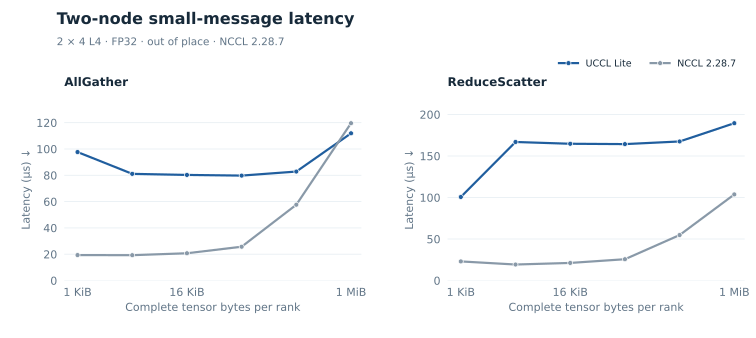
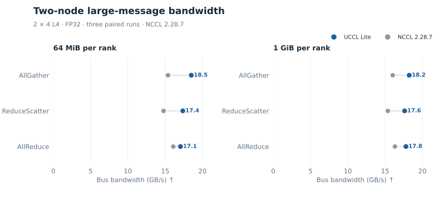

# Two-node collectives

All network benchmarks use two nodes with four L4 GPUs each. Local ranks 0/1
map to `mlx5_0` and ranks 2/3 to `mlx5_1`. Reported latency is the slowest of
eight ranks. Bus bandwidth multiplies complete bytes per rank divided by time
by `7/4` for AllReduce and `7/8` for AllGather/ReduceScatter.

## Hierarchical GPUDirect

[multinode_allreduce.cu](../src/collectives/multinode_allreduce.cu) performs:

```text
local ring ReduceScatter
    → exchange reduced quarters with corresponding ranks on the other node
    → local ring AllGather
```

The local ring is `0 → 1 → 3 → 2 → 0`. All four GPUs inject traffic across two
rails. Independent local and IB progress paths overlap piecewise network traffic
with local communication. Immutable IB slots avoid overwriting a source while
the NIC still reads it.

The reference sweep searches 1/2/4/8 MiB pieces (`-k`) and pipeline distances
1/2/4 (`-d`). The per-size best median beats the faster tested NCCL version from
32 MiB upward, reaching 18.06 GB/s at 64 MiB and 17.80 GB/s at 1 GiB. Small
messages lose because dependent proxy phases impose an approximately 80 µs floor.

A fresh [paired current-source sweep](../benchmarks/data/multinode_peer_20261110/summary_ar.csv)
uses one fixed default UCCL Lite configuration and NCCL 2.28.7 in-place
AllReduce, both with slowest-rank CUDA events. Across 32 MiB–1 GiB, all six
sizes have non-overlapping three-run ranges and higher UCCL Lite bandwidth. At
64 MiB, bus bandwidth is **17.05 versus 16.08 GB/s**; at 1 GiB, it is
**17.79 versus 16.31 GB/s**. This current result is separate
from the older best-per-size comparison above.

## Hierarchical AllGather and ReduceScatter

The same [multi-node executable](../src/collectives/multinode_allreduce.cu)
now accepts `--op allgather` and `--op reducescatter`. Both are out-of-place
float32 paths for exactly two nodes with four peer-accessible L4s each. They
use the existing local CUDA-IPC channels and the rail map above.

AllGather sends each rank's shard over IB to its corresponding rank on the
other node. Local rings forward the four local shards while IB is in flight,
then forward the four received shards. The ring order is `0 → 1 → 3 → 2 → 0`.
`--ag-ring 1` selects this path; the flat multicast is retained as a slower
comparison. Each global-rank output interval has one producer.

ReduceScatter first groups input shards by local destination and sums the four
local contributions. It exchanges one remote-destination partial with the
corresponding rank across nodes, then adds the received partial to the local
output. `--rs-ring 1 --rs-direct-ring 1 --rs-piece-bytes 8388608 -B 96 -T 512`
selects the measured path. It reads the **standard rank-ordered input directly**
and keeps each in-flight local partial in its own receive slot. The input is
immutable throughout the collective. The fixed piece rule uses at least two
pieces per destination shard and targets no more than 8 MiB per piece; it
reaches 16 pieces at 1 GiB. IB source slots remain unchanged until flush. A
launch occupancy check rejects grids that cannot reside together, because the
kernels synchronize across the grid. Earlier GPU-packing and prepacked-input
experiments remain archived but are excluded from the final comparison.



At 1 KiB, AllGather takes **97.66 µs** versus **19.36 µs** for NCCL 2.28.7,
and ReduceScatter takes **100.66 versus 23.03 µs**. At 1 MiB, AG reaches
**111.92 versus 119.60 µs**, while RS still loses at **189.54 versus
103.76 µs**. The latency figure omits the anomalous 512-KiB NCCL point;
the complete sweep retains it.



The bandwidth figure uses the [32–64 MiB paired summary](../benchmarks/data/multinode_peer_20261110/summary.csv),
[128 MiB–1 GiB summary](../benchmarks/data/multinode_peer_20261110/summary_large.csv),
and [in-place AR summary](../benchmarks/data/multinode_peer_20261110/summary_ar.csv).
At 64 MiB, AG/RS/AR reach **18.50 / 17.36 / 17.05 GB/s** versus
**15.38 / 14.78 / 16.08 GB/s** for NCCL. The full
[128-MiB–1-GiB paired sweep](../benchmarks/data/multinode_peer_20261110/summary_large.csv)
extends the checked comparison:

| Complete bytes/rank | AG UCCL / NCCL | RS UCCL / NCCL | AR UCCL / NCCL |
| ---: | ---: | ---: | ---: |
| 128 MiB | 18.20 / 15.93 | 17.54 / 15.25 | 16.96 / 16.18 |
| 256 MiB | 18.14 / 16.00 | 17.59 / 15.28 | 16.97 / 16.29 |
| 512 MiB | 18.16 / 16.04 | 17.57 / 15.34 | 17.50 / 16.29 |
| 1 GiB | 18.23 / 16.02 | 17.62 / 15.36 | 17.79 / 16.31 |

All table values are bus bandwidth in decimal GB/s. This uses complete bytes
per rank divided by time, multiplied by `7/8` for AG/RS and `7/4` for AR.

The full 1-KiB–1-GiB AG/RS data retain every regression. The bandwidth figure
selects 64 MiB and 1 GiB; all intermediate points remain in the CSVs. At
512 KiB the NCCL AG/RS timing is anomalously high, and at 8 MiB one RS run
is slow. Those points are retained in the data and excluded from the selected
latency view.

These are three paired repetitions, alternating backend order. Each repetition
has five warmups and ten timed calls. Both use one GPU per MPI rank, eight ranks,
FP32, and slowest-rank CUDA-event time; validation and initialization are
outside timing. NCCL uses MPI-enabled nccl-tests 2.19.7 with NCCL 2.28.7,
`-a 3`, default P2P/GDR, and both `mlx5_0,mlx5_1` HCAs. Each UCCL Lite
operation checks three changed input generations per size; NCCL reports zero
wrong and out-of-bounds values. The workload is a native primitive comparison,
not an application benchmark or a runtime peer/NCCL selector. The
[paired launcher](../scripts/run_multinode_peer_compare.sh),
[validator](../scripts/summarize_multinode_peer.py), and
[plotter](../scripts/plot_multinode_peer.py) reproduce the logs, table and SVG.
[Raw-log provenance and excluded prepacked-input runs](../benchmarks/data/multinode_peer_20261110/README.md)
identify the exact binaries and limitations.

## Pinned-host CPU router

[multinode_cpu_router.cu](../src/collectives/multinode_cpu_router.cu) retains
the local GPU ring but routes inter-node shards through pinned host buffers and
MPI/UCX. The default has no GPU RDMA registration. NUMA-local rank placement and
1 MiB double-buffered pieces achieve 15.93 GB/s at 1 GiB.

The source also retains explicitly selected experiments:

| Option | Behavior | Recorded outcome |
| --- | --- | --- |
| `-r cpu` | Reduce received host partials on CPU before H2D | About 1.1% slower than GPU reduction |
| `-m fused --direct-recv 1` | Final local reduction writes GPU and mapped host output; NIC writes remote GPU | 16.75 GB/s at 1 GiB; requires receive-side GDR |
| Add `--inband 1` | Ordered RDMA host doorbell replaces per-piece MPI handshake | 16.73 GB/s; effectively tied |

The fused transport still completes the entire local ReduceScatter before
posting network pieces. Removing handshakes cannot recover overlap that the
producer schedule does not expose. A device-triggered mapped-host PortChannel
variant encountered IB remote-access errors; it is not the validated fast path.

## No GPU P2P and no GPUDirect

[host_allreduce.cu](../src/collectives/host_allreduce.cu) is the strict fallback:
each piece uses synchronous D2H, CPU MPI_Allreduce, and synchronous H2D. It
registers no GPU memory with the NIC and makes no CUDA-IPC peer transfer.

[host_hierarchical_allreduce.cu](../src/collectives/host_hierarchical_allreduce.cu)
instead performs three local ReduceScatter steps through host buffers, exchanges
one reduced quarter between nodes, and performs three local AllGather steps.
Arithmetic remains on the GPU, but the reliable path serializes all staging.

At 1 GiB, the strict and hierarchical fallbacks reach 5.06 and 4.96 GB/s,
respectively. Under the same no-P2P/no-GDR restrictions, NCCL 2.28.7 reaches
14.23 GB/s. The bottleneck is serialized
staging, CPU work, and synchronization, not simply network bandwidth.

**Do not use `--persistent 1` as a correctness-qualified implementation.**
That opt-in mapped-host prototype intermittently loses or reuses complete rank
segments. It is retained for investigation and excluded from reported results.
Its shared-memory names also assume one job at a time per host. The default
synchronous path is the reliable comparison.
