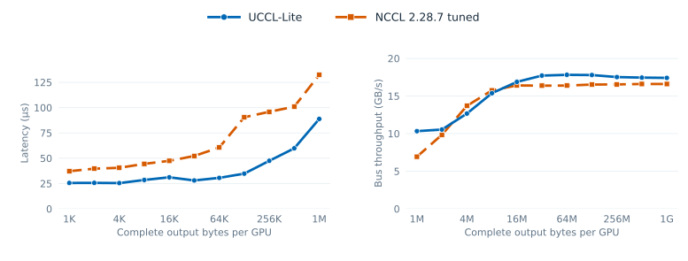
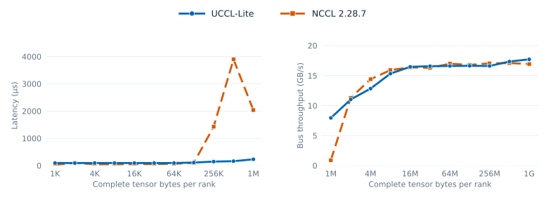
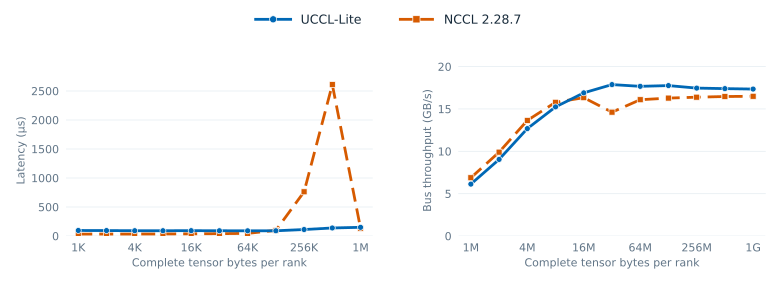
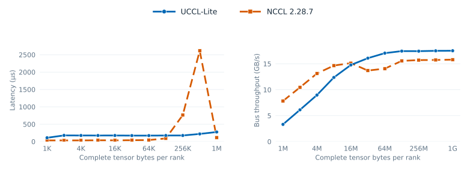

# Two-node collectives

## Direct local schedules

The [November 11 two-node paired sweep](../benchmarks/data/multinode_serial_20261111/README.md)
uses one CTA per GPU to visit the three local CUDA-IPC peers sequentially.
GPU semaphores complete the local phases while the IB PortChannel remains
independent. AllReduce uses direct local ReduceScatter, IB exchange, and
direct local AllGather through 1 MiB. The direct AllGather candidate uses
local writes through 2 MiB; the main figure now selects the host multicast
candidate through 256 KiB and resumes the direct candidate at 512 KiB.
ReduceScatter uses direct local writes and reduction through 1 MiB. Larger
sizes retain the previously measured ring and packed paths.





The current figures match eight FP32 GPUs, full bytes per GPU,
slowest-process host enqueue+completion timing, 20 warmups, three alternating
paired rounds of ten calls, and complete output checks on every invocation.
At 64 KiB, selected UCCL Lite AR/AG/RS take **47.08/30.58/34.59 µs** versus
their paired NCCL 2.28.7 controls **69.57/60.62/42.61 µs**. AllGather's
selected point uses four MPI processes; AR/RS use eight. At 1 KiB, AR loses;
the host-multicast AG median wins, with a retained outlier round. AR/RS and
the larger AG points use the
[tuned NCCL protocol policy](../benchmarks/data/nccl_tuned_2x4l4_20261111/README.md).
The host-multicast AG points use default NCCL through 64 KiB and RING+SIMPLE
at 128/256 KiB. Every selected point has its own paired NCCL control.
The latency panels retain the same linear style as the eight-L4 figures.
The [selected AllGather data](../benchmarks/data/host_multicast_selected_2x4l4_20261111/README.md)
records the four-process host path through 256 KiB and the eight-process
direct path after that threshold, each with a same-harness paired NCCL control.
The [targeted NCCL diagnosis](../benchmarks/data/nccl_spike_2x4l4_20261111/README.md)
shows that default `RING + LL` causes the spike on this topology; forcing
`SIMPLE` while keeping the ring and two channels removes it. The exact
internal LL wait remains unisolated.

## Previous adaptive local schedules

The November 10 follow-up on the same two four-L4 hosts kept FP32, rank placement,
NCCL 2.28.7, slowest-rank host enqueue+completion timing, five warmups,
three backend-alternating runs, ten timed calls per run, and complete
per-call output checks. A per-size UCCL policy uses flat local AG at
2 KiB–512 KiB, then ring AG; AllReduce uses flat local gather through
256 KiB. ReduceScatter uses flat local reduction at 2 KiB–512 KiB,
one-piece GPU-packed ring at 1–16 MiB, and direct ring at 1 KiB and from
32 MiB upward. The path for every size is in the summary CSV.

The packed RS path cuts 1-MiB UCCL latency from **276.3 to 135.1 µs**;
its paired NCCL control takes **117.6 µs**, so this size still loses.
At 2/4/8 MiB, optimized RS takes **182.5/291.8/509.4 µs** versus
NCCL **177.1/279.6/499.0 µs**. Across the complete sweep, fourteen
RS sizes improve by more than 3% over the earlier UCCL path, with
non-overlapping run ranges at thirteen. AG improves at nine sizes and AR
at seven by that median criterion. Small-message AR/AG/RS remain slower
than NCCL; the later large-message crossover remains visible in the
recorded CSVs. The NCCL AR 1-MiB timing anomaly is retained separately and is
not treated as a stable gain.

[Complete optimized summary](../benchmarks/data/optimization_20261110/multinode_summary.csv) ·
[raw logs, per-call samples and ablations](../benchmarks/data/optimization_20261110/README.md).

## Timing correction for the earlier peer sweep

The November 10 `multinode_peer_20261110` archive used UCCL Lite
`--gpu-timing 1` CUDA events, while the `nccl-tests` main time column came
from host timing. Its side-by-side latency and bandwidth values are retained
as historical diagnostics, but their ratios are **not a matched timing
comparison**. The refreshed comparison under
[refresh_20261110](../benchmarks/data/refresh_20261110/README.md) uses
host enqueue+completion timing for both backends and checks every call.

## November 10 matched two-node refresh

The fresh sweep uses `mibura-sky-test-02` and l40 (`mibura-sky-test-01`),
four L4 GPUs and two active IB HCAs per node. GPUs 0/1 and `mlx5_0` share
NUMA node 0; GPUs 2/3 and `mlx5_1` share NUMA node 1. Both hosts have full
local GPU peer access. The owner uses driver 595.58.03, l40 uses
580.178.04; both use CUDA 12.9, Open MPI 4.1.7rc1, UCX 1.19.0, and the
same NCCL 2.28.7 library and copied MSCCL++ binaries.

The FP32 AllReduce is in place; AllGather and ReduceScatter are out of
place. Each size is the complete byte extent per rank. UCCL Lite and
NCCL use slowest-rank host enqueue+completion time, one process per GPU,
five warmups, ten timed calls, and three backend-alternating repetitions.
Each warmup and timed call's complete output is checked. The custom NCCL
AR/AG/RS control uses the same rank layout, `ibp55s0f0` bootstrap interface,
and `mlx5_0,mlx5_1` rails; P2P/GDR use NCCL defaults.







| Complete bytes/rank | AR UCCL / NCCL (ms) | AG UCCL / NCCL (ms) | RS UCCL / NCCL (ms) |
| ---: | ---: | ---: | ---: |
| 64 MiB | 7.075 / 6.914 | 3.323 / 3.649 | 3.445 / 4.175 |
| 1 GiB | 106.115 / 110.971 | 54.152 / 56.947 | 53.653 / 59.488 |

At 1 GiB, AR/AG/RS have lower latency with non-overlapping three-run ranges.
All three UCCL paths lose at 1 KiB. NCCL AR at 1 MiB has a repeated,
highly variable delay; the targeted recheck and raw samples are retained.
No stable 1-MiB gain is claimed from that point.

[AR/AG/RS full summary](../benchmarks/data/refresh_20261110/multinode_paired_summary.csv) ·
[raw logs, per-call samples and topology](../benchmarks/data/refresh_20261110/README.md).

All network benchmarks use two nodes with four L4 GPUs each. Local ranks 0/1
map to `mlx5_0` and ranks 2/3 to `mlx5_1`. Reported latency is the slowest of
eight ranks. Bus bandwidth multiplies complete bytes per rank divided by time
by `7/4` for AllReduce and `7/8` for AllGather/ReduceScatter.

## Hierarchical GPUDirect

[multinode_allreduce.cu](../src/collectives/multinode_allreduce.cu) performs:

```text
local ring ReduceScatter
    → exchange reduced quarters with corresponding ranks on the other node
    → local ring AllGather
```

The local ring is `0 → 1 → 3 → 2 → 0`. All four GPUs inject traffic across two
rails. Independent local and IB progress paths overlap piecewise network traffic
with local communication. Immutable IB slots avoid overwriting a source while
the NIC still reads it.

The reference sweep searches 1/2/4/8 MiB pieces (`-k`) and pipeline distances
1/2/4 (`-d`). Its selected UCCL Lite path reaches 18.06 GB/s at 64 MiB and
17.80 GB/s at 1 GiB, measured with CUDA events. A separate host-clock NCCL
number cannot establish a speedup from this archive. Small UCCL messages
incur an approximately 80 µs floor from dependent proxy phases.

A historical [fixed-configuration sweep](../benchmarks/data/multinode_peer_20261110/summary_ar.csv)
records in-place AllReduce with the same UCCL Lite path at every size. Its
mixed-timer NCCL ratios are diagnostic only and are excluded from the new
comparison. This fixed-path archive is separate from the older
best-per-size search above.

## Hierarchical AllGather and ReduceScatter

The same [multi-node executable](../src/collectives/multinode_allreduce.cu)
now accepts `--op allgather` and `--op reducescatter`. Both are out-of-place
float32 paths for exactly two nodes with four peer-accessible L4s each. They
use the existing local CUDA-IPC channels and the rail map above.

AllGather sends each rank's shard over IB to its corresponding rank on the
other node. Local rings forward the four local shards while IB is in flight,
then forward the four received shards. The ring order is `0 → 1 → 3 → 2 → 0`.
`--ag-ring 1` selects this path; the flat multicast is retained as a slower
comparison. Each global-rank output interval has one producer.

ReduceScatter first groups input shards by local destination and sums the four
local contributions. It exchanges one remote-destination partial with the
corresponding rank across nodes, then adds the received partial to the local
output. `--rs-ring 1 --rs-direct-ring 1 --rs-piece-bytes 8388608 -B 96 -T 512`
selects the measured path. It reads the **standard rank-ordered input directly**
and keeps each in-flight local partial in its own receive slot. The input is
immutable throughout the collective. The fixed piece rule uses at least two
pieces per destination shard and targets no more than 8 MiB per piece; it
reaches 16 pieces at 1 GiB. IB source slots remain unchanged until flush. A
launch occupancy check rejects grids that cannot reside together, because the
kernels synchronize across the grid. Earlier GPU-packing and prepacked-input
experiments remain archived but are excluded from the final comparison.

The older AG/RS/AR sweep used three alternating repetitions, five warmups,
and ten calls per repetition on eight FP32 ranks. UCCL Lite reported
CUDA-event time, while MPI-enabled `nccl-tests` 2.19.7 with NCCL 2.28.7
reported host time. The [complete raw logs and mixed-timer figures](../benchmarks/data/multinode_peer_20261110/README.md)
remain available to inspect transport behavior, regressions, and the anomalous
512-KiB NCCL point. They are excluded from the refreshed README comparison.

## Experimental host multicast AllGather

[multinode_host_allgather.cu](../src/collectives/multinode_host_allgather.cu)
implements the two-copy host route on the 2+2 NUMA topology. Each NUMA
group's two GPUs upload to pinned local host packets. Its local HCA sends
the same packet to both remote NUMA groups; a local host exchange supplies
the other local group's shards. Two GPUs per group read the shared packet
through mapped host memory. Three slots overlap upload, UCX/IB transfer,
and GPU multicast, with sender and reader completions guarding reuse.

The [checked small/medium comparison and raw data](../benchmarks/data/host_rdma_multicast_2x4l4_20261111/README.md)
separates UCX automatic transport from forced `put_zcopy` RDMA WRITE. In
three-way alternating rechecks, the automatic eager path takes 24.97 µs at
1 KiB versus direct UCCL 30.66 µs and NCCL 32.53 µs. At 2 MiB, forced
RDMA WRITE with 128 KiB packets takes 160.63 µs versus direct UCCL
195.35 µs and NCCL 200.94 µs. The 4-MiB forced-write path ties direct
UCCL and loses to NCCL; the 1-GiB path is slower. These candidate runs
use four MPI processes controlling eight GPUs, while the direct path and
the previous main NCCL control use eight processes. The path remains opt-in
at runtime. The main AllGather figure now selects its UCX-auto variant
through 256 KiB; the [selection record](../benchmarks/data/host_multicast_selected_2x4l4_20261111/README.md)
documents the MPI layout change and the 256-KiB regression versus direct UCCL.

## Pinned-host CPU router

[multinode_cpu_router.cu](../src/collectives/multinode_cpu_router.cu) retains
the local GPU ring but routes inter-node shards through pinned host buffers and
MPI/UCX. The default has no GPU RDMA registration. NUMA-local rank placement and
1 MiB double-buffered pieces achieve 15.93 GB/s at 1 GiB.

The source also retains explicitly selected experiments:

| Option | Behavior | Recorded outcome |
| --- | --- | --- |
| `-r cpu` | Reduce received host partials on CPU before H2D | About 1.1% slower than GPU reduction |
| `-m fused --direct-recv 1` | Final local reduction writes GPU and mapped host output; NIC writes remote GPU | 16.75 GB/s at 1 GiB; requires receive-side GDR |
| Add `--inband 1` | Ordered RDMA host doorbell replaces per-piece MPI handshake | 16.73 GB/s; effectively tied |

The fused transport still completes the entire local ReduceScatter before
posting network pieces. Removing handshakes cannot recover overlap that the
producer schedule does not expose. A device-triggered mapped-host PortChannel
variant encountered IB remote-access errors; it is not the validated fast path.

## No GPU P2P and no GPUDirect

[host_allreduce.cu](../src/collectives/host_allreduce.cu) is the strict fallback:
each piece uses synchronous D2H, CPU MPI_Allreduce, and synchronous H2D. It
registers no GPU memory with the NIC and makes no CUDA-IPC peer transfer.

[host_hierarchical_allreduce.cu](../src/collectives/host_hierarchical_allreduce.cu)
instead performs three local ReduceScatter steps through host buffers, exchanges
one reduced quarter between nodes, and performs three local AllGather steps.
Arithmetic remains on the GPU, but the reliable path serializes all staging.

At 1 GiB, the strict and hierarchical fallbacks reach 5.06 and 4.96 GB/s,
respectively. Under the same no-P2P/no-GDR restrictions, NCCL 2.28.7 reaches
14.23 GB/s. The bottleneck is serialized
staging, CPU work, and synchronization, not simply network bandwidth.

**Do not use `--persistent 1` as a correctness-qualified implementation.**
That opt-in mapped-host prototype intermittently loses or reuses complete rank
segments. It is retained for investigation and excluded from reported results.
Its shared-memory names also assume one job at a time per host. The default
synchronous path is the reliable comparison.
