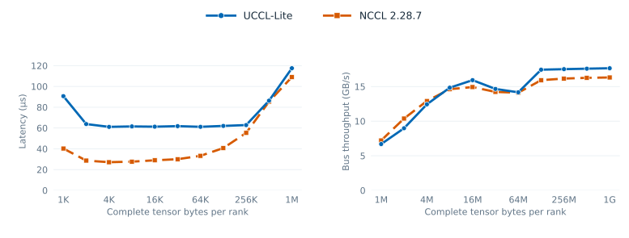
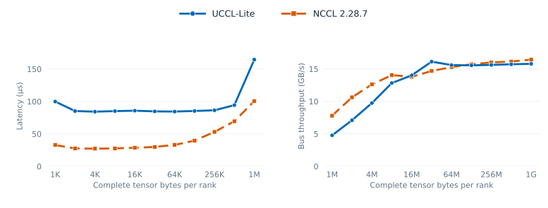

# Four-GPU peer AllGather and ReduceScatter

## November 10 refreshed sweep

The current-source sweep on `mibura-sky-test-02` uses four L4s in 2+2 NUMA
order, driver 595.58.03, CUDA 12.9 and NCCL 2.28.7. Both direct-peer and
NCCL run in one process with the same FP32 out-of-place buffers, complete
bytes per rank, slowest-rank per-call CUDA-event timer, and alternating order.
Each of three repetitions has five warmups and ten timed calls. Every warmup
and timed output is fully checked with a changed input generation. A separate
1008-byte non-power-of-two tail check passes.





| Complete bytes/rank | AG peer / NCCL (µs) | RS peer / NCCL (µs) |
| ---: | ---: | ---: |
| 1 KiB | 90.666 / 40.282 | 99.914 / 32.938 |
| 1 MiB | 117.491 / 109.014 | 164.496 / 100.739 |
| 32 MiB | 1717.338 / 1769.373 | 1560.730 / 1714.086 |
| 1 GiB | 45644.624 / 49371.273 | 51001.610 / 49011.466 |

The 1-GiB AG result is 1.082× faster; RS loses by about 4%. Small-message
losses remain substantial. The [complete summary](../benchmarks/data/refresh_20261110/single_peer_summary.csv),
[2,520 timed call samples](../benchmarks/data/refresh_20261110/single_peer_samples.csv),
[raw log](../benchmarks/data/refresh_20261110/single_peer_ag_rs_raw.log),
and [tail check](../benchmarks/data/refresh_20261110/single_peer_tail_1008.log)
retain every size and repetition. The older sweep below is historical and
uses a different per-run batch timing method.

[peer_ag_rs.cu](../src/collectives/peer_ag_rs.cu) is a standalone float32
implementation and matched NCCL benchmark for the four-GPU PCIe host. It
requires CUDA peer access among all four devices and uses one process. It is
separate from the BF16 CPU router and the historical eight-GPU no-P2P result.

Each source GPU sends its AllGather shard to a distinct output region on every
destination. For ReduceScatter, each source sends the destination's input shard
to that destination's scratch. A destination kernel sums four received arrays
in FP32 and owns every output element. Cross-device CUDA events make each
destination wait for all source transfers. Before reusing ReduceScatter
scratch, sources wait for the preceding destination reduction. The source
tensors remain immutable until completion. The rotating enqueue order spreads
first transfers across peers; CUDA is free to overlap later phases.

The harness validates every output element against a position-sensitive
reference for three changed input generations, including one after timing.
A separate 1008-byte run checks the non-power-of-two tail. The supported byte
count is a multiple of 16, because the four ranks each own an integral number
of float32 elements. Both operations are out of place.

```bash
make peer_ag_rs NCCL_HOME=/path/to/nccl/build
./build/uccl_lite_peer_ag_rs -b 1024 -e 67108864 -w 5 -n 10 -r 3
./build/uccl_lite_peer_ag_rs -b 1008 -e 1008 -w 2 -n 10 -r 3
```

## Measured result

The [complete 17-size sweep](../benchmarks/data/peer_ag_rs_4l4_20261110.txt)
was run November 10, 2026 on four NVIDIA L4s, PCIe Gen4 x16, NUMA pairs
`(0,1)` and `(2,3)`, driver 595.58.03, CUDA 12.9 and NCCL 2.28.7. Each
backend uses the same process, buffers, streams, dtype, size, and timing
method. The order alternates across three repetitions. Each repetition has
five warmups and ten timed calls; the recorded latency is the slowest-rank
CUDA-event interval divided by ten. The table shows medians of repetition
values. Allocation, fill and correctness checking are outside timing. The
complete file also retains each backend's min/max run values. No per-size
variant selection is used.

Small-message latency (peer / NCCL, lower is better):

| Complete bytes/rank | AllGather | ReduceScatter |
| ---: | ---: | ---: |
| 1 KiB | 56.42 / 19.43 µs | 79.97 / 19.66 µs |
| 1 MiB | 77.33 / 83.34 µs | 108.95 / 76.49 µs |

Large-message bus bandwidth (peer / NCCL, higher is better):

| Complete bytes/rank | AllGather | ReduceScatter |
| ---: | ---: | ---: |
| 8 MiB | 16.93 / 15.84 GB/s | 16.19 / 15.04 GB/s |
| 16 MiB | 17.81 / 16.36 GB/s | 17.25 / 15.33 GB/s |
| 32 MiB | 18.19 / 16.46 GB/s | 17.56 / 15.42 GB/s |
| 64 MiB | 17.87 / 16.57 GB/s | 16.18 / 16.42 GB/s |

For four ranks, bus bandwidth is complete bytes per rank divided by time,
multiplied by `3/4`. It is a useful-byte collective metric, not one PCIe
link's wire rate.

AG has a lower median latency on 7/17 sizes, from 1 through 64 MiB, with
non-overlapping recorded timing ranges. RS has a lower median on 4/17 sizes;
its 4-MiB advantage is only 1.2%, while 8–32 MiB exceed 3% with
non-overlapping ranges. The small-message and 64-MiB RS losses remain in the
data. This benchmark does not install a runtime dispatch policy or establish
performance on another topology, dtype, in-place layout, or node count.
