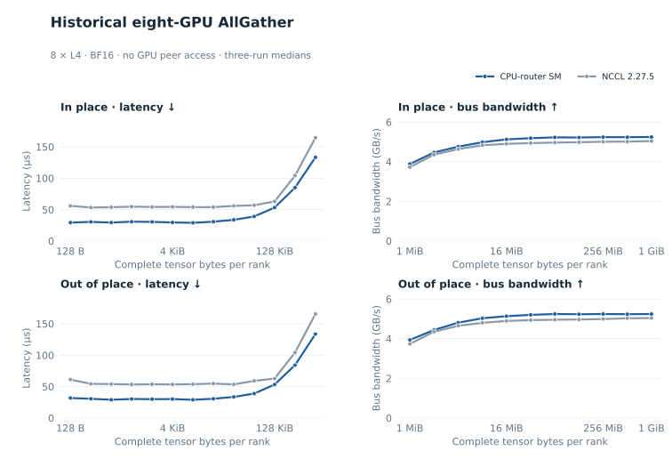
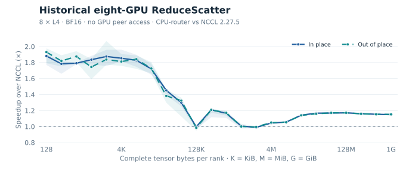

# Standalone AllGather and ReduceScatter reference results

These are historical results from the CPU-router primitive branch, now ported
as the [optional CPU-router module](cpu-router.md). `make adaptive-collectives`
builds a standalone BF16 AR/AG/RS dispatcher and calibration benchmark. The included dense
fusion benchmarks exercise AG/RS as part of communication–GEMM pipelines;
their timings must not be used as standalone collective measurements.

## Provenance

The [summary](../benchmarks/data/primitives_8l4.csv) retains the CPU-router
and NCCL rows from the matched historical rerun committed as
`9d088c97442659a41a3db2225659d71f3bac6ab5` in the source project's history.
It includes the ReduceScatter fix from `822fdcb`, not the earlier October 10
baseline or exploratory before/after tuning samples. The retained rows are
historical measurements; no new eight-GPU run was performed for this edit.

The retained CSV SHA-256 is
`3703360a23ba17b4f1ac22c4cd0a37e425381e56af265823765d914f0f7bebdc`.
It contains 288 summary rows: three collectives × two placements × two backends
× 24 sizes. AllReduce rows are retained for completeness; the README uses this
file for its historical eight-GPU result table, and this page shows the
standalone AllGather and ReduceScatter figures.

The data import was followed by a modular runtime port with new four-GPU
validation. No application integration or NCCL interposition adapter is included.
No eight-GPU benchmark was rerun for these figures.

## Hardware and method

- One node, eight NVIDIA L4 GPUs, CUDA 12.9, driver 580.178.04.
- NUMA map `[0,0,0,0,1,1,1,1]`; CUDA reports no GPU peer access.
- BF16, sum reduction for ReduceScatter; 128 B–1 GiB doubling sizes.
- One process and one submitting thread pinned to CPU 23.
- Five warmups, ten timed iterations, three repetitions with backend order
  rotated between repetitions; both in-place and out-of-place are measured.
- Both retained backends use the same per-collective unmodified nccl-tests 2.21.1
  executable, revision `afd59abab774a6a4b492eb344bd0c845a0b7bb4d`, built against
  NCCL 2.18.3 headers. Buffers use `cudaMalloc`; `-p 1` ensures allocation in
  that version's initialization path.
- The retained rows report zero wrong values in all 864
  run/size/placement measurements across 18 sweeps.

| CSV backend | Figure label | Meaning |
| --- | --- | --- |
| `kernel` | CPU-router SM · historical | GPU SM transfer kernels over registered host packets, CPU operators, two-slot ownership protocol |
| `nccl` | NCCL 2.27.5 | Native newer NCCL reference |

## Primitive implementation and the ReduceScatter fix

The CPU-router runtime composes collectives from registered memory spans,
GPU/host channels, CPU operators, generation counters, and reader credits.
AllGather publishes host packet views and has each GPU gather rank-ordered
slices. ReduceScatter uses a BF16 reduction tree with FP32 accumulation and
documented BF16 rounding boundaries. Two packet slots overlap upload, processing,
and consumption; storage is not reused until its readers release ownership.

The measured ReduceScatter fix sizes packets from the destination shard extent,
within 128–512 KiB packet bounds, and raises the worker cap to 16 per NUMA node,
still constrained by the 8,192-element CPU grain. It improves medium-message
overlap. AllGather keeps its existing packet geometry. The figures use one
explicit SM transport, with no internal NCCL fallback or per-size backend switch.

## Reading the figures

For both operations, decimal bus bandwidth is algorithm bandwidth × `7/8`.
AllGather's byte count is the complete output on each rank; ReduceScatter's
byte count is the complete input on each rank. It is not a single peer's payload
and not one physical PCIe link's wire rate.

Each row shows one placement. The left panels use median latency through
512 KiB; the right panels use bus bandwidth from 1 MiB to 1 GiB. Lower latency
and higher bandwidth are better. The full 24-size sweep and three-run min–max
values remain in the CSV. These eight-GPU BF16 results cannot be directly
ranked against the four-GPU float32 results.

At 1 GiB in-place:

| Collective | CPU-router SM | NCCL 2.27.5 |
| --- | ---: | ---: |
| AllGather | 5.25 GB/s | 5.04 GB/s |
| ReduceScatter | 5.59 GB/s | 4.86 GB/s |

Regenerate both plots, together with the other reference figures, using
`python3 scripts/plot_results.py --preview`. This redraws committed measurements;
reproducing the historical benchmark requires its recorded source revision and
eight-GPU testbed. The new port has its own build, selection, and calibration
instructions in [cpu-router.md](cpu-router.md).
