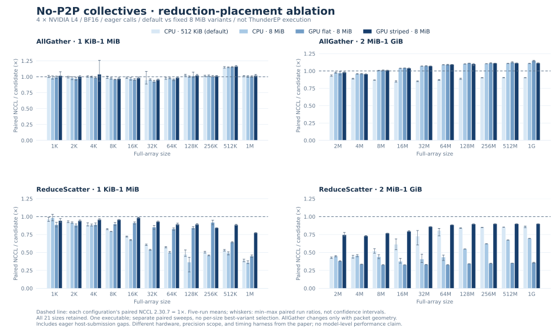

# Experimental reduction placement and destination striping

This experiment targets the no-P2P ReduceScatter bottleneck in local tests. It
is **opt-in**. CPU reduction remains the default; no new mode is enabled from
GPU count alone. These changes do not establish complete-inference acceleration.

## The architectural question

Offloading arithmetic to a GPU removes CPU partial-reduction and merge work,
but it increases download traffic: each destination must read every remote
contribution instead of one CPU-reduced result. Arithmetic placement and link
utilization therefore need separate ablations.

The original packet traversal follows a flat source array. In ReduceScatter,
many consecutive packets belong to a single destination's shard. Moving the
sum to the GPU without changing that schedule concentrates remote reads on
one receiving GPU until its shard is drained.

The new experimental layout transposes **host packet placement and traversal**,
not the public tensor layout:

| Schedule | Contents of one staged packet | Concurrent destination work |
| :--- | :--- | :--- |
| Flat | One interval of the concatenated destination shards | Usually one destination at large sizes |
| Interleaved | One stripe from each destination shard | Every destination consumes its own stripe |

Each source writes the remote-destination stripes into one bounded pinned host
packet. Each destination GPU sums the corresponding stripe across source
packets, retains its own contribution locally, and writes contiguous final
output. All ranks can use their receive links in the same packet generation.
No P2P, GPU RDMA, extra host routing metadata transfer, or public tensor-layout
change is required. The SM transport performs the strided upload; this is not
a DMA implementation or a dynamic MoE routing implementation.

Interleaved packet sizing now targets two stripes for the **whole collective**
when capacity permits, rather than inheriting the flat algorithm's two packets
per destination. The packet upper bound is independently configurable. In the
reported experiment, three 1-GiB probes compared 512 KiB, 2 MiB and 8 MiB bounds;
8 MiB was then fixed for the full sweep. There is no per-message winner selection.

## Measured local outcome



All four plotted configurations use the same executable and each has a separate
paired NCCL 2.30.7 sweep: 21 sizes × two collectives × two backends × five runs
× twenty timed calls, totaling **33,600 checked timed invocations**. The graph
shows ratios against each configuration's own NCCL run; whiskers are paired
run min/max ranges, not confidence intervals. The default 512-KiB path is retained
to avoid comparing only against a poorly configured large-packet CPU baseline.

| ReduceScatter | CPU default, 512 KiB | CPU, 8 MiB | Flat GPU, 8 MiB | Interleaved GPU, 8 MiB |
| :--- | ---: | ---: | ---: | ---: |
| 1 MiB full array | 245.650 µs | 265.412 µs | 220.043 µs | **123.812 µs** |
| 1 GiB full array | 54.730 ms | 69.850 ms | 130.933 ms | **51.273 ms** |
| 1 GiB paired NCCL / candidate | 0.863× | 0.696× | 0.360× | **0.899×** |

Destination interleaving is substantially better than the flat GPU experiment,
and roughly halves the measured 1-MiB latency versus the CPU default. **It still
loses to NCCL at every measured ReduceScatter size.** At 1 GiB, the interleaved
path's paired NCCL baseline is about 46.1 ms. Neither a large packet nor moving
arithmetic to the GPU alone solves the problem.

The 8-MiB packet configuration improves large AllGather: the interleaved-option
run records 42.438 ms versus its NCCL baseline, a **1.115×** ratio at 1 GiB.
That is a packet-geometry benefit in the unchanged gather algorithm, not a
new reduction mechanism or evidence of end-to-end superiority.

[Raw samples, all summaries and provenance](../benchmarks/data/reduction-placement/ablation_provenance.json)
include all four full sweeps, the three size-selection probes, and the negative
version-1 development summaries. The full development logs/raw samples remain
in the local run directories listed in provenance. The source and binary hashes
identify each stage; current figures never mix points from those earlier stages.

```bash
python3 scripts/plot_reduction_ablation.py --preview
```

This separate figure does not change or restore the removed README gallery.

## Three controlled configurations

```cpp
uccl_lite::cpu_router::CpuRouterOptions options;

// Existing NUMA-local CPU partials and destination-owned CPU merge (default).
options.reduction = uccl_lite::cpu_router::ReductionPlacement::Cpu;

// Destination-GPU FP32 sum, existing flat packet traversal.
options.reduction = uccl_lite::cpu_router::ReductionPlacement::Gpu;

// Destination-GPU FP32 sum, concurrent destination stripes for ReduceScatter.
options.interleaveScatter = true;
```

The GPU paths accumulate BF16 inputs in FP32 and round once to BF16. The CPU
path rounds intermediate NUMA partials to BF16. Their floating-point orders
are intentionally not presented as bitwise identical on arbitrary inputs.
AllGather is unaffected by arithmetic placement; the interleave option applies
only to ReduceScatter. AllReduce/reduce use the flat GPU sum when GPU placement
is selected. Broadcast and gather retain their existing copy implementation.

`CollectiveDispatcher` binds calibration to the placement and packet-order
identity. A GPU-placement profile cannot enable CPU placement, the old CPU
reference cannot enable either GPU mode, and a flat-GPU profile cannot enable
interleaved scatter. Unmeasured automatic mode invokes the existing fallback
without initializing router workers or buffers. The experiment is not yet a
three-way automatic placement selector: the caller chooses an option, and
the existing policy gates that configured candidate against its fallback.

The standalone benchmark now fingerprints NCCL environment variables and its
standard configuration files in the fallback identity. A calibration made with
P2P disabled must not enable a backend when P2P is subsequently enabled. A new
benchmark identity epoch invalidates older local profiles that omitted this
distinction; re-calibrate instead of reusing the research-run profile files.
The fingerprint is a configuration cache key, not a security primitive. External
callers remain responsible for supplying their own complete fallback identity.

## Ownership and unsupported combinations

Both GPU paths reuse the existing two-bank generation/credit protocol. The
CPU control worker waits for source uploads, publishes readiness, and releases
input banks only after all designated GPU readers acknowledge completion.
GPU arithmetic consumes immutable host packets. Destination interleaving keeps
this ownership rule; changing packet order does not permit early buffer reuse.
Non-destination ranks still participate in the required protocol, and partial
final stripes do not expose padding as tensor elements.

The current implementation supports standalone SM transport, in-place and
out-of-place calls, masks, and explicit graph capture/replay. It rejects GPU
reduction with DMA transport or resident GEMM fusion. Interleaved scatter also
rejects flat producer-event stripes, whose readiness semantics do not match
the new traversal. The new options are C++ only; the C API keeps CPU defaults.
Rebuild C++ clients and the module together after the options-structure change.

## Build and inspect archived results

Use the pinned NCCL build from the local comparison document, then:

```bash
make -j2 cpu-router adaptive-collectives router-checks \
  BUILD=build/reduction-striped NCCL_HOME="$PWD/build/nccl-2.30.7/build"

python3 scripts/plot_reduction_ablation.py --preview
```

The archived data come from separate paired NCCL/candidate sweeps, not a
simultaneous four-way randomized trial. Preserve each sweep's own NCCL
measurements. Do not select the fastest implementation separately at each plotted
point without labeling that oracle selection.

## Correctness checks

```bash
./build/reduction-striped/uccl_lite_router_policy_check
./build/reduction-striped/uccl_lite_dispatcher_check
./build/reduction-striped/uccl_lite_nccl_identity_check
./build/reduction-striped/uccl_lite_gpu_reduction_check --gpus 4 --interleave-scatter
./build/reduction-striped/uccl_lite_gpu_reduction_check --gpus 3 --interleave-scatter
./build/reduction-striped/uccl_lite_router_check --gpus 4 --interleave-scatter --delay-rank 2
./build/reduction-striped/uccl_lite_router_graph_check --gpus 4 --interleave-scatter --large
./build/reduction-striped/uccl_lite_router_check --devices 0,2,1 --interleave-scatter
./build/reduction-striped/uccl_lite_router_graph_check --devices 0,2,1 --interleave-scatter --elements 127
# Larger packets, a final tail and both packet-bank generations:
./build/reduction-striped/uccl_lite_gpu_reduction_check --gpus 4 \
  --interleave-scatter --packet-bytes 8388608 --elements 4194305
```

Repeat without `--interleave-scatter` to check the default CPU path, or replace
it with `--gpu-reduce` for the flat-GPU ablation. The independent arithmetic
oracle executable always uses GPU reduction: omit the interleave flag there,
rather than passing `--gpu-reduce`. The oracle uses host-double
sums of bounded random finite BF16 inputs, including cancellation, masks,
in-place placement and guards. Four- and three-GPU runs check 26,569,136 and
15,942,096 scalar/guard values respectively. This is not exhaustive floating-point
verification or evidence of behavior on other hardware.

The larger tail check adds 335,544,912 scalar/guard comparisons. Eager tests
cover 732 mixed operations per topology; graph tests cover 1,000 operations,
changing input values and queue wrap. Default CPU and count-aware C-API graph
paths also pass. Configuration-key checks verify that matched profiles are
recognized, changed P2P settings reject them, and pre-fingerprint local profiles
are not reused. Compute Sanitizer is not installed on this host.

## Remaining work

The opt-in GPU packet-progress experiment is measured separately in
[the baseline comparison](baseline-comparison.md). It removes CPU packet-routing
workers while preserving input-bank ownership across masks and replay. It does
not produce a general ReduceScatter win over NCCL. The results above retain the
earlier CPU-progress configurations and are not rewritten as new measurements.
