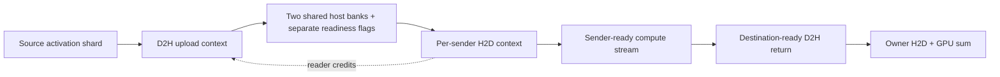
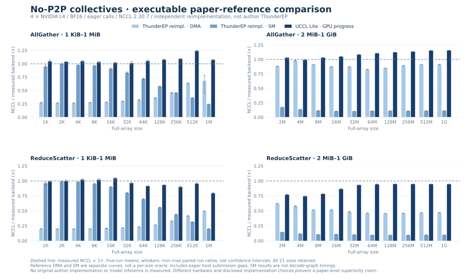

# ThunderEP communication — independent reimplementation

**Executable code, not a paper-number proxy.** This module independently
implements the communication mechanisms in
[ThunderEP, arXiv:2609.40093v1, §§4.2–4.5](https://arxiv.org/pdf/2609.40093).
It is **not the authors' implementation**, and is not a reproduction of their
vLLM/model-level results. Implementation choices absent from the paper are
listed below rather than presented as recovered author details.

The reference is deliberately separate from the UCCL Lite candidate and the
optional CPU-router. It does not import candidate destination striping or CPU
NUMA reduction, and never enables a deployment backend automatically.

## Mechanism coverage

| Paper mechanism | Executable implementation | Check |
| :--- | :--- | :--- |
| §4.2 single-step AllGather | One upload per source/chunk into shared pinned memory; every remote GPU reads it directly; own shard stays local | Position-sensitive gather and in-place tests |
| §4.2 GPU ReduceScatter | Upload only remote-destination blocks; receivers download their blocks and reduce with their local contribution on the GPU | Independent host-double oracle, tails and guards |
| §4.3 DMA payload transport | Explicit D2H/H2D `cudaMemcpyAsync`; no peer copies or SM payload kernels on this path | Independent DMA AG/RS checks |
| §4.3 bidirectional chunking | Separate outgoing/incoming contexts, two reusable banks; upload of the next chunk may overlap download of the previous chunk | Repeated bank reuse with tiny, odd chunk boundaries |
| §4.4 separate data and flags | Cache-line-separated, single-writer 64-bit generations; system-scoped acquire/release loads/stores; no host-memory RMW atomics | Mixed operation and graph tests |
| §4.4 bounded polling | One receiver leader per remote sender, nanosleep between polls; other SM-copy threads wait at a GPU-local CTA barrier | Cooperative-grid residency checked during construction |
| §4.4 sender/destination readiness | A receive depends on its sender only; combine accepts a distinct producer event for each destination | An indefinitely held sender does not stop another sender's complete round trip |
| §4.4 two-buffer ownership | Receivers write consumption credits; producers cannot overwrite a bank until its readers acknowledge the previous generation | Hundreds of chunk wraps; mixed AG/RS and changed inputs |
| §4.5 decode graphs | SM copies choose the bank from a device-resident round counter; no per-replay host command, graph update or buffer-address patch | 137 unchanged graph replays × six mixed collectives per topology |
| §4.5 prefill compute overlap | Per-sender gather callbacks on independent compute streams; destination-ready combine inputs; optional per-owner result callback | Routed top-2 MoE test with GPU permutation, two projections, SwiGLU, weighted unpermutation and combine |

The main selected design uses GPU reduction and dense AG/RS. The paper's
**rejected ablations**—CPU partial reduction and routing-aware sparse DMA—are
not silently substituted for that design. The existing
[CPU-router module](cpu-router.md) provides a separate CPU-reduction experiment;
this reference does not claim to reconstruct the paper's unpublished sparse-DMA
prototype, exact CPU reducer, or its ablation timings.

## Architecture and ownership



DMA bulk payloads use copy engines; tiny stream-ordered kernels acquire bank
credits, publish D2H completion, await a sender, and return H2D credits. These
control kernels do occupy a small number of SM threads: **DMA is not a claim
that the complete operation uses zero SMs**. Only readiness metadata is polled;
the CPU does not poll packet flags or execute reductions.

For SM decode, producers and consumers occupy separate CTAs in one cooperative
grid. The grid must fit concurrently, preventing waiting receivers from
excluding producers. Producers and receivers independently advance through
chunks; the final barrier exists only where the complete reduction needs all
contributions. Each operation increments its device counter, including graph
replay. A 64-bit overflow fails rather than wrapping generations.

Dispatch and combine have separate DMA banks and queues. Sharing them would
allow a delayed dispatch to block a different, already-computed source's
return path. Credits protect host-bank reuse; stream dependencies separately
protect the GPU reduction scratch. Data is never read directly from another
GPU's memory.

## Choices the paper does not fully specify

These are reproduction assumptions, not claims about the authors' code:

- **Rank/process model:** one process owns 1–16 ordered GPUs. This is not a
  drop-in multi-process vLLM communicator. Multi-process bootstrap, shared-host
  registration and framework scheduling need a separate integration.
- **Precision:** BF16 communication, FP32 accumulation in ascending source order,
  one final round-to-nearest-even BF16 conversion. The primitive evaluation's
  exact dtype/accumulation order is not specified in the paper.
- **Queue assignment:** the two directions are independent, with per-peer
  stream fan-out and separate dispatch/combine contexts to avoid head-of-line
  waits. The paper illustrates two streams but does not publish the scheduling
  code combining that picture with readiness-order execution. This is not a
  literal two-CUDA-stream implementation or an established performance match.
- **Chunk size:** a caller-supplied fixed upper bound; the benchmark uses 8 MiB,
  capped by its maximum shard. No per-size autotuning or best-curve selection.
  Exact author chunk counts are unavailable.
- **Synchronization:** naturally aligned 64-bit system-scope signals, 128-byte
  separation, 128 ns nanosleep requests. The paper does not give these constants.
  The local-thread fan-in uses CTA shared-memory barriers rather than publishing
  a separate global-memory readiness word for every copy CTA.
- **Reduction staging:** remote blocks are staged in GPU scratch, then summed
  when the owner's required contributions have arrived. Within a destination,
  reduction is not incrementally overlapped with each incoming block.
- **Host placement:** portable mapped pinned allocations, with no attempt to
  manufacture the paper's single-NUMA layout on this dual-NUMA machine.

Consequently, a local win against this implementation means exactly that—not a
win against the authors' tuned ThunderEP binary. Exact 6-rank binary-size rounding,
bandwidth normalization and framework EP/DP settings remain evaluation questions.

## Build and use

The library and correctness tests need only CUDA 12.9+ and C++17; no NCCL,
MSCCL++, CUTLASS, Torch, serving framework or model weights are required.

```bash
make -j2 host-staged-reference host-staged-checks BUILD=build/paper-reference
build/paper-reference/uccl_lite_host_staged_check --gpus 4
build/paper-reference/uccl_lite_host_staged_check --gpus 3 --reverse
build/paper-reference/uccl_lite_host_staged_check --gpus 1
build/paper-reference/uccl_lite_host_staged_moe_check 4
```

Public API:
[ep_transport.hpp](../include/uccl_lite/host_staged/ep_transport.hpp).
Library: `build/paper-reference/host_staged/libuccl_lite_host_staged.a`.

```cpp
namespace hs = uccl_lite::host_staged;
hs::Options options;
options.transfer = hs::Transfer::DmaPrefill;
options.maxShardElements = max_tokens_per_rank * hidden;
options.chunkElements = std::min(options.maxShardElements, size_t(1 << 20));
hs::EpTransport transport({0, 1, 2, 3}, options);
transport.enqueue(hs::Collective::AllGather, elements_per_rank, bindings);
```

Each binding supplies input, output and a CUDA stream. Enqueue joins completion
into that stream. Calls are externally serialized, all ranks participate in the
same operation order, and all referenced resources must outlive queued work.
Construction, synchronization and destruction are explicit setup/lifetime
boundaries; destruction waits on the selected devices. Only ordinary local
device memory is accepted. Standard NCCL-style AG/RS in-place offsets work;
other overlapping ranges are rejected.

### Prefill: dispatch → compute → immediate return

Provide an `onGather(receiver, sender, shard, count, computeStream)` callback.
It is invoked by the submitting host to **enqueue**, not synchronously execute,
the unchanged expert kernels. It runs after that sender's shard arrives, without
waiting for unrelated senders. Record an event after its partial output is ready.
Pass those events, indexed by destination, as `Binding::inputReady` to combine.
An optional `onReduced` callback exposes the owner's result before unrelated
owners complete. The [routed MoE test](../tests/host_staged/moe_check.cu) is a
working example of this event wiring, not a throughput implementation of Qwen.

Explicit `inputReady` **replaces** readiness on the binding's main stream. It
permits overlap with the preceding gather's completion join, so the caller must
also ensure that each output region is free for this operation. With no events,
ordinary main-stream ordering applies to inputs and outputs. Events must already
be recorded on the appropriate GPU before enqueue; unrecorded CUDA events do
not mean "wait for a future record."

Warm callback kernels on every GPU before inter-rank waits, or set
`CUDA_MODULE_LOADING=EAGER`. CUDA lazy loading may require quiescence and can
prevent progress in a test that deliberately holds a GPU indefinitely.
[NVIDIA documents this synchronization hazard and kernel preloading](https://docs.nvidia.com/cuda/archive/12.2.2/cuda-c-programming-guide/lazy-loading.html).

### Decode: fixed graph, changing inputs and routes

Construct a separate `SmDecode` transport. Validate/warm the fixed bindings
eagerly, then capture `enqueueRank` on each rank, with the same collective
sequence. Launch **all** rank graphs before synchronizing any of them. The
caller owns the graphs, buffers and streams; destroy the graphs before the
transport. Multiple simultaneous graphs sharing an instance or changing rank
order are unsupported. DMA capture and per-sender callbacks in SM mode are
rejected explicitly; the paper applies compute overlap during prefill only.

No `beginReplay`, host generation write or graph edit is needed. The MoE test
replays a fixed dispatch/compute/combine graph with changing GPU-generated
top-2 routes, including skew and empty experts; only token creation is outside
that graph. The communication graph does not depend on routes.

## Validation and measurements

The four-L4 local checks cover eager DMA/SM gather and scatter, odd tails,
standard in-place offsets, random finite BF16 inputs, input/output guards,
invalid bindings, three-/one-rank variants, repeated bank reuse, unchanged
graphs and a host-held sender. The tiny MoE test uses an independent CPU oracle;
its tolerance is `2e-6 + 1% * |reference|`, allowing BF16 output rounding.
It is a correctness test, not a model performance result.

The comparison harness runs **actual NCCL, actual UCCL Lite, and this executable
DMA/SM reference** together, with all outputs checked. It does not insert paper
numbers into the local chart. NCCL is pinned to 2.30.7; P2P/RDMA are disabled and
the log must show only SHM channels. Every backend uses the same full-array size,
BF16 data, eager timing and correctness inputs. All four candidates coexist in
memory; fixed reference scratch allocations affect the resource footprint.

### Local results — November 5, 2026

Four L4s, dual Xeon Silver 4410Y, two NUMA nodes, CUDA 12.9, driver 595.58.03.
All 21 powers-of-two sizes from 1 KiB to 1 GiB completed: **16,800 checked timed
calls**, five warmups per size/backend and five repetitions of twenty calls.
The following are five-run means; each sample is slowest-rank CUDA-event time.

| Collective | Full-array size | NCCL 2.30.7 | Reference DMA | Reference SM | UCCL Lite GPU progress |
| :--- | ---: | ---: | ---: | ---: | ---: |
| AllGather | 1 KiB | 40.580 µs | 149.041 µs | 42.654 µs | 38.752 µs |
| AllGather | 1 MiB | 113.108 µs | 165.476 µs | 463.896 µs | 105.196 µs |
| AllGather | 1 GiB | 48.737 ms | 53.349 ms | 427.906 ms | 42.151 ms |
| ReduceScatter | 1 KiB | 41.184 µs | 203.496 µs | 42.761 µs | 41.465 µs |
| ReduceScatter | 1 MiB | 96.460 µs | 194.632 µs | 481.163 µs | 121.231 µs |
| ReduceScatter | 1 GiB | 47.967 ms | 101.948 ms | 488.152 ms | 50.709 ms |



Neither reference path has a lower mean than NCCL in this eager sweep. UCCL Lite
has a lower mean at 20/21 AG sizes and 4/21 RS sizes; these are not significance
tests. **These results do not validate performance equivalence to ThunderEP.**
In particular, the conservative SM reference has one copy CTA per peer, uses
scalar BF16 copies, and is intended for small decode payloads—not bulk prefill.
Its large-message results are retained explicitly instead of hiding them.
The DMA implementation also has per-chunk control/submission overhead and
untuned host placement. Explaining their individual costs requires profiling
and controlled ablations; the table alone does not establish a cause.

[Raw samples](../benchmarks/data/host-staged-reference/samples.csv) ·
[All summary rows](../benchmarks/data/host-staged-reference/summary.csv) ·
[Hashes, environment and commands](../benchmarks/data/host-staged-reference/provenance.json) ·
[Execution/NCCL log](../benchmarks/data/host-staged-reference/stdout.txt) ·
[Candidate configuration log](../benchmarks/data/host-staged-reference/stderr.txt)

```bash
make -j2 host-staged-benchmark BUILD=build/paper-reference \
  NCCL_HOME="$PWD/build/nccl-2.30.7/build"
python3 scripts/compare_host_staged.py --output build/paper-reference-new
python3 scripts/plot_host_staged.py --preview
python3 -m unittest discover -s tests -p 'test_compare*.py' -v
```

The benchmark additionally links the existing CPU-router library (CUTLASS build
dependency) and NCCL. Its wrapper preserves raw samples, source/binary hashes,
hardware, environment, commands and failed-run logs, refuses existing output
directories, and rejects incomplete or duplicate samples. Five repetitions use
rotating backend order; five is not a multiple of four. Reported latencies include
host-submission gaps and exclude fill, checking and setup. They are **not
steady-state decode-graph latencies**. DMA and SM curves are both retained rather
than selecting the faster one for each size.

The finalized checks pass on four GPUs, three GPUs in reversed order, and one
GPU: 72 eager cases and 822 captured collective executions per topology (also
injecting delays on rotating ranks during graph replay), with
13 invalid-input cases on multi-GPU and 10 on single-GPU. Four- and three-GPU
sender-hold tests pass. The four- and three-GPU routed MoE tests pass 24 routing cases in
each of the DMA-overlapped and fixed-SM-graph paths. Existing host regressions
also pass: 31 backend-policy, 28 dispatcher, eight NCCL-identity checks, plus
ten Python summary tests. Compute Sanitizer is not installed; these tests do
not establish arbitrary-stream race freedom or correctness on untested GPUs.

A separate Nsight Systems 64-MiB sanity run also confirms **actual copy-engine
duplex execution**: filtering only streams containing this reference's
`dmaSignal` kernels gives 64 D2H copies / 512 MiB and 96 H2D copies / 768 MiB
for two AG and two RS calls, exactly the single-step traffic budget. Opposite
directions have overlapping intervals on all four GPUs (14/14/20/20 interval
pairs). This is an instrumented functionality check, not a speedup measurement;
its samples are not included in the chart. The tiny MoE test establishes the
dependency pipeline and numerical result, not large-model compute-overlap
throughput. [Trace command, selection and local artifact checksum](../benchmarks/data/host-staged-reference/trace_validation.json).

## Not included in the standalone deliverable

No vLLM/SGLang patches, Torch extension or checkpoint is placed under
`experimental/lite/`. The public asynchronous interfaces provide integration
points, but they do not themselves implement multi-process vLLM, its quantized
expert kernels or its scheduler. The paper's three models, six consumer GPUs,
CUDA 13.0 and complete prefill/decode workloads remain unverified. These limits
are separate from the communication mechanisms implemented above.
