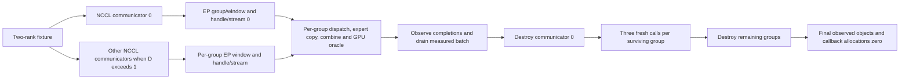

# RC/IB qualification results

Initial qualification: 2026-10-10. GPU guards, independent HT communicators and frozen-backup follow-ups: 2026-10-11.

The independent execution task delivered a private candidate that passes the bounded GIN primitive, EP2 communication, and standalone transport Context lifecycle checks below. Its corrected closed-wave throughput is lower than the native NCCL reference at every measured payload size. Model E2E, large EP, and an optimization benefit remain unverified.

These results apply to the candidate patch identified below. The local production sources at the base commit have not received that patch. This document records evidence reviewed locally; it does not report a new execution by this checkout.

## Source and evidence identity

| Item | Identity |
| --- | --- |
| Base commit | `5e57d6540bd9e993fbbb1fa869dae36434f98564` |
| Tracked diff SHA256 | `3b7f7daf48a1505ce85c009a179f596f028ff49c71a2f9ac5b45a520dc6205bb` |
| Complete patch, including the new contract harness, SHA256 | `fae492a926499d82b62d78dd77002cfce144739c99b81cb87a6d1ce888b7c859` |
| Contract harness SHA256 | `bb5c28c03b64794fd5d66cceb7184ad23813f3f15ed1c2a400751ddb0e3dde68` |
| Initial delivery manifest SHA256 | `42d80f3d5d95ecc82f851a26e02437e795f16c3a38c064a1d1f2b5544be122d2` |
| Initial run matrix SHA256 | `8cd2838a2aa9a82f4bbc102cdeb822a10f5c86b7db27f07f13f1c40cf51ce0ab` |

Necessary dependency versions are CUDA 13.2 and NCCL 2.30.4. The standalone build uses `-O3`; EP builds retain assertions in the default build type, with `-lineinfo` for UCCL. The EP runs are not a paired Release performance comparison.

The candidate contains CUDA/IB build selection, registered RC WRITE_VALUE bounce slots, 64-bit QUIET/BARRIER WR IDs, an aligned bulk/unaligned word-copy S2D map path, global-bit-offset bitmap decoding, and collective drain before releasing the HT window/proxy. The test fixes preserve production guards, query actual HT receive rows, validate the full hidden dimension, and return nonzero status for failed validation. The benchmark also corrects its closed-wave timing interval.

The initial local audit confirmed the 46,095-byte patch SHA256 and successful `git apply --check` at the base commit. All 70 initial required run IDs exist in the 132-row matrix with PASS and exit code 0; each has a local raw log. All three initial result archives match their recorded sizes and SHA256 values. Sampled final T50 and lifecycle logs contain their success markers; the cached T50 device memcheck log contains two `ERROR SUMMARY: 0` entries. The 60 corrected wave records from 10 runs were independently recomputed from their byte counts, iterations and slower-rank elapsed times; their medians match the table below. Original failure records remain in the matrix.

## Correctness coverage

| Gate | Covered workload | Result |
| --- | --- | --- |
| GIN primitives | 4 KiB–16 MiB; put/add, tail/add, 32-queue atomics, put_value, payload before signal, quiet and cooperative source reuse | UCCL corrected candidate: 5 independent runs PASS; native control PASS |
| EP2 communication | T50, hidden 7168; full payload, indices and weights; normal collective close | UCCL and native: 5 runs each PASS |
| Cached EP2 | T64, T65, T4096; repeated dispatch/combine | 6 cases across both backends PASS |
| Device memcheck | Cached T50, full hidden dimension | Both ranks: 0 device errors |
| HT ep_bench | Experts 8, top-k 2, T64, hidden 7168; global dispatch/combine validation and normal destruction | Both backends: 3 runs each PASS |
| GPU consumer and peer credit | 1 KiB, 64 KiB, 1 MiB payload; running GPU consumer and actual RC payload path | PASS |
| Primitive limits and reuse | Scalar/warp flush, independent I2/I4 slots, ID1023, 16 MiB at the 24-bit chunk boundary, 8192 operations on one lane | PASS |
| Control-only and empty peer | Signal/credit without payload; one rank skips WRITE | PASS; no zero-length DMA claim |
| Context lifecycle | D1/D2/D4/D8 independent standalone Contexts; survivors communicate after Context 0 destruction | PASS; final owned RDMA objects 0 |
| Bounded Q10 GPU guards, 2026-10-11 | 9 invalid-parameter cases, trap and illegal-load controls, public zero-length no-op; 12 cases per rank | 24 raw result records checked; PASS for this case set |
| Actual HT communicator lifecycle, 2026-10-11 | Independent NCCL EP communicators D1/D2/D4/D8, each I1; both backends and D2 serial controls | 12 runs/24 rank-runs PASS, including two earlier pilots |

EP tests are communication fixtures without real expert MLP computation. The device memcheck run uses `--report-api-errors no` for expected NCCL architecture capability probes. This establishes zero reported device errors in that run, not absence of all CUDA API errors. The original API diagnostics and earlier device-invalid-access logs are retained.

Plain RC normal mode already supports non-reorderable piggyback atomics. The non-EFA assertion restricts reorderable messages; it does not prohibit all IB put/add operations. The WRITE_VALUE and control WR-ID fixes belong to the identified candidate.

## GPU guard and backup follow-up — 2026-10-11

The updated 147-row matrix contains 82 required controller run IDs, all PASS with exit code 0, plus 12 additional rank-1 guard passes. The candidate patch SHA256 is unchanged.

All 24 final `GUARD_RESULT` records were parsed independently: launch error 0, `pass=true`, completion status equal to the expected status, no created verbs resources or submitted WR, and a null queue pointer. The cases cover invalid signal ID/alignment, window and atomic-value overflow, invalid queue layout, self peer, negative public length, raw zero length, and raw 24-bit overflow. Across both ranks, the invalid cases and trap controls report 20 expected status-719 completions; illegal-load controls report two expected status-700 completions; public zero-length no-op reports two successful completions. This qualifies rejection before FIFO publication for this bounded case set. The initial status-715 expectation mismatch and earlier control failure remain archived.

The execution owner supplied verification records for three frozen post-Q10 archives at each of two independent remote locations. All six recorded copies have VERIFIED state, matching size and SHA256 against the frozen local packages. The local audit checked those recorded values and each package's contents hash; it did not initiate remote transfers. This closes the backup gate for that frozen version. Subsequent dependency-storage cleanup records and the ongoing HT multi-communicator tests are outside this backup snapshot.

| Follow-up evidence | SHA256 |
| --- | --- |
| Updated delivery manifest | `9db761e91b97f522f82e390b404aceeb0ad9acf57c37e4cb8e02001054238e80` |
| Updated run matrix | `904bbadf45e908a0832e9aa296df0dd1d612eae974b97775e19bf5fe0789a2f0` |
| Remote backup verification index | `134668893f4aaf55b099b276adb2213bf5b93688add428e93b59a6949677e807` |

## Independent HT communicators — 2026-10-11

This separate fixture uses two ranks and one local rank per node, with a distinct NCCL communicator, EP group/window, handle and CUDA stream per group. The production source diff remains unchanged. The expert stage is a device copy; the GPU oracle validates group/epoch/rank/token identity, routing, all 7168 BF16 columns, unique token coverage and the expected combined output.

| Workload | Runs / rank-runs | Calls per rank | Result |
| --- | --- | --- | --- |
| UCCL/native interleaved D1/D2/D4/D8; each group I1 | 8 / 16 | 32 total, fixed across D | PASS |
| UCCL/native D2 sequential controls | 2 / 4 | 32 | PASS |
| Earlier UCCL D1/D2 pilots | 2 / 4 | 8 | PASS |

The controlled runs use T64, hidden 7168, experts 8 and top-k 2. Measured host admission peaks are D for concurrent submissions and 1 for the D2 sequential controls. These are application leases lasting until completion-event observation; GPU kernel concurrency is not measured.

The measured batch drains before communicator 0 is destroyed. Every surviving group then completes three fresh calls before final destruction. All observed project RDMA objects and callback allocations finish at zero. The relation below describes the fixture and its checked lifecycle.

The observed resource patterns differ across backends and resource classes. QP/CQ/MR object counts grow proportionally in this configuration; UCCL PD growth has an intercept while native PD count is constant. These are allocated object snapshots, not active WR occupancy. Logical MR lengths do not deduplicate physical pages, and callback accounting excludes NCCL/driver/host allocator pools. The complete G2 resource and queue ledger remains PARTIAL.

Local audit verified all 519 archived files against their per-file hashes and existing raw mirrors, replayed 24 rank-run snapshots and 12 controller logs, and checked helper/binary/library identities in the retained records. The 16 resource-curve rows match the qualification summary. Both raw archives have matching verified copies at two independent remote locations, four recorded copies in total. This is a new frozen scope; it does not rewrite the earlier post-Q10 backup.

| HT evidence | SHA256 |
| --- | --- |
| Qualification summary | `5b7ea7f647a57434254a4d31d3eb366f7e07fadcaa6f2e64001bb21a24e1f2e6` |
| Resource curve | `baf15d0dccc8308c9df9eec6453bc211364477529c054a0bba9952a97fc42af9` |
| HT fixture source | `bb60a3ce14ff81c2184523d5bf836d96404a196682ff2ea6764268d84d33f8b3` |
| Fixture header | `c67a4e796a4bcc2e8329ffcf86be8a02205cb23da4c96f8f869751018e019dab` |
| Raw archive A | `d5d7a89968452af14001c501ea5afda5df1f81d4eb601b5fac8942b348d13fcd` |
| Raw archive B | `1631057be0f28a482a660fed469e7b1efd09a4df084eba7a2b327c7ca7284547` |
| Remote verification index | `97cf7d173fb5ad2b6c95db6599c74669a8c657f50ec57d7b063abedc7eb00da6` |

Closed-batch wall time includes producer/oracle/copy work, host waits and MPI barriers. Backend CPU placement and provider structures differ. This qualification establishes bounded communication and safe destruction; it establishes no formal arrival-inclusive p99, equal-budget speedup, shared-manager benefit, real expert computation or serving result.

## Corrected closed-wave throughput

Each backend has five independent runs at six payload sizes, with complete correctness checks. Timing begins before the starting MPI barrier and ends after the closing barrier, including rendezvous/admission. Each run uses the slower rank; the table reports the median per-rank payload GB/s. The ratio is UCCL throughput divided by native throughput, so values below 1 mean lower UCCL throughput.

| Payload bytes | UCCL GB/s | Native NCCL GB/s | UCCL/native |
| --- | --- | --- | --- |
| 4096 | 0.026754 | 0.118769 | 0.225× |
| 16384 | 0.109816 | 0.479078 | 0.229× |
| 65536 | 0.315878 | 1.869434 | 0.169× |
| 262144 | 1.754593 | 6.734526 | 0.261× |
| 1048576 | 4.766983 | 19.260820 | 0.247× |
| 16777216 | 23.992723 | 43.691606 | 0.549× |

CPU and SM budgets were not equalized. These measurements describe this closed-wave experiment and do not establish an equal-budget optimization win. Earlier throughput batches are marked invalid timing and are excluded.

F/S concurrent versus application round-robin runs are exploratory cohort completion measurements, not per-operation p50/p99. The additional main-thread placement changes the CPU budget; it cannot support a scheduler benefit claim.

## Remaining gates

| Scope | Status |
| --- | --- |
| Formal arrival-inclusive latency and request ledger, 100000 operations/session | NOT_RUN |
| HT same-group I greater than 1 | NOT_RUN |
| Equal-budget scheduler/manager comparison and external contention | NOT_RUN |
| Real expert computation, reference MoE and serving C_req128 | NOT_RUN |
| EP8/16/32/64 and multiple real remote peers | NOT_RUN |
| This task's Zip/DietGPU compression and H100 model E2E | NOT_RUN |

D8 here counts standalone transport Contexts, not EP8. Independent I4 slots do not establish HT reentrancy. The earlier local C128 tensor test does not establish 128 simultaneous communication calls. The separate H100 execution queue remains withdrawn; these results do not resume it.
