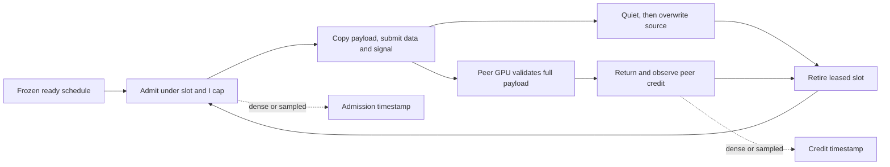

# R7b trace calibration

2026-10-11. R7b qualifies a lighter observation mode for this bounded RC fixture. Sparse tracing meets the frozen 5% upper bound on burst total completion-time overhead. Removing dense observation also changes F tail latency, so the dense measurements have observable instrumentation cost. The production transport is unchanged; these ratios describe measurement modes.

The independent execution owner's index contains 45 PASS controllers and 90 PASS rank analyses: five I4 qualification runs (full, none, sparse, latency and legacy), followed by five sessions × two workloads × four measurement variants at I1. Full GPU payload validation, source overwrite after quiet, consumer credit before receiver-slot reuse and normal drain are recorded as passing. The first R7 attempt failed its observer executable guard before Context creation, exit 4, leaving 44 NOT_RUN. Those records remain frozen alongside the separate R7b generation.

The runtime is the R6 production diff `a5df1a2d373cc25f711271168ea5cece11b16b5fdd6e9ec4734cb0816573419d`. The original [R6 qualification](VALIDATION_RC.md), including its 0/12 qualified I-cap performance comparisons, remains unchanged.

## Fixture and observation design

Each rank drives independent F and S primitive Contexts with resident inputs: 14,336-byte F payloads and 1 MiB S payloads. Both have four allocated slots and an 8 MiB registered window. Eight CPU cores, blocking host waits and two 256-thread GPU CTAs per rank are common. Burst supplies F20,000/S2,500 at ready time zero. Paced supplies F81,920/S10,240 per session at nominal 760 frames/s, the 95% reference load.

| Variant | F observations | S observations | Observation ledger |
| --- | --- | --- | --- |
| Legacy | Every operation | Every operation | Frozen R6 latency executable |
| Dense | Every operation | Every operation | R7b latency mode; source, consumer, occupancy and mapped counters retained |
| Sparse | Fixed uint32 hash selects about one quarter; admit and credit recorded | Every credit recorded | Source/consumer phases, S admit, global mapped peaks and time-weighted occupancy UNMEASURED |
| None | No per-operation timestamps | No per-operation timestamps | Functional counts and coarse group completion time retained; p99 UNMEASURED |

R7b dense/sparse/none use one binary. Its recorded replay attributes are 42 registers/thread, 96 bytes static shared memory and 16 bytes local memory/thread. Legacy is a separate compiled executable; the bridge does not establish identical register allocation. R7b changes the two private observer/affinity callback paths relative to the reviewed R7 helper, while retaining its complete CUDA replay logic.

Ready time precedes resource admission. A source lease closes after quiet, then the source is deliberately overwritten. The peer GPU validates the full payload before returning credit. Slot retirement requires source completion and observed credit. The observation mode controls recording on those paths.

## Burst observation cost

Total completion time is the slower of the local F/S group intervals from the GPU anchor, including outgoing completion and incoming consumption. The table compares each observation mode with none. Speed ratio is none time / candidate time; positive time change means additional cost. Intervals resample the same five complete session blocks on both sides.

| Rank | Candidate / baseline | Total-time speed ratio | Total-time change [95% paired interval] | F group time change [95% paired interval] |
| --- | --- | --- | --- | --- |
| 0 | sparse / none | 0.9999× | +0.0078% [−0.0592%, +0.0663%] | [+0.246%, +0.883%] |
| 0 | dense / none | 0.9976× | +0.2430% [+0.1791%, +0.3484%] | [+6.420%, +7.172%] |
| 1 | sparse / none | 1.0001× | −0.0062% [−0.0742%, +0.0546%] | [+0.318%, +0.681%] |
| 1 | dense / none | 0.9984× | +0.1585% [+0.0930%, +0.2095%] | [+6.207%, +6.949%] |

Sparse total-time interval upper bounds meet the frozen 5% gate for this burst workload. Its F group time interval upper bounds are also below 1%. Dense meets the aggregate gate while adding more than 6% F group time: aggregate completion is dominated by S and cannot stand in for the F tail.

Using the same F hash subset in dense and sparse runs gives the following supplied tail comparison. Burst has only 25,100/25,645 matched observations across five sessions, so this tail comparison is exploratory.

| Rank | Dense → sparse F p99 (ms) | p99 speed ratio | p99 reduction [95% paired interval] |
| --- | --- | --- | --- |
| 0 | 866.404 → 816.280 | 1.061× | +5.79% [+5.24%, +6.45%] |
| 1 | 866.676 → 818.110 | 1.059× | +5.60% [+5.30%, +6.01%] |

The reduction measures changed observation behavior with the same transport implementation. It establishes no transport or shared-manager speedup.

## Paced sampled tails

The larger trace gives 20,706 and 20,677 actual hash-selected F observations per rank/session. Five sessions provide 103,530 and 103,385 recorded observations. The 409,600 completed F operations per point are reported separately from the matched sample count.

| Rank | Mode | Matched F samples | F p99 µs [95% session interval] |
| --- | --- | --- | --- |
| 0 | legacy | 103,530 | 60.722 [53.830, 62.050] |
| 0 | dense | 103,530 | 55.499 [53.442, 56.188] |
| 0 | sparse | 103,530 | 56.421 [51.003, 58.212] |
| 0 | none | 0 | UNMEASURED |
| 1 | legacy | 103,385 | 60.913 [53.815, 62.235] |
| 1 | dense | 103,385 | 61.830 [59.257, 62.564] |
| 1 | sparse | 103,385 | 57.726 [40.925, 58.572] |
| 1 | none | 0 | UNMEASURED |

Within the same dense execution, its hash subset versus all F changes paced p99 by +0.1046% [−0.0580%, +0.1655%] on rank 0 and −0.0178% [−0.2052%, +0.1630%] on rank 1. This checks the chosen sampling rule within those executions. Across modes, sparse versus dense changes paced p99 by +1.66% [−7.11%, +4.43%] and −6.64% [−33.33%, −4.18%], respectively. Sampling discrepancy and reduced instrumentation behavior are separate measurements.

None has no observed p99. Paced aggregate completion time therefore cannot qualify an absolute p99 perturbation bound. Five sessions, this fixed hash and these workloads limit the result; physical ranks and messages are not extra independent sessions.

## Audit and remaining qualification

The statistical method exactly enumerates 126 multinomial count vectors representing all 5^5 five-session draws. It retains complete sessions, uses integer nearest-rank pooled quantiles and paired percentile 95% intervals, and reports ranks separately.

Local audit checks the frozen source/plan/statistics fingerprints and all 45 controller/90 rank PASS records. It independently recomputes 16 aggregate points and 20 aggregate paired comparisons from the per-session completion times and payload byte counts in the execution index; the values and intervals match. Tail point arithmetic and the computation source were checked. The supplied per-operation tail intervals were not independently recomputed from raw samples by this audit.

Two archive manifests describe 889 and 698 captured files. Both small remote verification indices record both archive sizes/SHA256 as VERIFIED, four copies at two independent locations. This audit checks those records and manifest references without initiating a raw transfer or full per-file replay.

| Evidence | SHA256 |
| --- | --- |
| R7b helper | `bde272be5f1ce3cd5b3f55bb875f41b7b8e9fbcd71ef92216a4fb1dab6c3cd52` |
| Frozen plan | `558652f1d8b3dfae8cbd4f80db94f9a849ab9fed432f729df4823d7349490833` |
| Rank 0 statistics | `ed4e8721aed8cd0d10459a8fa763d06530828c7d68b490b42e8ec2ac89525aa2` |
| Rank 1 statistics | `17665bcb785b3070d36ac049ef77c76fcb4ed837db0334d04bdd184ff327104f` |
| Independent small-record/aggregate audit | `a1519236f3332bddc17cb2146465e5f809dd776ce3b116ea7d4bddc485c3a34c` |

Absolute p99 instrumentation error, CPU proxy/post/WR timing and the complete unique-page/pinned-memory/queue ledger remain PARTIAL. This calibration does not qualify HT same-group I greater than 1, real expert computation, high-batch model E2E, serving or large EP. The separate Zip/DietGPU H100 queue remains withdrawn.
