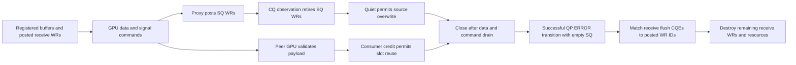

# G2 resource and completion qualification

2026-10-11. The independent execution owner is qualifying a diagnostic copy
of the RC transport. Its first D1 token probe completed payload validation,
but failed diagnostic qualification. Subsequent D2/4/8 and bulk probes were
stopped. The production transport and the [R6](VALIDATION_RC.md) and
[R7b](VALIDATION_TRACE_R7B.md) results are unchanged.

The fixture has two GPU ranks, one remote peer per Context, D independent
Contexts and at most one active request per Context. Each Context has four
allocated payload slots and an 8 MiB send/receive window. D1/2/4/8 vary Context
count; they do not establish HT same-group concurrency or model batch size.
The planned probes use 14,336-byte token and 1 MiB bulk payloads. First touch
uses every logical queue; later phases hold total calls fixed while activating
one or all Contexts. Diagnostic timings have unqualified instrumentation cost.

## First D1 outcome and accounting corrections

| Check | Rank 0 | Rank 1 | Evidence scope |
| --- | --- | --- | --- |
| Completed GPU calls | 288 | 288 | Owner-reported full payload validation, zero errors/timeouts |
| SQ WR submitted / retired | 864 / 864 | 864 / 864 | Independently checked final small ledger |
| Pending SQ / commands after destruction | 0 / 0 | 0 / 0 | Independently checked final small ledger |
| QP/CQ/PD/MR and tracked allocations after destruction | All zero | All zero | Independently checked final small ledger |
| Old diagnostic ledger errors | 38,930 | 49,554 | FAIL retained; not a qualified transport-error count |
| Remaining seven planned probes | NOT_RUN | NOT_RUN | Stopped by the qualification gate |

The initial device-memory assertion expected only the 8 MiB window. Both
created-state allocation lists also contain 64 eight-byte allocations and one
256-byte handle array: 768 bytes of device metadata. Their sum is 8,389,376
bytes per Context. A correct assertion identifies the unique window allocation
and accounts for metadata separately; it does not discard metadata or enlarge
the payload window.

Both ranks register 34,243,232 logical MR bytes over 8,831,528 unique virtual
bytes, or 8,884,224 bytes after unioning OS-page-rounded virtual intervals.
Those are distinct accounting quantities. Registration overlap does not imply
distinct physical backing pages, and virtual-page union is not a physical-page
or pinned-page measurement. Physical page identity remains UNMEASURED.

The owner traced the shutdown errors to receive flush completions after the
production close path transitions a QP to ERROR. The diagnostic revision must
distinguish those completions from successful receives and WRs cancelled at
destruction. Acceptance requires an explicitly successful close transition,
an already empty SQ, and a matching posted receive WR ID. Other error
completions remain failures. Error CQEs provide valid WR ID, status, QP number
and vendor syndrome; their opcode and byte length cannot be used for
classification ([rdma-core contract](https://github.com/linux-rdma/rdma-core/blob/master/libibverbs/man/ibv_poll_cq.3)).

Receive accounting must conserve posted WRs across consumed, flushed,
cancelled-at-destruction and still-posted categories. Send accounting separately
conserves submitted, retired and pending WRs. Resource destruction and receive
cancellation do not prove payload consumption; the GPU oracle and consumer
credit cover that phase.

## Review status

The local audit verifies all 26 frozen production source fingerprints against
the published iteration runtime and all 28 r8c diagnostic source fingerprints
against its manifest. It recomputes the device allocation sums and checks
final resource/WR counts from the two small failure records. It does not replay
the complete raw event stream or independently rerun the GPU oracle.

The independent r8d correction is pending build and runtime evidence here.
Keep the original source/build/run identities and FAIL outcome. Only a fresh
qualification may admit the later probes; no speedup or complete physical-page,
queue-memory, model E2E or shared-manager benefit is established by this record.
