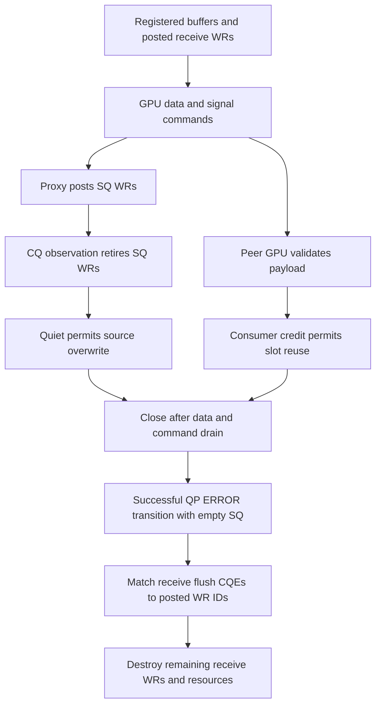

# G2 resource and completion qualification

2026-10-11. The independent execution owner is qualifying a diagnostic copy
of the RC transport. Its first D1 token probe completed payload validation,
but failed diagnostic qualification. Subsequent D2/4/8 and bulk probes were
stopped. The production transport and the [R6](VALIDATION_RC.md) and
[R7b](VALIDATION_TRACE_R7B.md) results are unchanged.
The corrected r8d generation subsequently records eight PASS controllers and
16 PASS rank analyses; the separate outcomes are retained below.

The fixture has two GH200 GPU ranks, one remote peer per Context, D independent
Contexts and at most one active request per Context. Each Context has four
allocated payload slots and an 8 MiB send/receive window. D1/2/4/8 vary Context
count; they do not establish HT same-group concurrency or model batch size.
The planned probes use 14,336-byte token and 1 MiB bulk payloads. First touch
uses every logical queue; later phases hold total calls fixed while activating
one or all Contexts. Diagnostic timings have unqualified instrumentation cost.

## First D1 outcome and accounting corrections

| Check | Rank 0 | Rank 1 | Evidence scope |
| --- | --- | --- | --- |
| Completed GPU calls | 288 | 288 | Owner-reported full payload validation, zero errors/timeouts |
| SQ WR submitted / retired | 864 / 864 | 864 / 864 | Independently checked final small ledger |
| Pending SQ / commands after destruction | 0 / 0 | 0 / 0 | Independently checked final small ledger |
| QP/CQ/PD/MR and tracked allocations after destruction | All zero | All zero | Independently checked final small ledger |
| Old diagnostic ledger errors | 38,930 | 49,554 | FAIL retained; not a qualified transport-error count |
| Remaining seven planned probes | NOT_RUN | NOT_RUN | Stopped by the qualification gate |

The initial device-memory assertion expected only the 8 MiB window. Both
created-state allocation lists also contain 64 eight-byte allocations and one
256-byte handle array: 768 bytes of device metadata. Their sum is 8,389,376
bytes per Context. A correct assertion identifies the unique window allocation
and accounts for metadata separately; it does not discard metadata or enlarge
the payload window.

Both ranks register 34,243,232 logical MR bytes over 8,831,528 unique virtual
bytes, or 8,884,224 bytes after unioning OS-page-rounded virtual intervals.
Those are distinct accounting quantities. Registration overlap does not imply
distinct physical backing pages, and virtual-page union is not a physical-page
or pinned-page measurement. Physical page identity remains UNMEASURED.

The owner traced the shutdown errors to receive flush completions after the
production close path transitions a QP to ERROR. The diagnostic revision must
distinguish those completions from successful receives and WRs cancelled at
destruction. Acceptance requires an explicitly successful close transition,
an already empty SQ, and a matching posted receive WR ID. Other error
completions remain failures. Error CQEs provide valid WR ID, status, QP number
and vendor syndrome; their opcode and byte length cannot be used for
classification ([rdma-core contract](https://github.com/linux-rdma/rdma-core/blob/master/libibverbs/man/ibv_poll_cq.3)).

Receive accounting must conserve posted WRs across consumed, flushed,
cancelled-at-destruction and still-posted categories. Send accounting separately
conserves submitted, retired and pending WRs. Resource destruction and receive
cancellation do not prove payload consumption; the GPU oracle and consumer
credit cover that phase.

## Review status

The local audit verifies all 26 frozen production source fingerprints against
the published iteration runtime and all 28 r8c diagnostic source fingerprints
against its manifest. It recomputes the device allocation sums and checks
final resource/WR counts from the two small failure records. It does not replay
the complete raw event stream or independently rerun the GPU oracle.

## Corrected r8d cohort

The new observer accounts for successful QP-to-ERROR transitions with empty SQs,
matched receive flush completions and remaining receive WR cancellations.
The analyzer checks the receive conservation equation and separate window and
metadata allocations. Proxy affinity is applied and verified after all proxies
are ready, keeping the eight-core CPU budget.

| D Contexts | GPU calls per rank and payload case | Token case | 1 MiB case |
| --- | --- | --- | --- |
| 1 | 288 | PASS, two rank records | PASS, two rank records |
| 2 | 320 | PASS, two rank records | PASS, two rank records |
| 4 | 384 | PASS, two rank records | PASS, two rank records |
| 8 | 512 | PASS, two rank records | PASS, two rank records |

The local small-record audit verifies all eight planned D/payload combinations,
zero controller exits, exactly two successful rank analyses per combination,
empty reported error lists and the expected GPU call counts. The owner reports
full GPU payload checks, balanced send and receive WR lifetimes, zero final
resource counts and no forced atomic dependency bypass. Both CPU build records
return success; 28 r8d diagnostic source hashes match their frozen manifest.
Complete per-operation event replay, clock alignment, cross-QP timing and final
raw archive verification remain pending in this audit.

| Evidence | SHA256 |
| --- | --- |
| r8d diagnostic source manifest | `927a6304bccce66f77283496bc14cf5e33e68fd9ef88db8e30149e12043d3754` |
| Eight-controller observation index | `5164b04e6dba5eadf8bc40b079b6cc041dae2d842e2cae4d6e0057e7c76573dd` |
| CPU build observation records | `8d7463b418aae56c00b1e8b7348679e6d6ee917973698b10213a0c10b3667461` |
| r8d GPU fixture | `5a09080f42110440cf15b9da1c75f84fd2a0d954d5d98d9deb054e81e68a53e6` |
| r8d qualification analyzer | `f69c0945a2ef5cbfbed2905ba7b6b93dbc6e8a52e1d044d2895eaac964e77212` |

The original r8c source/build/run identities and FAIL outcome remain intact.
Neither generation establishes a speedup, physical-page identity, total pinned
queue memory, model E2E or a shared-manager benefit.

## r8e CPU correlation and independent small-record audit

The owner's CPU replay correlates 6,016 GPU calls with payload WRITE and native
signal/credit FAA WRs from the same eight GPU jobs. All 6,016 payload-to-signal
pairs use the same QP; cross-QP coverage is NOT_EXERCISED. The earlier CPU
analysis required different QPs and failed that assumption on both D1 token
ranks. Those two FAIL records remain immutable. The r8e revision classifies
the observed QPs and reports local WR order separately; no GPU rerun occurred.

The replay checks source slot addresses and signal namespaces. Destination
address checks require a known peer window; a fallback that establishes only
local windows does not prove the peer destination. Existing local WR order
and GPU payload validation do not qualify cross-QP or per-Context I greater
than 1.

Each rank/case has 96 local host/GPU clock brackets. Reported order intervals
assume one stable local affine clock map between the calibration observations.
CPU CQ observation time is distinct from NIC completion time; there is no
cross-host clock subtraction. The owner reports all four conditional order
counts as 6,016/6,016. These are conditional replay results, not a universal
timestamp error or p99 performance qualification.

The independent audit hashes all 267 collected small files, checks 96 stage
ledgers, recomputes MR byte/page interval unions and requested allocation sums,
checks unique windows and balanced resource/WR destruction, and independently
recomputes the exact rational clock-slope bounds from 1,536 calibration
brackets. All checks pass. It verifies the reported per-call proof counts but
does not recompute those proofs from the complete raw event stream. Full raw
replay, verified cross-node archives, physical-page identity and actual
pinned/HBM occupancy remain pending.

| Evidence | SHA256 |
| --- | --- |
| Small review index | `d29479f47a976fcce30a7e82ff6964f93c9deca203a5b252f64803d1e04f9f0e` |
| r8e CPU analyzer | `82efa3d36ef1be0bdcf946a504f8e1b893deda67b9cd590aa654b609a12a74c2` |
| Owner correlation/resource summary | `5453186226ce1e03005400f8ced54aed9c2283c8ec3e26a8d8a98466ac0172df` |
